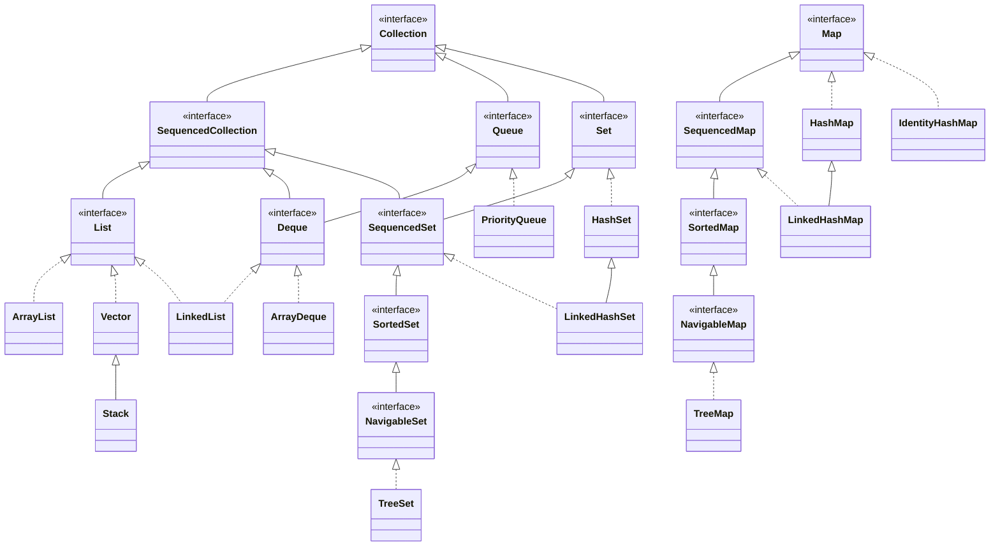

# ts-collections-framework documentation

`ts-collections-framework` brings the classic collections framework API to TypeScript and JS: `ArrayList`,
`LinkedList`, `ArrayDeque`, `PriorityQueue`, `HashSet`, `TreeSet`, `HashMap`, `LinkedHashMap`, `TreeMap`, lazy
`Stream`s with `Collectors` and `Gatherers`, `Optional`, the `Collections` utility class and more. It keeps the
semantics that make that API pleasant for real programs — **value equality** through `equals()`/`hashCode()`,
**fail-fast iterators**, **live views**, **navigable sorted collections** and **lazy, short-circuiting streams** — while
fitting into JS: every collection is iterable, maps iterate as `[key, value]` pairs, comparators are plain
functions, and there are zero dependencies.

```ts
import { ArrayList, TreeMap, Collectors, List } from 'ts-collections-framework';

const words = ArrayList.of('pear', 'fig', 'apple', 'kiwi');
const byLength = words.stream().collect(
  Collectors.groupingBy((w) => w.length, () => new TreeMap<number, List<string>>(), Collectors.toList()),
);
console.log(byLength.toString()); // → {3=[fig], 4=[pear, kiwi], 5=[apple]}
```

- [Why this library exists](#why-this-library-exists)
- [Which page do I need?](#which-page-do-i-need)
- [All pages](#all-pages)
- [The interface hierarchy](#the-interface-hierarchy)
- [API reference](#api-reference)

## Why this library exists

JS and TypeScript ship with exactly two collections: `Map` and `Set`. They are fast and well-built, but they stop
there. They compare object keys by reference, so two equal `Point(1, 2)` keys are different keys. They have no
sorted variants, no navigation (`floor`, `ceiling`, range views), no priority queue and no deque. And changing a
collection while you iterate it fails silently instead of loudly.

The npm ecosystem fills the gaps one data structure at a time: one package for a heap, another for a tree map, a
third for an LRU cache. Each has its own API, its own idea of equality and its own level of testing. None of them
adds up to a framework: a single, coherent set of interfaces that every implementation honours, so that a `List`
is a `List` whichever class backs it.

Other platforms solved this long ago. The best-known example is **Java's Collections Framework**, which for more
than twenty-five years has given developers one vocabulary for lists, queues, sets, maps and streams, together with
a precise specification of how each one behaves.

**ts-collections-framework brings that framework to Node.js, JS and TypeScript.** Think of it as its direct
equivalent: the same interfaces, the same classes and the same documented behaviour, adapted to TypeScript. It is
built to production standards: every documented behaviour is tested, it is verified against the reference runtime
on over 1.6 million compared operations ([how](./advanced/testing.md)), and it is tuned to match or beat native
collections and the popular alternatives ([numbers](./advanced/performance.md)).

## Which page do I need?

| I want to… | Read |
|---|---|
| install it and write my first lines | [Getting started](./guide/getting-started.md) |
| understand why `contains` finds my object, why my loop threw, why `subList` changed my list | [Core concepts](./guide/core-concepts.md) |
| pick between `ArrayList`/`LinkedList`, `HashMap`/`TreeMap`, … | [Choosing a collection](./guide/choosing-a-collection.md) |
| translate what I do with `Array`/`Map`/`Set` | [Coming from JS](./guide/coming-from-js.md) |
| look up a list, queue, set or map method | [Lists](./collections/lists.md), [Queues and deques](./collections/queues-and-deques.md), [Sets](./collections/sets.md), [Maps](./collections/maps.md) |
| make something read-only, or use `List.of`/`Set.of`/`Map.of` | [Immutable collections and wrappers](./collections/immutable-and-wrappers.md) |
| replace `filter`/`map`/`reduce` chains | [Streams overview](./streams/overview.md), [Stream operations](./streams/operations.md) |
| group, count, partition or join results | [Collectors](./streams/collectors.md) |
| write a custom stream stage (windows, folds, scans) | [Gatherers](./streams/gatherers.md) |
| sum/average numbers efficiently | [Number streams](./streams/number-streams.md) |
| handle "maybe a value" results | [Optional](./streams/optional.md) |
| sort, search, shuffle, wrap, fill… | [Collections utilities](./utilities/collections.md) |
| build comparators, hash fields, null-check | [Comparator and Objects](./utilities/comparator-and-objects.md) |
| implement my own collection | [Custom collections](./advanced/custom-collections.md) |
| make it fast | [Performance](./advanced/performance.md) |
| know exactly where it differs from the classic API | [Compatibility](./advanced/compatibility.md) |

## All pages

### Guide

| Page | Contents |
|---|---|
| [Getting started](./guide/getting-started.md) | install, ESM/CJS imports, a 5-minute tour, iteration, generics, bundlers, Node support |
| [Core concepts](./guide/core-concepts.md) | value equality, ordering, null policy, fail-fast iteration, live views, exceptions, unmodifiable vs immutable, sequenced collections, `RandomAccess` |
| [Choosing a collection](./guide/choosing-a-collection.md) | decision flowchart and comparison table with complexities |
| [Coming from JS](./guide/coming-from-js.md) | `Array`/`Map`/`Set` cheat sheet, array methods vs streams, interop, pitfalls |

### Collections

| Page | Contents |
|---|---|
| [Lists](./collections/lists.md) | `List`, `ArrayList`, `LinkedList`, `Vector`, `Stack`, list iterators, `subList` |
| [Queues and deques](./collections/queues-and-deques.md) | `Queue`, `Deque`, `ArrayDeque`, `PriorityQueue`, `LinkedList` as a deque |
| [Sets](./collections/sets.md) | `Set`, `SequencedSet`, `SortedSet`, `NavigableSet`, `HashSet`, `LinkedHashSet`, `TreeSet` |
| [Maps](./collections/maps.md) | `Map`, `SequencedMap`, `SortedMap`, `NavigableMap`, `HashMap`, `LinkedHashMap` (LRU), `TreeMap`, `IdentityHashMap`, entries |
| [Immutable collections and wrappers](./collections/immutable-and-wrappers.md) | `List.of`/`Set.of`/`Map.of`, `copyOf`, `ofLazy`, empty/singleton collections, unmodifiable/synchronized/checked wrappers |

### Streams

| Page | Contents |
|---|---|
| [Overview](./streams/overview.md) | how streams work: sources, laziness, short-circuiting, single use, closing |
| [Operations](./streams/operations.md) | every intermediate and terminal operation |
| [Number streams](./streams/number-streams.md) | `IntStream`, `LongStream`, `DoubleStream`, summary statistics |
| [Collectors](./streams/collectors.md) | `Collectors.*` and writing your own `Collector` |
| [Gatherers](./streams/gatherers.md) | `Gatherers.*` (windows, fold, scan, …) and custom `Gatherer`s |
| [Optional](./streams/optional.md) | `Optional`, `OptionalInt`, `OptionalLong`, `OptionalDouble` |
| [Spliterators](./streams/spliterators.md) | `Spliterator`, `Spliterators`, `StreamSupport` |

### Utilities

| Page | Contents |
|---|---|
| [Collections](./utilities/collections.md) | the `Collections` utility class: sorting, searching, shuffling, wrappers, factories |
| [Comparator and Objects](./utilities/comparator-and-objects.md) | comparator helpers, natural ordering, `Objects.equals`/`hash`/`requireNonNull` … |

### Advanced

| Page | Contents |
|---|---|
| [Custom collections](./advanced/custom-collections.md) | building on `AbstractList`, `AbstractSet`, `AbstractMap`, … |
| [Performance](./advanced/performance.md) | complexities, benchmarks, tips |
| [Testing](./advanced/testing.md) | testing code that uses the library |
| [Compatibility](./advanced/compatibility.md) | TypeScript adaptations, stream differences, how compatibility is verified |
| [Compatibility report](./COMPATIBILITY.md) | generated proof run against the reference runtime |

## The interface hierarchy

Interfaces are on the left of each arrow; solid arrows are "extends", dotted arrows point from a class to the most
specific interface it implements. Program against the interfaces and pick a class at construction time.



Also part of the hierarchy:

- **Immutable** `List.of`/`copyOf` (a `List`), `Set.of`/`copyOf` (a `Set`), `Map.of`/`copyOf`/`ofEntries` (a `Map`).
- **Skeletons** for your own classes: `AbstractCollection`, `AbstractList`, `AbstractSequentialList`,
  `AbstractQueue`, `AbstractSet`, `AbstractMap` — see [Custom collections](./advanced/custom-collections.md).
- **Iteration**: `Iterator`, `ListIterator`, `Enumeration`, `Spliterator`; every collection is also a JS
  `Iterable`.
- **Streams**: `Stream`, `IntStream`, `LongStream`, `DoubleStream` (all `BaseStream`), `Collector`, `Gatherer`,
  `Optional*`.

```ts
import { LinkedList, List, Deque, SequencedCollection } from 'ts-collections-framework';

const ll = new LinkedList<number>();
const asList: List<number> = ll;   // LinkedList is a List…
const asDeque: Deque<number> = ll; // …and a Deque
const seq: SequencedCollection<number> = ll;
asDeque.push(2);
asList.add(3);
console.log(seq.getFirst(), seq.getLast(), ll.toString()); // → 2 3 [2, 3]
```

## API reference

Every exported class, interface and function is documented in the TypeDoc API reference. Generate it locally with

```sh
npm run docs:api
```

and open `docs-api/index.html`.
