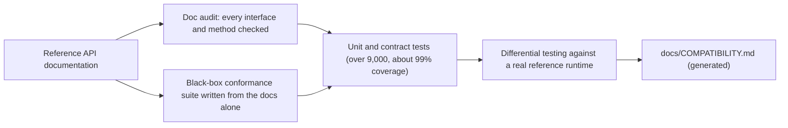

# Compatibility with the Java API

This library aims to behave exactly like the Java Collections Framework: same method names, same results, same
exceptions, same edge cases. Where TypeScript or the JS runtime makes an exact copy impossible or harmful, the
library adapts in a small, documented set of ways. This page lists every adaptation, the stream-specific
differences, the reference behaviours we deliberately do not copy, the APIs that are newer than the reference
runtime used for testing, and how all of this is verified.

- [TypeScript adaptations](#typescript-adaptations)
- [Stream differences](#stream-differences)
- [Reference quirks we deliberately do not copy](#reference-quirks-we-deliberately-do-not-copy)
- [APIs newer than the JDK](#apis-newer-than-the-jdk)
- [How compatibility is verified](#how-compatibility-is-verified)

## TypeScript adaptations

| Classic API | Here | Why |
|---|---|---|
| `list.remove(int index)` | `list.removeAt(index)` | On a `List<number>`, `remove(1)` could mean either; `remove(o)` always means "the element equal to `o`". |
| `Comparator` objects with default methods (`c.reversed()`, `c.thenComparing(…)`) | comparators are functions `(a, b) => number`; the helpers are on the `Comparator` object: `Comparator.reversed(c)`, `Comparator.thenComparing(c1, c2)`, `Comparator.thenComparingBy(c, key)` | Lambdas are plain functions, and functions can't carry default methods without wrapping. |
| Functional interfaces (`Predicate`, `Function`, `BiFunction`, `Supplier`, `Consumer`, …) | plain functions | Same reason. `Predicate.not(p)` is just `(x) => !p(x)`. |
| `Set`, `Map`, `Iterator`, `List` type names | same names | They shadow the JS globals in a module that imports them; alias (`import { Map as CMap }`) or use `globalThis.Map`. |
| `new TreeMap(SortedMap)` vs `new TreeMap(Map)`, likewise `TreeSet`, `PriorityQueue` | one constructor; a *sorted* source always keeps its comparator | Overloads are resolved at compile time in the reference; here the static type is gone at run time, so the runtime type decides. |
| `Gatherer.ofSequential(a, b)` | resolved by the first function's arity | Both two-argument overloads take two functions. A first function declaring no parameters is the initializer (`ofSequential(initializer, integrator)`); otherwise it is `ofSequential(integrator, finisher)`. Use `Integrator.ofGreedy` or the 3-argument form if your integrator declares no parameters. |
| `AutoCloseable` streams with try-with-resources | `close()`, plus `[Symbol.dispose]()` so `using s = …` works | The JS explicit-resource-management protocol, present where the runtime defines `Symbol.dispose`. |
| Static factories `List.of`, `Set.of`, `Map.of`, `Map.entry` | same, on the `List`/`Set`/`Map` objects | `List`, `Set`, `Map` are both interfaces and factory objects. |
| Absent results | `null` (never `undefined`) | Matches the reference; collections that reject `null` also reject `undefined`. |
| JS extras | `ArrayList.of(...)`, `HashMap.of([k, v], …)`, `Stream.from(iterable)`, `Stream.ofArray(arr)`, `[Symbol.iterator]` on every collection and stream | Convenience; not in the reference. |

A sorted source keeps its comparator, even when passed where a plain `Map` is expected:

```ts
import { TreeMap, Map } from 'ts-collections-framework';

const desc = new TreeMap<number, string>((a, b) => b - a);
desc.put(1, 'one');
desc.put(2, 'two');

const asMap: Map<number, string> = desc;
const copy = new TreeMap<number, string>(asMap);
console.log(copy.toString());           // → {2=two, 1=one}
console.log(copy.comparator() !== null); // → true
```

`Gatherer.ofSequential` with the two shapes:

```ts
import { Stream, Gatherer, Integrator, Downstream } from 'ts-collections-framework';

// () => state: an initializer, so this is ofSequential(initializer, integrator)
const runningSum = Gatherer.ofSequential(
  () => ({ sum: 0 }),
  Integrator.ofGreedy((s: { sum: number }, x: number, down: Downstream<number>) => down.push((s.sum += x))),
);
console.log(Stream.of(1, 2, 3).gather(runningSum).toList().toString()); // → [1, 3, 6]

// (state, element, downstream) => …: an integrator, so this is ofSequential(integrator, finisher)
const withEnd = Gatherer.ofSequential(
  (_s: null, x: string, down: Downstream<string>) => down.push(x),
  (_s: null, down: Downstream<string>) => { down.push('END'); },
);
console.log(Stream.of('a', 'b').gather(withEnd).toList().toString()); // → [a, b, END]
```

Streams close with `using`:

```ts
import { List } from 'ts-collections-framework';

let closed = false;
{
  using s = List.of(1, 2, 3).stream().onClose(() => { closed = true; });
  console.log(s.count()); // → 3
}
console.log(closed); // → true
```

## Bulk removal when the test throws

`removeIf`, `removeAll` and `retainAll` here make one pass over the storage. If the predicate (or `c.contains`) throws
partway, what has already been removed can differ from the reference. Lists are never left with duplicated or lost
survivors either way.

| Call | Reference | Here |
|---|---|---|
| `ArrayList`/`Vector` `removeIf` | tests every element first, removes nothing on a throw | elements tested before the throw stay removed |
| `subList(…).removeIf` on an array-backed list | partial removal (`Vector`) or none (`ArrayList`) | nothing removed |
| `reversed().removeAll`/`retainAll` | removes through the view, testing in view order | one `removeIf` on the base, testing in base order, so a different subset is removed when `contains` throws |

## Stream differences

| Topic | Reference | Here |
|---|---|---|
| `parallel()` / `parallelStream()` | runs on a thread pool | only sets the flag (`isParallel()` is `true`); evaluation is sequential. Results of order-independent and encounter-order terminals are the same; side-effect order is the sequential one. |
| `Gatherers.mapConcurrent` | maps ahead on virtual threads | maps sequentially, in order; same results and exception types |
| `LongStream` | 64-bit `long` | JS `number`, exact up to `Number.MAX_SAFE_INTEGER` (2^53 − 1); no `bigint` |
| `IntStream` | 32-bit, wraps on overflow | values are not coerced to 32 bits and `sum()` does not wrap |
| Spliterator sizes | `long`, `Long.MAX_VALUE` when unknown | numbers; unknown size is `Infinity` |
| `-0` vs `0` | `-0.0` and `0.0` differ for doubles | `DoubleStream.distinct()`/`sorted()` keep them apart like the reference; everywhere else (`Stream.distinct`, sets, maps, `equals`) `-0` equals `0` (SameValueZero) |
| `iterator()`/`spliterator()` over `flatMap` | buffers the whole mapped stream | pulls it one element at a time (an infinite inner stream still yields); an upstream `peek` may observe fewer elements |

```ts
import { List, LongStream, IntStream, DoubleStream, Stream } from 'ts-collections-framework';

console.log(List.of(1, 2).parallelStream().isParallel());          // → true
console.log(IntStream.of(2147483647, 1).sum());                    // → 2147483648
console.log(LongStream.of(Number.MAX_SAFE_INTEGER).sum());          // → 9007199254740991
console.log(Stream.iterate(1, (x) => x + 1).spliterator().estimateSize()); // → Infinity
console.log(DoubleStream.of(0, -0).distinct().count(), Stream.of(0, -0).distinct().count()); // → 2 1
```

## Reference quirks we deliberately do not copy

The differential run (below) found a few places where the JDK contradicts its *own* documented
contract. In each case this library follows the documentation:

| Quirk in the reference | What the contract says / what we do |
|---|---|
| `HashMap`/`HashSet` spliterators drop `SIZED` from `characteristics()` after traversal begins (also through `synchronizedSet`, `unmodifiableSet`, `checkedSet`) | characteristics must be stable; ours keeps `SIZED` |
| The `ListIterator` of a `reversed()` list view (on `ArrayList`, `LinkedList`, `Vector`, `Stack`, `AbstractList` subclasses, and their `subList`s) accepts `set()`/`remove()` right after `add()` | `ListIterator` specifies `IllegalStateException` there; ours throws it |

```ts
import { ArrayList } from 'ts-collections-framework';

const it = ArrayList.of('a').reversed().listIterator(1);
it.add('bb');
try {
  it.remove(); // not allowed right after add()
} catch (e) {
  console.log((e as Error).name); // → IllegalStateException
}
```

The full list, with a minimal reproduction script for each, is in the generated
[compatibility report](../COMPATIBILITY.md#divergences).

## APIs newer than the JDK

A few APIs are newer than the JDK version used by the differential tests (the report states the
exact version). They are implemented from their specification and covered by unit tests, but are excluded from the
differential comparison:

| API | What it does |
|---|---|
| `List.ofLazy(size, fn)`, `Set.ofLazy(candidates, fn)`, `Map.ofLazy(keys, fn)` | unmodifiable collections whose elements/values are computed on first access, at most once (preview API) |
| `Comparator.max(c, a, b)`, `Comparator.min(c, a, b)` | the larger/smaller of two values under a comparator |

```ts
import { List, Comparator } from 'ts-collections-framework';

let calls = 0;
const squares = List.ofLazy(5, (i) => { calls++; return i * i; });
console.log(squares.get(3), calls); // → 9 1
console.log(squares.get(3), calls); // → 9 1
console.log(Comparator.max(Comparator.naturalOrder<string>(), 'pear', 'apple')); // → pear
```

## How compatibility is verified

Four layers, from documentation to the real runtime:



1. **Doc audit.** Every interface and class is checked member by member against the Java API
   documentation: names, argument handling, return values, thrown exceptions.
2. **Unit and contract tests.** Over 9,000 tests (about 99% line coverage), including shared contract suites run
   against every implementation of an interface (`tests/contracts`).
3. **Conformance suite.** A black-box suite written from the documentation alone, without looking at the
   implementation (`tests/conformance`).
4. **Differential testing.** A harness generates random operation scripts — on every concrete collection, many
   constructor variants, every immutable/empty/singleton factory, the `Abstract*` skeletons, nested views and
   wrappers, stream pipelines, collectors, gatherers, `Optional`, `Objects`, `Comparator`, spliterators — and runs
   each script on the real reference runtime and on this library. Every return value, every exception class and the
   full collection state after every operation are compared.

### Latest proof run

From the generated [compatibility report](../COMPATIBILITY.md):

| | |
|---|---|
| Scripts | 200,000 (40 batches of 5,000) |
| Operations compared | 1,693,921 |
| Comparable public API reached | 1,602 / 1,602 rows (100%) |
| Excluded API rows | 107, each with a reason (JS-only members, APIs newer than the reference, identity hash codes, non-public members, abstract hooks) |
| Divergent scripts | 58, in 22 signatures — **0 library bugs**: 9 intentional (documented design differences), 13 reference quirks |

Outputs are compared after documented *normalisations* — for example, hash-ordered collections are compared as
sorted multisets because their iteration order is unspecified, numbers are compared by value (one JS number type
vs. separate int/long/double), and only the sign of a comparator result is compared. The report lists every
normalisation with its reason, every divergence with a shrunk reproduction, and the per-member API coverage matrix.

### Running it yourself

The differential harness needs a real JDK of version 23 or newer on your `PATH`. Without one, every
entry point prints a message and exits successfully (and the jest smoke test is skipped).

```sh
npm run test:diff          # 20,000 random scripts; shrinks and reports any divergence, exits 1 on one
npm run test:diff:proof    # 200,000 scripts across worker processes + API coverage; regenerates docs/COMPATIBILITY.md
npx jest tests/differential  # 200-script smoke test
```

Every script has a seed-based id, so any divergence is reproducible; the harness's own README
(`tools/differential/README.md`) explains the script format, how to rerun a single script, and how to add new
operations.

See also: [Testing](./testing.md) for testing your own code that uses the library.
