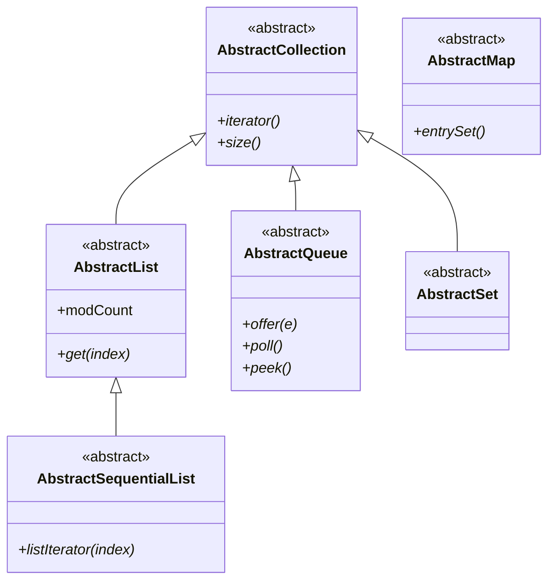

# Implementing your own collections

The library exports skeleton classes that implement most of a collection interface on top of a few primitive methods: `AbstractCollection`, `AbstractList`, `AbstractSequentialList`, `AbstractQueue`, `AbstractSet` and `AbstractMap`. This page covers what each skeleton requires, the contracts an implementation must keep, and complete worked examples.

A subclass that implements the primitives (often `size()` plus `get(i)` or `iterator()`) inherits `contains`, `indexOf`, `subList`, `equals`/`hashCode`/`toString`, bulk operations, `stream()`, `spliterator()`, `for..of`, sequenced methods such as `getFirst`/`reversed`, and fail-fast iteration. It works anywhere a library collection does: in `Collections.*` algorithms, as a constructor argument to `ArrayList`/`HashSet`/..., in `equals` against built-in collections, and as a stream source.

## The skeletons at a glance



The diagram shows the abstract methods each skeleton adds. `AbstractMap` is a separate root, because a map is not a collection. Mutators such as `add`, `set` and `put` have defaults that throw `UnsupportedOperationException`; override them to make the collection modifiable. The next section lists exactly what to implement.

## What each skeleton requires

| Skeleton | Read-only: implement | Modifiable: also override | Gives you |
| --- | --- | --- | --- |
| `AbstractCollection<E>` | `iterator()`, `size()` | `add(e)`; an iterator whose `remove()` works | the whole `Collection` interface, `stream()`, `for..of` |
| `AbstractList<E>` | `get(i)`, `size()` | `set(i, e)`; and for a list that can grow or shrink, `addAtIndex(i, e)` and `removeAt(i)` that bump `modCount` | `List` + `SequencedCollection`: iterators, `subList`, `reversed()`, `sort`, value `equals`/`hashCode` |
| `AbstractSequentialList<E>` | `listIterator(index)`, `size()` | a list iterator with `set`/`add`/`remove` and its own `modCount` tracking | positional `get`/`set`/`add`/`removeAt` built on the list iterator |
| `AbstractQueue<E>` | `offer`, `poll`, `peek`, `iterator()`, `size()` | (already modifiable through `offer`/`poll`) | `add` (throws `IllegalStateException` when `offer` refuses), `remove()`, `element()`, `clear`, `addAll` |
| `AbstractSet<E>` | `iterator()`, `size()` | `add(e)`; an iterator with `remove()` | set `equals`/`hashCode`, a fast `removeAll`, a `DISTINCT` (or `SORTED`) spliterator |
| `AbstractMap<K, V>` | `entrySet()` | `put(k, v)`; an entry-set iterator with `remove()` | the whole `Map` interface including `keySet()`/`values()` views, `compute*`, `merge` |

The defaults are correct but generic. `AbstractCollection.contains` is a linear scan, and `AbstractMap.get` walks `entrySet()`. Override any method your storage can do faster. The worked examples override `contains` and `findEntry` for this reason.

> [!IMPORTANT]
> `AbstractQueue` assumes the queue rejects `null`, because `poll()` and `peek()` return `null` to mean "empty".

`AbstractMap` also exports `SimpleEntry` (a mutable pair) and `SimpleImmutableEntry` (whose `setValue` throws), for building entry sets.

## Contracts you must keep

### modCount and fail-fast iteration

Every iterator `AbstractList` hands out records `modCount` when it is created. On each `next()`/`previous()` it checks that the value has not changed. If it has, the iterator throws `ConcurrentModificationException` instead of silently skipping or repeating elements. `subList` views and the list spliterator use the same counter to detect changes made around them.

That only works if you increment `modCount` on every structural change: any `add` or `remove` that changes the size, `clear()`, and evictions. `set(i, e)` is not structural, so leave `modCount` alone there. The iterator's own `remove()` and `add()` go through `removeAt` and `addAtIndex`, then adopt the new count, so they keep working.

| Operation | Bump `modCount`? |
| --- | --- |
| `addAtIndex`, `removeAt`, `clear`, an eviction | yes, by one per call |
| `set(i, e)`, `sort` (it uses `set`) | no |
| a failed operation that changed nothing | no |

`AbstractCollection`, `AbstractSet` and `AbstractMap` have no `modCount` of their own. Their iterators are whatever `iterator()` or `entrySet().iterator()` returns. If you write that iterator yourself, give your class a counter and check it the same way. If you delegate to a library collection, as the queue, set and map examples below do, you inherit its fail-fast behaviour.

### addAtIndex / addAllAt instead of overriding add

`List` overloads `add`: `add(e)` appends and returns `true`, while `add(index, e)` inserts and returns nothing. JS has no real overloading, so `AbstractList.add` tells the two apart by `arguments.length` and routes both to one protected hook:

```ts nocheck
add(e)            → addAtIndex(size(), e); return true
add(index, e)     → addAtIndex(index, e)
addAll(c)         → addAllAt(size(), c)
addAll(index, c)  → addAllAt(index, c)
addFirst / addLast, listIterator().add, subList(...).add  → all end up in addAtIndex
```

> [!IMPORTANT]
> Override `addAtIndex(index, e)`, not `add`.

If you override `add(e)` alone, `add(0, x)` would arrive as `add(0)` with an extra argument, and inserting through a `subList` or list iterator would bypass your code. `addAllAt(index, c)` defaults to a loop of `addAtIndex` calls. Override it when your storage can insert a batch more cheaply, for example with one splice. Validate the index with `Objects.checkIndex` (for `get`/`set`/`removeAt`) or a position check `0 <= index <= size()` (for `addAtIndex`), so bad indices throw `IndexOutOfBoundsException` like the built-in lists.

### The RANDOM_ACCESS brand

TypeScript interfaces vanish at runtime, so whether a list has fast `get(i)` is signalled with a symbol brand. `ArrayList`, `Vector`, `List.of` and the others expose `[RANDOM_ACCESS]: true`. `AbstractList` does not add the brand for you. Add it when `get(i)` is O(1):

```ts nocheck
import { AbstractList, RANDOM_ACCESS } from '@ylcnfrht/collections';
import type { RandomAccess } from '@ylcnfrht/collections';

class MyList<E> extends AbstractList<E> implements RandomAccess {
  get [RANDOM_ACCESS](): true {
    return true;
  }
  // ...
}
```

The brand changes real behaviour:

- `Collections.*` algorithms (reverse, shuffle, rotate, binarySearch, fill, copy, replaceAll) use indexed loops instead of list iterators.
- `subList()` views report the brand too.
- `spliterator()` becomes an index-based, fail-fast spliterator that splits in halves, instead of an iterator-based one.

Leave the brand off for linked storage. Otherwise those algorithms would call `get(i)` n times and become O(n²).

### Sorted sets and spliterator characteristics

`AbstractSet.spliterator()` reports `DISTINCT | SIZED | SUBSIZED`. If your set also has the four methods `comparator()`, `first()`, `last()` and `headSet()`, it is treated as a sorted set. Its spliterator then reports `DISTINCT | SORTED | ORDERED | SIZED | SUBSIZED`, and `getComparator()` returns your `comparator()` (`null` for natural ordering). That lets streams skip a redundant natural `sorted()` and keep encounter order. The [sorted array set example](#worked-example-a-sorted-array-set-abstractset) shows it.

## Worked example: a read-only range (AbstractCollection)

A collection does not have to store its elements. `IntRange` computes them, uses O(1) memory and answers `contains` in O(1). It implements only `iterator()` and `size()`, plus a faster `contains`:

```ts
import { AbstractCollection, ArrayList, HashSet, NoSuchElementException, UnsupportedOperationException } from '@ylcnfrht/collections';
import type { Iterator } from '@ylcnfrht/collections';

/** The integers start, start + step, ... below end. Read-only. */
class IntRange extends AbstractCollection<number> {
  constructor(private readonly start: number, private readonly end: number, private readonly step = 1) {
    super();
    if (!Number.isInteger(step) || step <= 0) throw new RangeError('step must be a positive integer');
  }
  size(): number {
    return Math.max(0, Math.ceil((this.end - this.start) / this.step));
  }
  iterator(): Iterator<number> {
    let i = 0;
    const n = this.size();
    const { start, step } = this;
    return {
      hasNext: () => i < n,
      next: () => {
        if (i >= n) throw new NoSuchElementException();
        return start + step * i++;
      },
      remove: () => {
        throw new UnsupportedOperationException('read-only');
      },
      forEachRemaining(action) {
        while (i < n) action(start + step * i++);
      },
    };
  }
  // O(1) instead of the default linear scan
  override contains(o: unknown): boolean {
    return typeof o === 'number' && Number.isInteger(o) && o >= this.start && o < this.end && (o - this.start) % this.step === 0;
  }
}

const evens = new IntRange(0, 10, 2);
console.log(evens.size(), evens); // → 5 [0, 2, 4, 6, 8]
console.log(evens.contains(6), evens.contains(7)); // → true false
console.log(evens.containsAll(ArrayList.of(2, 4))); // → true

// streams, for..of and copy constructors come from the skeleton
console.log(evens.stream().mapToInt((x) => x * x).sum()); // → 120
let total = 0;
for (const x of evens) total += x;
console.log(total); // → 20
console.log(new HashSet(evens).contains(8)); // → true

// mutators are refused
const attempt = (op: () => unknown): string => {
  try {
    op();
    return 'ok';
  } catch (e) {
    return (e as Error).name;
  }
};
console.log(attempt(() => evens.add(12))); // → UnsupportedOperationException
console.log(attempt(() => evens.removeIf((x) => x > 4))); // → UnsupportedOperationException
console.log(attempt(() => evens.removeIf((x) => x > 100))); // → ok
```

`add` keeps the default from `AbstractCollection`, which throws. `removeIf` and `clear` work through `iterator().remove()`, so they throw only when they actually reach an element to remove. That is why a `removeIf` that matches nothing succeeds. A plain `AbstractCollection` uses identity `equals`. Extend `AbstractSet` or `AbstractList` when you want value equality.

## Worked example: a fixed-capacity ring list (AbstractList)

`RingList` keeps the last `capacity` elements in a circular buffer. Appending to a full list evicts the oldest element. Index access is O(1), so it carries the `RANDOM_ACCESS` brand. Inserting into the middle of a full list is refused. Every structural change (append, eviction, insert, remove) increments `modCount`.

```ts
import {
  AbstractList,
  ArrayList,
  Collections,
  ConcurrentModificationException,
  IllegalStateException,
  IndexOutOfBoundsException,
  List,
  Objects,
  RANDOM_ACCESS,
  isRandomAccess,
} from '@ylcnfrht/collections';
import type { RandomAccess } from '@ylcnfrht/collections';

class RingList<E> extends AbstractList<E> implements RandomAccess {
  private readonly buf: E[];
  private head = 0; // physical index of element 0
  private count = 0;

  constructor(readonly capacity: number) {
    super();
    if (!Number.isInteger(capacity) || capacity <= 0) throw new RangeError('capacity must be a positive integer');
    this.buf = new Array<E>(capacity);
  }

  get [RANDOM_ACCESS](): true {
    return true;
  }

  private phys(i: number): number {
    return (this.head + i) % this.capacity;
  }

  size(): number {
    return this.count;
  }

  get(index: number): E {
    Objects.checkIndex(index, this.count);
    return this.buf[this.phys(index)];
  }

  override set(index: number, e: E): E {
    Objects.checkIndex(index, this.count);
    const p = this.phys(index);
    const old = this.buf[p];
    this.buf[p] = e; // not structural: no modCount++
    return old;
  }

  protected override addAtIndex(index: number, e: E): void {
    if (!Number.isInteger(index) || index < 0 || index > this.count) {
      throw new IndexOutOfBoundsException(`Index: ${index}, Size: ${this.count}`);
    }
    if (this.count === this.capacity) {
      if (index !== this.count) throw new IllegalStateException('full: only appends evict');
      this.buf[this.head] = e; // overwrite the oldest slot ...
      this.head = (this.head + 1) % this.capacity; // ... which becomes the newest
      this.modCount++;
      return;
    }
    // shift [index, count) one slot right, then write
    for (let i = this.count; i > index; i--) this.buf[this.phys(i)] = this.buf[this.phys(i - 1)];
    this.buf[this.phys(index)] = e;
    this.count++;
    this.modCount++;
  }

  override removeAt(index: number): E {
    Objects.checkIndex(index, this.count);
    const old = this.buf[this.phys(index)];
    for (let i = index; i < this.count - 1; i++) this.buf[this.phys(i)] = this.buf[this.phys(i + 1)];
    this.buf[this.phys(this.count - 1)] = undefined as E; // drop the reference
    this.count--;
    this.modCount++;
    return old;
  }

  // clear() would work by default (removeRange via the iterator); this is O(1) per slot
  override clear(): void {
    this.buf.fill(undefined as E);
    this.head = this.count = 0;
    this.modCount++;
  }
}

const recent = new RingList<number>(3);
for (let i = 1; i <= 5; i++) recent.add(i);
console.log(recent, recent.size()); // → [3, 4, 5] 3
console.log(recent.get(0), recent.getLast()); // → 3 5

// List equality and hashing are by elements, so a ring list equals any list with the same contents
console.log(recent.equals(List.of(3, 4, 5)), recent.hashCode() === List.of(3, 4, 5).hashCode()); // → true true
console.log(ArrayList.of(3, 4, 5).equals(recent)); // → true

// inherited List API: indexOf, subList views, reversed views, sort, list iterators
console.log(recent.indexOf(4), recent.subList(1, 3), recent.reversed()); // → 1 [4, 5] [5, 4, 3]
recent.removeAt(0);
recent.add(0, 9);
console.log(recent); // → [9, 4, 5]
recent.sort(null);
console.log(recent); // → [4, 5, 9]
console.log(isRandomAccess(recent), isRandomAccess(recent.subList(0, 2))); // → true true
Collections.reverse(recent);
console.log(recent); // → [9, 5, 4]

// a full ring refuses inserts that are not appends
try {
  recent.add(0, 1);
} catch (e) {
  console.log((e as Error).name); // → IllegalStateException
}

// fail-fast: an append (it evicts 9) while iterating is detected; the list is now [5, 4, 7]
try {
  for (const x of recent) if (x === 9) recent.add(7);
} catch (e) {
  console.log(e instanceof ConcurrentModificationException); // → true
}
// removal through the iterator itself is fine
recent.removeIf((x) => x > 5);
console.log(recent, recent.size()); // → [5, 4] 2
try {
  recent.get(2);
} catch (e) {
  console.log((e as Error).name); // → IndexOutOfBoundsException
}

// streams, with a fail-fast spliterator
console.log(recent.stream().map((x) => x * 10).toList()); // → [50, 40]
```

Design notes:

- `set` does not touch `modCount`, so `sort`, `Collections.reverse` and `Collections.shuffle`, which only use `set`, do not invalidate other iterators. That matches `ArrayList`.
- The eviction is structural. The list's contents shift by one, so open iterators must fail. That is why the `for..of` above throws.
- `removeIf` goes through the list iterator's `remove()`, which calls `removeAt` and then adopts the new `modCount`, so it never trips the check.
- `subList`, `reversed()` and the list iterators are live views over `get`/`set`/`addAtIndex`/`removeAt`. They work with no extra code.

## Worked example: a bounded queue (AbstractQueue)

`BoundedQueue` is a FIFO queue that holds at most `capacity` elements. `offer` returns `false` when the queue is full, and the inherited `add` turns that into `IllegalStateException`. Storage is delegated to an `ArrayDeque`, which gives O(1) operations and a fail-fast iterator with `remove()`.

```ts
import { AbstractQueue, ArrayDeque, IllegalArgumentException, List, Objects } from '@ylcnfrht/collections';
import type { Iterator } from '@ylcnfrht/collections';

class BoundedQueue<E> extends AbstractQueue<E> {
  private readonly items: ArrayDeque<E>;
  constructor(readonly capacity: number) {
    super();
    if (!Number.isInteger(capacity) || capacity <= 0) throw new IllegalArgumentException(`capacity: ${capacity}`);
    this.items = new ArrayDeque<E>(capacity);
  }
  offer(e: E): boolean {
    Objects.requireNonNull(e); // null is reserved for "empty" by poll()/peek()
    if (this.items.size() >= this.capacity) return false;
    this.items.addLast(e);
    return true;
  }
  poll(): E | null {
    return this.items.pollFirst();
  }
  peek(): E | null {
    return this.items.peekFirst();
  }
  iterator(): Iterator<E> {
    return this.items.iterator();
  }
  size(): number {
    return this.items.size();
  }
  remainingCapacity(): number {
    return this.capacity - this.items.size();
  }
}

const q = new BoundedQueue<string>(2);
console.log(q.offer('a'), q.offer('b'), q.offer('c')); // → true true false
console.log(q, q.remainingCapacity()); // → [a, b] 0

try {
  q.add('c'); // add = offer, or throw
} catch (e) {
  console.log((e as Error).name, (e as Error).message); // → IllegalStateException Queue full
}

console.log(q.element(), q.remove(), q.poll(), q.poll()); // → a a b null
try {
  q.remove();
} catch (e) {
  console.log((e as Error).name); // → NoSuchElementException
}

try {
  q.addAll(List.of('x', 'y', 'z')); // two fit, the third throws
} catch (e) {
  console.log((e as Error).name, q); // → IllegalStateException [x, y]
}

q.clear(); // inherited: polls until empty
console.log(q.isEmpty(), q.stream().count()); // → true 0
try {
  q.offer(null as unknown as string);
} catch (e) {
  console.log((e as Error).name); // → NullPointerException
}
```

## Worked example: a sorted array set (AbstractSet)

`SortedArraySet` keeps its elements in a sorted `ArrayList` and finds them with `Collections.binarySearch`. Lookups are O(log n). For small sets, inserts cost O(n) but are fast in practice. Because it defines `comparator()`, `first()`, `last()` and `headSet()`, its inherited spliterator reports `SORTED` and hands out the comparator.

```ts
import { AbstractSet, ArrayList, Collections, Comparator, NoSuchElementException, Spliterator, TreeSet, naturalCompare } from '@ylcnfrht/collections';
import type { Iterator } from '@ylcnfrht/collections';

class SortedArraySet<E> extends AbstractSet<E> {
  private readonly list = new ArrayList<E>();
  constructor(private readonly cmp: Comparator<E> | null = null) {
    super();
  }
  private search(e: E): number {
    return Collections.binarySearch(this.list, e, this.cmp ?? naturalCompare);
  }
  size(): number {
    return this.list.size();
  }
  iterator(): Iterator<E> {
    return this.list.iterator(); // fail-fast, and remove() keeps the list sorted
  }
  override add(e: E): boolean {
    const i = this.search(e);
    if (i >= 0) return false;
    this.list.add(-i - 1, e); // insertion point
    return true;
  }
  override contains(o: unknown): boolean {
    try {
      return this.search(o as E) >= 0;
    } catch {
      return false; // incomparable or null: not an element
    }
  }
  override remove(o: unknown): boolean {
    if (!this.contains(o)) return false;
    this.list.removeAt(this.search(o as E));
    return true;
  }
  // the four methods that make AbstractSet treat this as a sorted set
  comparator(): Comparator<E> | null {
    return this.cmp;
  }
  first(): E {
    if (this.list.isEmpty()) throw new NoSuchElementException();
    return this.list.getFirst();
  }
  last(): E {
    if (this.list.isEmpty()) throw new NoSuchElementException();
    return this.list.getLast();
  }
  headSet(to: E): SortedArraySet<E> {
    const out = new SortedArraySet<E>(this.cmp);
    for (const e of this.list) if ((this.cmp ?? naturalCompare)(e, to) < 0) out.add(e);
    return out;
  }
}

const s = new SortedArraySet<number>();
for (const x of [5, 1, 3, 1, 4]) s.add(x);
console.log(s, s.first(), s.last()); // → [1, 3, 4, 5] 1 5
console.log(s.contains(4), s.contains('4'), s.headSet(4)); // → true false [1, 3]

// set equality and hashing are value-based, across implementations
const tree = new TreeSet<number>();
tree.addAll(s);
console.log(s.equals(tree), tree.equals(s), s.hashCode() === tree.hashCode()); // → true true true

// the inherited spliterator knows the set is sorted
const sp = s.spliterator();
console.log(sp.hasCharacteristics(Spliterator.SORTED), sp.hasCharacteristics(Spliterator.DISTINCT), sp.getComparator()); // → true true null

const desc = new SortedArraySet<string>(Comparator.reverseOrder());
desc.addAll(ArrayList.of('a', 'c', 'b'));
console.log(desc, desc.spliterator().getComparator() === Comparator.reverseOrder()); // → [c, b, a] true

s.removeIf((x) => x % 2 === 1);
console.log(s); // → [4]
```

This class is not declared as `implements SortedSet<E>`, because the full interface has many more members (`subSet`, `tailSet`, sequenced methods and so on). The brand check is structural: having the four methods is enough to get the `SORTED` spliterator. If you need the full `NavigableSet` API, wrapping or extending `TreeSet` is usually less work.

## Worked example: a bidirectional map (AbstractMap)

`BiMap` keeps keys and values unique and offers an `inverse()` view, in which the roles are swapped. It stores two `LinkedHashMap`s, one for each direction, so both `get(key)` and `inverse().get(value)` are O(1). The view shares them, so a change made through one side shows up on the other.

`AbstractMap` needs only `entrySet()`, but this example also overrides:

- `put`, so the map is modifiable;
- `findEntry`, which makes `get`, `containsKey`, `getOrDefault` and `replace` O(1) instead of a scan;
- `size` and `clear`, for speed.

The entry-set iterator's `remove()` keeps the two maps in sync. That one method makes `keySet().remove`, `values().removeIf`, `entrySet().clear` and the inherited `remove(key)` correct.

```ts
import { AbstractMap, AbstractSet, IllegalArgumentException, LinkedHashMap, Map, Objects, SimpleImmutableEntry } from '@ylcnfrht/collections';
import type { Iterator, MapEntry, Set } from '@ylcnfrht/collections';

class BiMap<K, V> extends AbstractMap<K, V> {
  constructor(
    private readonly fwd: LinkedHashMap<K, V> = new LinkedHashMap<K, V>(),
    private readonly bwd: LinkedHashMap<V, K> = new LinkedHashMap<V, K>(),
  ) {
    super();
  }

  /** The same mappings with keys and values swapped; a live view. */
  inverse(): BiMap<V, K> {
    return new BiMap<V, K>(this.bwd, this.fwd);
  }

  override size(): number {
    return this.fwd.size();
  }

  protected override findEntry(key: unknown): MapEntry<K, V> | undefined {
    return this.fwd.containsKey(key) ? new SimpleImmutableEntry(key as K, this.fwd.get(key) as V) : undefined;
  }

  override put(key: K, value: V): V | null {
    if (this.bwd.containsKey(value) && !Objects.equals(this.bwd.get(value), key)) {
      throw new IllegalArgumentException(`value already bound: ${String(value)}`);
    }
    const old = this.fwd.put(key, value);
    if (old !== null) this.bwd.remove(old);
    this.bwd.put(value, key);
    return old;
  }

  override clear(): void {
    this.fwd.clear();
    this.bwd.clear();
  }

  entrySet(): Set<MapEntry<K, V>> {
    const { fwd, bwd } = this;
    return new (class extends AbstractSet<MapEntry<K, V>> {
      size(): number {
        return fwd.size();
      }
      iterator(): Iterator<MapEntry<K, V>> {
        const it = fwd.entrySet().iterator(); // fail-fast, supports remove()
        let last: MapEntry<K, V> | null = null;
        return {
          hasNext: () => it.hasNext(),
          next: () => {
            const e = it.next();
            last = e;
            return new SimpleImmutableEntry(e); // setValue would bypass the inverse map
          },
          remove: () => {
            it.remove(); // throws IllegalStateException if next() was not called
            bwd.remove(last!.getValue());
            last = null;
          },
          forEachRemaining(action) {
            while (it.hasNext()) action(this.next());
          },
        };
      }
    })();
  }
}

const codes = new BiMap<string, number>();
codes.put('ok', 200);
codes.put('not found', 404);
codes.put('teapot', 418);
console.log(codes); // → {ok=200, not found=404, teapot=418}
console.log(codes.get('teapot'), codes.inverse().get(404)); // → 418 not found

// the inverse is live in both directions
codes.inverse().put(500, 'error');
console.log(codes.get('error'), codes.size()); // → 500 4

// values are unique
try {
  codes.put('fine', 200);
} catch (e) {
  console.log((e as Error).name); // → IllegalArgumentException
}

// re-putting a key replaces its value and frees the old value
console.log(codes.put('teapot', 419), codes.inverse().containsKey(418)); // → 418 false

// views and default methods come from AbstractMap, all routed through entrySet().iterator().remove()
codes.keySet().remove('ok');
codes.values().removeIf((v) => v >= 500);
console.log(codes, codes.inverse()); // → {not found=404, teapot=419} {404=not found, 419=teapot}
console.log(codes.getOrDefault('nope', -1), codes.containsValue(404)); // → -1 true

// map equality is by mappings, across implementations
console.log(codes.equals(Map.of('not found', 404, 'teapot', 419))); // → true
console.log(codes.computeIfAbsent('created', () => 201), codes.inverse().get(201)); // → 201 created
```

What the skeleton handles for you here: `toString`, `equals`/`hashCode` (by mappings, so they match a `HashMap` with the same contents), the `keySet()` and `values()` views, `getOrDefault`, `putIfAbsent`, `compute*`, `merge`, `putAll` and `for..of` over `[key, value]` pairs. `replaceAll` and `entry.setValue` throw `UnsupportedOperationException`, because the entries are immutable snapshots. To support them, return entries whose `setValue` also updates `bwd`.

## equals, hashCode and compareTo on your element types

Custom collections, like the built-in ones, compare elements with `Objects.equals`, hash them with `Objects.hashCode`, and order them with `naturalCompare` unless you give a comparator. Element types therefore need:

```ts
import { HashSet, Objects, TreeSet } from '@ylcnfrht/collections';
import type { Comparable } from '@ylcnfrht/collections';

class Money implements Comparable<Money> {
  constructor(readonly currency: string, readonly cents: number) {}
  equals(o: unknown): boolean {
    return o instanceof Money && o.currency === this.currency && o.cents === this.cents;
  }
  hashCode(): number {
    return Objects.hash(this.currency, this.cents);
  }
  compareTo(o: Money): number {
    // consistent with equals: 0 only for equal currency and amount
    return this.currency < o.currency ? -1 : this.currency > o.currency ? 1 : this.cents - o.cents;
  }
  toString(): string {
    return `${(this.cents / 100).toFixed(2)} ${this.currency}`;
  }
}

const wallet = new HashSet<Money>();
wallet.add(new Money('EUR', 500));
console.log(wallet.add(new Money('EUR', 500)), wallet.size()); // → false 1

const sorted = new TreeSet<Money>();
sorted.add(new Money('USD', 100));
sorted.add(new Money('EUR', 250));
sorted.add(new Money('EUR', 100));
console.log(sorted); // → [1.00 EUR, 2.50 EUR, 1.00 USD]
```

The full rules are in [Comparator and Objects](../utilities/comparator-and-objects.md#writing-equals-hashcode-and-compareto-for-your-own-types): how each JS value type hashes, and the common mistakes such as mutable keys or `equals` without `hashCode`.

## Checklist

- [ ] Implement the abstract methods from the [table](#what-each-skeleton-requires). Override the "throws UOE" ones only if the collection is modifiable.
- [ ] Lists: override `addAtIndex`/`removeAt`, not `add`/`remove`. Increment `modCount` on every structural change, and never in `set`.
- [ ] Validate indices with `Objects.checkIndex` (and `0..size()` for insert positions), so callers get `IndexOutOfBoundsException`.
- [ ] Add `[RANDOM_ACCESS]` only when `get(i)` is O(1).
- [ ] Iterators: implement all four of `hasNext`, `next`, `remove`, `forEachRemaining`. `next()` past the end throws `NoSuchElementException`, and `remove()` without a preceding `next()` throws `IllegalStateException`. Delegating to a library iterator handles this.
- [ ] Override `contains` / `findEntry` / `size` when your storage can answer faster than a scan.
- [ ] Queues built on `AbstractQueue` must reject `null`.
- [ ] Test the class with the same contract suites the library uses (see [Testing](./testing.md#adding-a-new-collection-with-contract-tests)).
