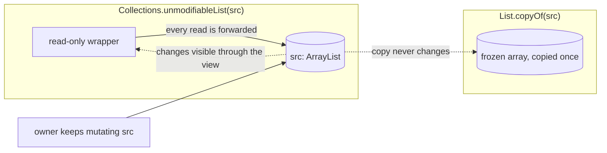

# Immutable collections and wrappers

Not every collection should be changeable by whoever holds it. This page covers the two ways to hand out a
collection that cannot be modified — **immutable copies** (`List.of`, `Set.copyOf`, `Map.of`, …), which are frozen
snapshots, and **unmodifiable views** (`Collections.unmodifiableList` and friends), which are read-only windows onto a
collection that may still change underneath — plus the ready-made empty, singleton and repeated-element collections,
lazily computed collections, and the checked and synchronized wrappers. The last section lists exactly which calls
throw `UnsupportedOperationException`.

- [Immutable factories: List.of, Set.of, Map.of](#immutable-factories-listof-setof-mapof)
- [Lazy collections (preview)](#lazy-collections-preview)
- [Empty, singleton and nCopies](#empty-singleton-and-ncopies)
- [Unmodifiable views vs immutable copies](#unmodifiable-views-vs-immutable-copies)
- [All the wrappers](#all-the-wrappers)
- [Sets backed by maps](#sets-backed-by-maps)
- [Which mutators throw](#which-mutators-throw)

## Immutable factories: List.of, Set.of, Map.of

`List`, `Set` and `Map` are both TypeScript interfaces and factory objects. Their factories build compact, truly
immutable collections that behave like any other `List`/`Set`/`Map` for reading — including value equality with
mutable collections.

| Factory | Builds | Notes |
| --- | --- | --- |
| `List.of(a, b, …)` | list of the arguments | random access |
| `List.copyOf(collection)` | immutable list of the elements | returns the argument itself if it already is a `List.of`-style list |
| `Set.of(a, b, …)` | set of the arguments | a duplicate argument throws `IllegalArgumentException` |
| `Set.copyOf(collection)` | immutable set of the elements | duplicates are dropped silently |
| `Map.of(k1, v1, k2, v2, …)` | map of the pairs | a duplicate key throws `IllegalArgumentException`; an odd argument count too |
| `Map.ofEntries(e1, e2, …)` | map of the entries | usually with `Map.entry(k, v)`; duplicate keys throw |
| `Map.copyOf(map)` | immutable copy of a map | returns the argument itself if it already is a `Map.of`-style map |
| `Map.entry(k, v)` | immutable entry | `setValue` throws |

```ts
import { List, Set, Map, ArrayList, HashSet, HashMap } from 'ts-collections-framework';

const primes = List.of(2, 3, 5, 7);
console.log(primes.get(2), primes.size());       // → 5 4
console.log(primes.equals(ArrayList.of(2, 3, 5, 7))); // → true

const vowels = Set.of('a', 'e', 'i', 'o', 'u');
console.log(vowels.contains('e'));               // → true
console.log(vowels.equals(HashSet.of('u', 'o', 'i', 'e', 'a'))); // → true

const ports = Map.of('http', 80, 'https', 443);
console.log(ports.get('https'));                 // → 443

const big = Map.ofEntries(Map.entry('a', 1), Map.entry('b', 2), Map.entry('c', 3));
console.log(big.size());                         // → 3

const copy = Set.copyOf(ArrayList.of(1, 1, 2)); // duplicates dropped
console.log(copy.size());                        // → 2

const snapshot = Map.copyOf(HashMap.of<string, number>(['x', 1]));
console.log(snapshot.equals(HashMap.of<string, number>(['x', 1]))); // → true
```

### Strict about null and duplicates

These collections are deliberately strict, so mistakes surface at construction time instead of later:

- **No nulls.** A `null` or `undefined` element, key or value throws `NullPointerException` — also in `copyOf`.
- **Null queries throw too.** Since a null can never be inside, `contains(null)`, `indexOf(null)`, `get(null)`,
  `containsKey(null)` and `containsValue(null)` throw `NullPointerException` rather than returning `false`/`null`.
  (Unmodifiable *views* and `Collections.emptyList()` & co. answer such queries normally.)
- **No duplicates** in `Set.of` and in the keys of `Map.of`/`Map.ofEntries` (`IllegalArgumentException`).

```ts
import { List, Set, Map } from 'ts-collections-framework';

const nameOf = (f: () => unknown): string => {
  try {
    f();
    return 'ok';
  } catch (e) {
    return (e as Error).name;
  }
};

console.log(nameOf(() => List.of(1, null)));             // → NullPointerException
console.log(nameOf(() => Map.of('a', undefined)));       // → NullPointerException
console.log(nameOf(() => List.of(1, 2).contains(null))); // → NullPointerException
console.log(nameOf(() => Map.of('a', 1).get(null)));     // → NullPointerException
console.log(nameOf(() => Set.of(1, 1)));                 // → IllegalArgumentException
console.log(nameOf(() => Map.of('a', 1, 'a', 2)));       // → IllegalArgumentException
```

### Iteration order of Set.of and Map.of is unspecified

`List.of` keeps argument order, of course. `Set.of` and `Map.of` do **not** promise any order — treat it like a
`HashSet`'s. If you need order, sort, or use a `LinkedHashSet`/`TreeMap` copy:

```ts
import { Set, Map, TreeSet, TreeMap } from 'ts-collections-framework';

const s = Set.of('pear', 'apple', 'fig');
console.log(new TreeSet(s).toString()); // → [apple, fig, pear]

const m = Map.of('b', 2, 'a', 1);
console.log(new TreeMap(m).toString()); // → {a=1, b=2}
```

## Lazy collections (preview)

`List.ofLazy`, `Set.ofLazy` and `Map.ofLazy` build immutable collections whose contents are **computed on first
access, at most once**, by a function you supply. They are a preview feature: the API may still change.

| Factory | Content |
| --- | --- |
| `List.ofLazy(size, i => value)` | `size` elements; element `i` is computed the first time it is read |
| `Set.ofLazy(candidates, e => boolean)` | the candidates for which the predicate returns `true`, each decided on first query |
| `Map.ofLazy(keys, k => value)` | the given keys; each value computed on first `get`/iteration |

Reading a whole lazy collection (`toString`, `equals`, iteration, `size()` for a lazy set) computes everything it
needs. A function that throws or returns `null` makes that slot fail with `NoSuchElementException` — then and on
every later access, without calling the function again. Later changes to the candidates/keys collection are not
seen.

```ts
import { List, Map, Set, TreeSet } from 'ts-collections-framework';

let calls = 0;
const squares = List.ofLazy(5, (i) => {
  calls++;
  return i * i;
});
console.log(squares.get(3), squares.get(3), calls); // → 9 9 1
console.log(squares.toString(), calls);             // → [0, 1, 4, 9, 16] 5

const config = Map.ofLazy(Set.of('host', 'port'), (key) => (key === 'port' ? '8080' : 'localhost'));
console.log(config.get('port'));  // → 8080
// not one of the keys
console.log(config.get('debug')); // → null

const evens = Set.ofLazy(TreeSet.of(1, 2, 3, 4), (n) => n % 2 === 0);
console.log(evens.contains(2), evens.contains(3), evens.size()); // → true false 2

const failing = List.ofLazy(1, (): string => {
  throw new Error('backend down');
});
const attempt = (): string => {
  try {
    return failing.get(0);
  } catch (e) {
    return (e as Error).name;
  }
};
console.log(attempt()); // → NoSuchElementException
// the function is not called again: the slot stays failed
console.log(attempt()); // → NoSuchElementException
```

## Empty, singleton and nCopies

`Collections` has shared, unmodifiable collections for the trivial cases. Unlike `List.of`, these allow `null`
elements and answer null queries normally.

| Method | Result |
| --- | --- |
| `Collections.emptyList()`, `emptySet()`, `emptyMap()` | one shared empty instance each |
| `Collections.emptySortedSet()`, `emptyNavigableSet()`, `emptySortedMap()`, `emptyNavigableMap()` | empty sorted/navigable collections |
| `Collections.emptyIterator()`, `emptyListIterator()`, `emptyEnumeration()` | iterators with nothing to iterate |
| `Collections.singletonList(e)`, `singleton(e)`, `singletonMap(k, v)` | exactly one element/mapping |
| `Collections.nCopies(n, e)` | list of `n` times the same element, in O(1) space |
| `Collections.EMPTY_LIST`, `EMPTY_SET`, `EMPTY_MAP` | the shared empties as constants |

```ts
import { Collections, ArrayList } from 'ts-collections-framework';

console.log(Collections.emptyList<number>().toString());   // → []
console.log(Collections.singletonMap('k', 1).toString());  // → {k=1}
console.log(Collections.singletonList(null).toString());   // → [null]

const dashes = Collections.nCopies(3, '-');
console.log(dashes.toString());                            // → [-, -, -]

// a common use: pre-filling a mutable list
const slots = new ArrayList<number | null>(Collections.nCopies(4, null));
slots.set(2, 42);
console.log(slots.toString());                             // → [null, null, 42, null]
```

## Unmodifiable views vs immutable copies

These two look alike — both throw `UnsupportedOperationException` from `add` — but they answer different needs.



- An **unmodifiable view** stores a reference to the source. It costs O(1) to create, and every change the owner
  makes to the source **shows through** the view. Use it to expose internal state read-only ("you may look, only I
  may change it").
- An **immutable copy** copies the elements once. It costs O(n) to create, never changes afterwards, and does not
  keep the source alive. Use it for values that must not change after you hand them out (a snapshot, a constant,
  a defensive copy of an argument).

```ts
import { ArrayList, Collections, List } from 'ts-collections-framework';

const source = ArrayList.of('a', 'b');
const view = Collections.unmodifiableList(source);
const copy = List.copyOf(source);

source.add('c');
console.log(view.toString()); // → [a, b, c]
console.log(copy.toString()); // → [a, b]

try {
  view.add('d');
} catch (e) {
  console.log((e as Error).name); // → UnsupportedOperationException
}
```

A typical class exposes a view of its private state:

```ts
import { ArrayList, Collections, List } from 'ts-collections-framework';

class Playlist {
  private readonly tracks = new ArrayList<string>();
  add(track: string): void {
    this.tracks.add(track);
  }
  /** read-only, always up to date */
  getTracks(): List<string> {
    return Collections.unmodifiableList(this.tracks);
  }
}

const p = new Playlist();
const tracks = p.getTracks();
p.add('Intro');
console.log(tracks.size(), tracks.get(0)); // → 1 Intro
```

Views of views do not stack: wrapping an unmodifiable list again returns the same wrapper. The views of an
unmodifiable map (`keySet()`, `values()`, `entrySet()`) are unmodifiable too, and its entries reject `setValue`.

## All the wrappers

All wrappers are views: they forward to the collection they wrap, which stays the single source of truth.

### Unmodifiable

| Method | Wraps |
| --- | --- |
| `Collections.unmodifiableCollection(c)` | any `Collection` (equality is by identity, since a plain collection has no value equality contract) |
| `Collections.unmodifiableSequencedCollection(c)` | a `SequencedCollection` |
| `Collections.unmodifiableList(l)` | a `List` |
| `Collections.unmodifiableSet(s)` | a `Set` |
| `Collections.unmodifiableSequencedSet(s)` | a `SequencedSet` (e.g. `LinkedHashSet`) |
| `Collections.unmodifiableSortedSet(s)`, `unmodifiableNavigableSet(s)` | a `TreeSet`; range views are unmodifiable too |
| `Collections.unmodifiableMap(m)` | a `Map` |
| `Collections.unmodifiableSequencedMap(m)` | a `SequencedMap` (e.g. `LinkedHashMap`) |
| `Collections.unmodifiableSortedMap(m)`, `unmodifiableNavigableMap(m)` | a `TreeMap`; range views are unmodifiable too |

### Checked

`Collections.checked*` wrappers guard a collection against elements of the wrong runtime type — useful when data
crosses an untyped boundary (parsed JSON, a plugin, `any`). TypeScript's types are erased at run time, so instead of
a class token you pass a **type-check predicate**. Every way an element can get in is checked — `add`, `addAll`,
`set`, `offer`, `push`, list iterators, sub-views, and for maps `put`, `putAll`, `compute*`/`merge` results and
`entry.setValue` — and a failing element throws `ClassCastException` before the collection is touched.

| Method | Checks |
| --- | --- |
| `checkedCollection(c, type)`, `checkedList(l, type)`, `checkedQueue(q, type)` | elements |
| `checkedSet(s, type)`, `checkedSortedSet(s, type)`, `checkedNavigableSet(s, type)` | elements |
| `checkedMap(m, keyType, valueType)`, `checkedSortedMap(…)`, `checkedNavigableMap(…)` | keys and values |

```ts
import { ArrayList, HashMap, Collections } from 'ts-collections-framework';

const isString = (x: unknown): boolean => typeof x === 'string';
const names = Collections.checkedList(new ArrayList<unknown>(), isString);
names.add('ada');
try {
  names.addAll(ArrayList.of<unknown>('bob', 42)); // checked before anything is added
} catch (e) {
  console.log((e as Error).name); // → ClassCastException
}
console.log(names.toString()); // → [ada]

const scores = Collections.checkedMap(
  new HashMap<unknown, unknown>(),
  isString,
  (v) => typeof v === 'number',
);
scores.put('ada', 10);
try {
  scores.merge('ada', 'oops', () => 'not a number');
} catch (e) {
  console.log((e as Error).name); // → ClassCastException
}
console.log(scores.get('ada')); // → 10
```

### Synchronized

`Collections.synchronizedCollection`, `synchronizedList`, `synchronizedSet`, `synchronizedSortedSet`,
`synchronizedNavigableSet`, `synchronizedMap`, `synchronizedSortedMap` and `synchronizedNavigableMap` exist so code
ported from the classic collections API keeps working. JS runs your code on a single thread (workers do not share
these objects), so there is nothing to lock: the wrappers are plain delegating views. They add no safety and no
measurable cost; in new code just use the collection directly.

```ts
import { ArrayList, Collections } from 'ts-collections-framework';

const list = ArrayList.of(1);
const sync = Collections.synchronizedList(list);
sync.add(2);
console.log(list.toString()); // → [1, 2]
```

## Sets backed by maps

`Collections.newSetFromMap(map)` turns an **empty** map into a set: `add(e)` is `map.put(e, true)`, and everything
else goes through `map.keySet()`. The set inherits the map's key semantics — the only reason to use it. Pair it
with `IdentityHashMap` for an identity set, or with an access-ordered `LinkedHashMap`, and so on.
`Collections.newSequencedSetFromMap(map)` does the same for a `SequencedMap`, adding `addFirst`/`addLast`/`reversed`.
A non-empty map throws `IllegalArgumentException`.

```ts
import { Collections, IdentityHashMap, LinkedHashMap, ArrayList, List } from 'ts-collections-framework';

// a set that tells equal-but-distinct objects apart
const seen = Collections.newSetFromMap(new IdentityHashMap<List<number>, boolean>());
seen.add(ArrayList.of(1));
seen.add(ArrayList.of(1));
console.log(seen.size()); // → 2

const ordered = Collections.newSequencedSetFromMap(new LinkedHashMap<string, boolean>());
ordered.add('b');
ordered.addFirst('a');
console.log(ordered.toString(), ordered.reversed().toString()); // → [a, b] [b, a]

try {
  Collections.newSetFromMap(LinkedHashMap.of(['x', true]));
} catch (e) {
  console.log((e as Error).name); // → IllegalArgumentException
}
```

## Which mutators throw

An unmodifiable collection throws `UnsupportedOperationException` from its mutators. The details — whether a call
that would change nothing also throws — differ by kind, and follow the reference runtime exactly:

| Collection | Mutator that would change something | Mutator call that would change nothing |
| --- | --- | --- |
| `List.of`, `Set.of`, `Map.of` and their `copyOf` | throws | **throws** (e.g. `List.of().clear()`, `Set.of(1).remove(9)`) |
| `keySet()`/`values()` of a `Map.of` map | throws | returns `false` (e.g. `keySet().remove('missing')`) |
| `Collections.unmodifiable*` views, and their views | throws | **throws** |
| `Collections.emptyList()`/`emptySet()`/`emptyMap()` | throws (`add`, `put`, `compute*`, …) | no-op: `clear()` does nothing, `remove`/`removeIf`/`removeAll`/`retainAll` return `false` (`remove` on the map returns `null`) |
| `Collections.singletonList`/`singleton`/`singletonMap` | throws | `remove(absent)` returns `false` (`null` for the map); `clear()` and `removeIf` throw |
| `Collections.nCopies` | throws | `remove(absent)`/`removeIf(nothing)` return `false`; `clear()` throws |
| `Collections.emptySortedSet()` & co. | throws | throws (they are unmodifiable views of empty tree collections) |
| `Map.entry`, `SimpleImmutableEntry`, navigation entries of `TreeMap` | `setValue` throws | — |

In short: never rely on a no-op mutator succeeding on a collection you did not create. If you need to know whether
you may modify a collection, own it — make a copy (`new ArrayList(c)`) and modify that.

```ts
import { List, Map, Collections, ArrayList } from 'ts-collections-framework';

const nameOf = (f: () => unknown): string => {
  try {
    return String(f());
  } catch (e) {
    return (e as Error).name;
  }
};

console.log(nameOf(() => List.of<number>().clear()));                           // → UnsupportedOperationException
console.log(nameOf(() => Map.of('a', 1).keySet().remove('missing')));           // → false
console.log(nameOf(() => Map.of('a', 1).keySet().remove('a')));                 // → UnsupportedOperationException
console.log(nameOf(() => Collections.unmodifiableList(new ArrayList()).clear())); // → UnsupportedOperationException
console.log(nameOf(() => Collections.emptyList<number>().removeIf(() => true))); // → false
console.log(nameOf(() => Collections.emptyList<number>().add(1)));              // → UnsupportedOperationException
console.log(nameOf(() => Collections.singleton(1).remove(2)));                  // → false
console.log(nameOf(() => Collections.singleton(1).remove(1)));                  // → UnsupportedOperationException
```

See also [the Collections utilities](../utilities/collections.md) for the algorithms (`sort`, `shuffle`,
`binarySearch`, …), [lists](./lists.md), [sets](./sets.md) and [maps](./maps.md) for the mutable implementations,
and [core concepts](../guide/core-concepts.md) for equality and views in general.
