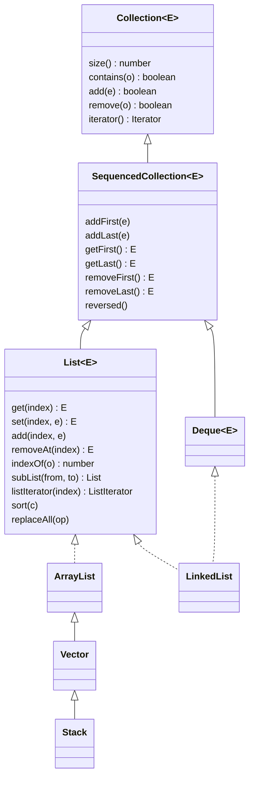
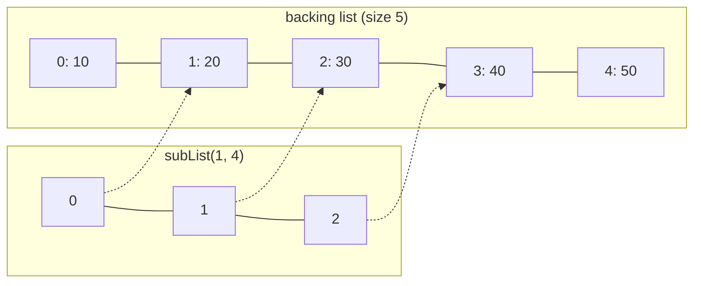
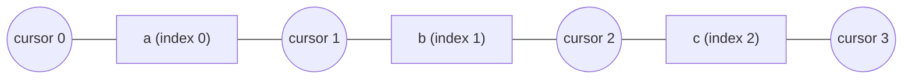
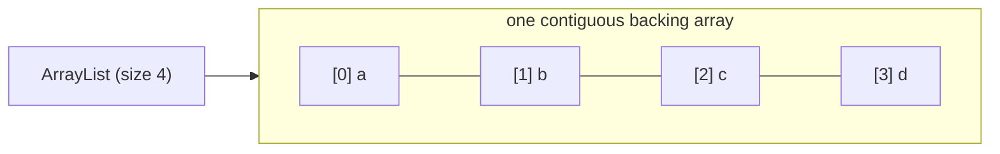
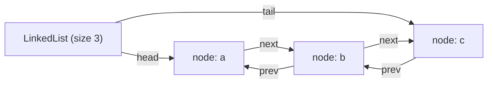

# Lists

A `List<E>` is an ordered collection with positional access: every element has an index from `0` to `size() - 1`, duplicates are allowed, and two lists are equal when they hold equal elements in the same order (whatever their class). This page covers the `List` interface first — indexing, views, the bidirectional `ListIterator`, sorting — and then the four implementations: `ArrayList` (the default choice), `LinkedList` (a list that is also a deque), and the legacy `Vector` and `Stack`. Membership and searching use value equality (`equals()`/`hashCode()`, see [core concepts](../guide/core-concepts.md)), and every iterator is fail-fast.

**Contents**

- [The List interface](#the-list-interface)
  - [Positional access](#positional-access)
  - [removeAt(index) vs remove(element)](#removeatindex-vs-removeelement)
  - [Searching: indexOf, lastIndexOf, contains](#searching-indexof-lastindexof-contains)
  - [Both ends: SequencedCollection methods](#both-ends-sequencedcollection-methods)
  - [Live views: subList and reversed](#live-views-sublist-and-reversed)
  - [ListIterator](#listiterator)
  - [Bulk updates: sort and replaceAll](#bulk-updates-sort-and-replaceall)
  - [Fail-fast iteration](#fail-fast-iteration)
- [ArrayList](#arraylist)
- [LinkedList](#linkedlist)
- [Vector](#vector)
- [Stack](#stack)
- [Recipes](#recipes)
- [Choosing between the list classes](#choosing-between-the-list-classes)

---

## The List interface

`List<E>` extends `SequencedCollection<E>`, which extends `Collection<E>`, which extends the JS `Iterable<E>`. So every list works with `for...of`, spread, and `Array.from`, *and* has the full collection API (`contains`, `addAll`, `removeIf`, `stream()`, …).



### Positional access

`get`, `set`, `add(index, e)` and `removeAt` take an index. An index outside the valid range throws `IndexOutOfBoundsException` — there is no silent `undefined` like a JS array. For `add(index, e)` the valid range is `0..size()` inclusive (inserting at `size()` appends); for the others it is `0..size()-1`.

```ts
import { ArrayList } from 'ts-collections-framework';

const list = ArrayList.of('a', 'b', 'd');
list.add(2, 'c');                  // insert before index 2
console.log(list.toString());      // → [a, b, c, d]
console.log(list.get(0));          // → a
console.log(list.set(3, 'D'));     // → d
console.log(list.toString());      // → [a, b, c, D]

try {
  list.get(4);
} catch (e) {
  console.log((e as Error).name);  // → IndexOutOfBoundsException
}
```

`set` returns the element it replaced, which makes swap-like code short.

### removeAt(index) vs remove(element)

In the classic collections API, `remove(int)` and `remove(Object)` are overloads. TypeScript cannot tell those apart on a `List<number>` — is `remove(1)` "the element at index 1" or "the element equal to 1"? This library therefore splits them:

| Call | Meaning | Returns |
| --- | --- | --- |
| `remove(o)` | remove the **first element equal to** `o` | `true` if something was removed |
| `removeAt(i)` | remove the element **at index** `i` | the removed element (throws if `i` is out of range) |

```ts
import { ArrayList } from 'ts-collections-framework';

const nums = ArrayList.of(10, 20, 30, 1);
console.log(nums.remove(1));       // → true
console.log(nums.toString());      // → [10, 20, 30]
console.log(nums.removeAt(1));     // → 20
console.log(nums.toString());      // → [10, 30]
console.log(nums.remove(99));      // → false
```

### Searching: indexOf, lastIndexOf, contains

`indexOf` and `lastIndexOf` return the first / last index of an equal element, or `-1`. "Equal" means `Objects.equals`: the element's own `equals()` when it has one, otherwise SameValueZero (so `NaN` finds `NaN`). This is what makes lists of value objects work:

```ts
import { ArrayList } from 'ts-collections-framework';

class Point {
  constructor(readonly x: number, readonly y: number) {}
  equals(o: unknown): boolean {
    return o instanceof Point && o.x === this.x && o.y === this.y;
  }
  hashCode(): number {
    return 31 * this.x + this.y;
  }
  toString(): string {
    return `(${this.x}, ${this.y})`;
  }
}

const pts = ArrayList.of(new Point(0, 0), new Point(1, 2), new Point(0, 0));
console.log(pts.contains(new Point(1, 2)));     // → true
console.log(pts.indexOf(new Point(0, 0)));      // → 0
console.log(pts.lastIndexOf(new Point(0, 0)));  // → 2
console.log(pts.indexOf(new Point(9, 9)));      // → -1
console.log(pts.toString());                    // → [(0, 0), (1, 2), (0, 0)]
```

All three are linear scans, O(n), in every list class. For sorted lists use [binary search](#binary-search-on-a-sorted-list); for frequent membership tests use a [set](./sets.md).

### Both ends: SequencedCollection methods

Every list has the `SequencedCollection` methods for its two ends. The `get*`/`remove*` ones throw `NoSuchElementException` on an empty list.

```ts
import { ArrayList } from 'ts-collections-framework';

const l = ArrayList.of(2);
l.addFirst(1);
l.addLast(3);
console.log(l.toString());       // → [1, 2, 3]
console.log(l.getFirst());       // → 1
console.log(l.getLast());        // → 3
console.log(l.removeFirst());    // → 1
console.log(l.removeLast());     // → 3
console.log(l.toString());       // → [2]

try {
  new ArrayList<number>().getFirst();
} catch (e) {
  console.log((e as Error).name); // → NoSuchElementException
}
```

On an `ArrayList`, `addFirst`/`removeFirst` shift every element (O(n)); on a `LinkedList` they are O(1). If you mostly work at the front, see [LinkedList](#linkedlist) or [ArrayDeque](./queues-and-deques.md#arraydeque).

### Live views: subList and reversed

`subList(from, to)` and `reversed()` do **not** copy. They return a *view*: a `List` object that reads and writes the original list's storage. Changes through the view show up in the list, and changes to the list show up in the view.

`subList(from, to)` is a window over the half-open range `[from, to)`:



View index `i` maps to backing index `from + i`. That makes the view the idiomatic way to do range operations without range-specific methods:

```ts
import { ArrayList } from 'ts-collections-framework';

const list = ArrayList.of(10, 20, 30, 40, 50);
const window = list.subList(1, 4);
console.log(window.toString());   // → [20, 30, 40]

window.set(0, 21);                // write through the view
console.log(list.toString());     // → [10, 21, 30, 40, 50]

window.clear();                   // remove a range from the list
console.log(list.toString());     // → [10, 50]
console.log(window.size());       // → 0
```

Other range operations in the same style: `list.subList(a, b).sort(null)` sorts just that range, `list.subList(a, b).indexOf(x)` searches it, `list.subList(0, k)` followed by `new ArrayList(view)` copies a prefix.

A view stays valid only while the backing list is changed **through the view** (or not at all). If the backing list changes size behind the view's back, the view fails fast on its next use:

```ts
import { ArrayList } from 'ts-collections-framework';

const list = ArrayList.of(1, 2, 3, 4);
const view = list.subList(1, 3);
list.add(5);                       // structural change, not through the view

try {
  view.size();
} catch (e) {
  console.log((e as Error).name);  // → ConcurrentModificationException
}
```

`reversed()` returns a live view in reverse order. Adding to the front of the reversed view adds to the end of the list:

```ts
import { ArrayList } from 'ts-collections-framework';

const list = ArrayList.of(1, 2, 3);
const rev = list.reversed();
console.log(rev.toString());      // → [3, 2, 1]
rev.addFirst(4);
console.log(list.toString());     // → [1, 2, 3, 4]
console.log(rev.get(0));          // → 4
```

Need an independent copy instead? Wrap the view: `new ArrayList(list.subList(1, 3))`. For an unmodifiable view see [immutable collections and wrappers](./immutable-and-wrappers.md).

### ListIterator

`listIterator(index?)` returns a `ListIterator`, a cursor that moves both ways and can edit the list in place. The cursor sits **between** elements, never on one: with `n` elements there are `n + 1` cursor positions.



At cursor position `k`, `next()` returns element `k` and moves right, `previous()` returns element `k - 1` and moves left, `nextIndex()` is `k`, and `previousIndex()` is `k - 1`.

| Method | Effect |
| --- | --- |
| `next()` / `previous()` | return the element crossed and move the cursor |
| `hasNext()` / `hasPrevious()` | whether there is an element to the right / left |
| `nextIndex()` / `previousIndex()` | the index `next()` / `previous()` would return |
| `remove()` | remove the element returned by the last `next()`/`previous()` |
| `set(e)` | replace the element returned by the last `next()`/`previous()` |
| `add(e)` | insert `e` at the cursor (before the element `next()` would return); the cursor moves past it |

`remove()` and `set()` need a "last returned" element. Calling them before any `next()`/`previous()`, or right after `add()` or `remove()`, throws `IllegalStateException`.

```ts
import { ArrayList } from 'ts-collections-framework';

const letters = ArrayList.of('a', 'c', 'd');
const it = letters.listIterator();
it.next();                         // cursor now between a and c
it.add('b');                       // inserts at the cursor
console.log(letters.toString());   // → [a, b, c, d]
console.log(it.nextIndex());       // → 2

try {
  it.set('x');                     // nothing "last returned" after add()
} catch (e) {
  console.log((e as Error).name);  // → IllegalStateException
}

console.log(it.next());            // → c
it.set('C');                       // replace what next() returned
console.log(it.previous());        // → C
console.log(it.previous());        // → b
it.remove();
console.log(letters.toString());   // → [a, C, d]
```

`listIterator(index)` starts the cursor at `index`; `listIterator(list.size())` is how you walk a list backwards:

```ts
import { LinkedList } from 'ts-collections-framework';

const list = LinkedList.of(1, 2, 3);
const it = list.listIterator(list.size());
const out: number[] = [];
while (it.hasPrevious()) out.push(it.previous());
console.log(out);                  // → [ 3, 2, 1 ]
```

The `ListIterator` is the efficient way to edit a `LinkedList` while walking it: every `add`/`set`/`remove` is O(1) at the cursor, whereas `list.add(i, e)` must first walk to `i`.

### Bulk updates: sort and replaceAll

`sort(comparator)` sorts the list in place. It is **stable** (equal elements keep their relative order). Pass `null` for natural ordering — numbers numerically, strings by code unit, objects by their `compareTo()`. Note that this is not `Array.prototype.sort`'s default, which compares numbers as strings.

`replaceAll(fn)` replaces every element with `fn(element)`, in place.

```ts
import { ArrayList, Comparator } from 'ts-collections-framework';

const nums = ArrayList.of(10, 9, 100, 1);
nums.sort(null);
console.log(nums.toString());     // → [1, 9, 10, 100]

nums.sort(Comparator.reverseOrder<number>());
console.log(nums.toString());     // → [100, 10, 9, 1]

nums.replaceAll((n) => n * 2);
console.log(nums.toString());     // → [200, 20, 18, 2]

const people = ArrayList.of(
  { name: 'Ada', age: 36 },
  { name: 'Bob', age: 25 },
  { name: 'Cy', age: 36 },
);
people.sort(Comparator.comparing((p: { name: string; age: number }) => p.age));
console.log(people.toArray().map((p) => p.name)); // → [ 'Bob', 'Ada', 'Cy' ]
```

Ada and Cy have the same age, so stability keeps Ada before Cy. Building comparators is covered in [the Collections utilities page](../utilities/collections.md).

### Fail-fast iteration

Each list counts its *structural modifications* (changes in size). An iterator remembers that count when created and throws `ConcurrentModificationException` as soon as it notices the list was structurally changed by anything other than the iterator itself. This turns a subtle bug — skipping or repeating elements — into an immediate, loud error.

```ts
import { ArrayList } from 'ts-collections-framework';

const list = ArrayList.of(1, 2, 3, 4);
try {
  for (const n of list) {
    if (n % 2 === 0) list.remove(n);   // modifies the list under the loop
  }
} catch (e) {
  console.log((e as Error).name);      // → ConcurrentModificationException
}
```

Fail-fast is a debugging aid, not a guarantee: it is "best effort" detection. `set()` is not a structural change and never trips it. The fix is to remove through the iterator, or with `removeIf` — see [remove while iterating](#remove-while-iterating).

> The `for...of` iterator of `ArrayList` is slightly stricter than the cursor returned by `iterator()`: it fails as soon as the size changes, while `iterator()` reproduces the reference runtime exactly, including its well-known blind spot (removing the second-to-last element ends the loop silently instead of throwing). Either way, do not rely on the exception for correctness.

---

## ArrayList

`ArrayList<E>` stores its elements in a dense native JS array. It is the default list: indexed reads and writes are O(1), appending is amortized O(1), iteration is cache-friendly, and memory overhead is low. It implements the `RandomAccess` marker (`isRandomAccess(list)` returns `true`), which algorithms like `Collections.binarySearch` use to pick index-based strategies.

```ts
import { ArrayList, LinkedList, isRandomAccess } from 'ts-collections-framework';

console.log(isRandomAccess(new ArrayList<number>()));  // → true
console.log(isRandomAccess(new LinkedList<number>())); // → false
```

### Creating one

```ts
import { ArrayList, HashSet } from 'ts-collections-framework';

const empty = new ArrayList<string>();
const sized = new ArrayList<string>(1000);          // capacity hint
const fromValues = ArrayList.of(3, 1, 2);
const copy = new ArrayList(fromValues);             // copy of any Collection
const fromSet = new ArrayList(new HashSet(ArrayList.of('x')));

console.log(empty.size(), sized.size());            // → 0 0
console.log(copy.toString(), fromSet.toString());   // → [3, 1, 2] [x]
console.log(fromValues.equals(copy));               // → true
console.log(fromValues === copy);                   // → false
```

To build from a JS array, spread it: `ArrayList.of(...array)`.

### Capacity hints

`new ArrayList(initialCapacity)`, `ensureCapacity(n)` and `trimToSize()` exist for API compatibility, but they are **hints only**: the JS engine manages the array's storage, and preallocating would create holes that make the array slower. A negative capacity still throws `IllegalArgumentException`, as in the reference API. There is no need to call these for performance; see [performance](../advanced/performance.md).

### clone()

`clone()` returns a shallow, independent copy of the same class. The elements themselves are shared, not copied.

```ts
import { ArrayList } from 'ts-collections-framework';

const a = ArrayList.of({ n: 1 }, { n: 2 });
const b = a.clone();
b.add({ n: 3 });
console.log(a.size(), b.size());   // → 2 3
b.get(0).n = 100;                  // same object in both lists
console.log(a.get(0).n);           // → 100
```

### How it is stored



`get(i)` is a single array read. Inserting or removing at index `i` must shift every element after `i` by one slot, which is why middle and front operations are O(n).

### ArrayList complexity

| Operation | Cost | Notes |
| --- | --- | --- |
| `get(i)`, `set(i, e)` | O(1) | |
| `add(e)`, `addLast(e)` | O(1) amortized | native `push` |
| `add(i, e)`, `removeAt(i)` | O(n − i) | shifts the tail of the array |
| `addFirst`, `removeFirst` | O(n) | shifts everything |
| `removeLast()` | O(1) | |
| `contains`, `indexOf`, `remove(o)` | O(n) | linear scan with `equals()` |
| `addAll(c)` | O(m) | m = `c.size()` |
| `addAll(i, c)` | O(n + m) | one shift, not m shifts |
| `removeIf`, `removeAll`, `retainAll` | O(n) | single compacting pass (×cost of `contains` on the argument for `removeAll`/`retainAll`) |
| `sort` | O(n log n) | stable |
| `subList`, `reversed` | O(1) | live views, no copy |
| `iterator().next()` | O(1) | |

---

## LinkedList

`LinkedList<E>` is a doubly linked list. It implements **both** `List<E>` and `Deque<E>`, so it can be used as a list, a FIFO queue, or a stack. Each element lives in its own node with links to its neighbours; the list keeps references to the first and last node.



Compare that with ArrayList's single array: adding or removing at either end only rewires a couple of links (O(1)), but reaching index `i` means walking node by node from the nearer end (O(min(i, n − i))).

```ts
import { LinkedList } from 'ts-collections-framework';

const list = LinkedList.of('b', 'c');
list.addFirst('a');                 // O(1)
list.addLast('d');                  // O(1)
console.log(list.toString());       // → [a, b, c, d]
console.log(list.get(2));           // → c

// Deque methods, on the same object
list.offerFirst('start');
console.log(list.pollLast());       // → d
console.log(list.peekFirst());      // → start
console.log(list.toString());       // → [start, a, b, c]

// Stack methods (push/pop work on the front)
list.push('top');
console.log(list.pop());            // → top
```

Unlike `ArrayDeque`, `LinkedList` accepts `null` elements. That makes `poll()` ambiguous — it returns `null` both for "empty" and for "the head was null" — so check `isEmpty()` if you store nulls. Queue usage is covered on the [queues and deques page](./queues-and-deques.md#linkedlist-as-a-queue).

### reversed() is a LinkedList

`LinkedList.reversed()` returns a live reverse-ordered view whose type is `LinkedList`, so it has the full list *and* deque API:

```ts
import { LinkedList } from 'ts-collections-framework';

const list = LinkedList.of(1, 2, 3);
const rev = list.reversed();
console.log(rev instanceof LinkedList);  // → true
console.log(rev.toString());             // → [3, 2, 1]
console.log(rev.peekFirst());            // → 3
rev.addFirst(4);                         // the view's first is the list's last
console.log(list.toString());            // → [1, 2, 3, 4]
```

### When LinkedList is the right choice

LinkedList earns its keep when you insert or remove **at a position you are already at**, via a `ListIterator`, or at the ends. For pure queue or stack use, `ArrayDeque` is usually faster and lighter (one array instead of one node object per element). For indexed access, `ArrayList` wins by a wide margin.

### LinkedList complexity

| Operation | Cost | Notes |
| --- | --- | --- |
| `addFirst`, `addLast`, `add(e)`, `offer*`, `push` | O(1) | |
| `removeFirst`, `removeLast`, `poll*`, `pop` | O(1) | |
| `getFirst`, `getLast`, `peek*` | O(1) | |
| `get(i)`, `set(i, e)` | O(min(i, n − i)) | walks from the nearer end |
| `add(i, e)`, `removeAt(i)` | O(min(i, n − i)) | the walk; the relink itself is O(1) |
| `ListIterator` `add` / `set` / `remove` | O(1) | at the cursor |
| `contains`, `indexOf`, `remove(o)` | O(n) | |
| `removeFirstOccurrence`, `removeLastOccurrence` | O(n) | |
| `sort` | O(n log n) | stable |
| `reversed()`, `descendingIterator()` | O(1) | views |

---

## Vector

`Vector<E>` is the legacy growable array. In this library it is an `ArrayList` subclass that adds the old element-style methods, a simulated capacity, and `ArrayIndexOutOfBoundsException` for bad indexes. JS is single-threaded, so there is no synchronization cost — and no synchronization benefit either. Use `Vector` when porting code that relies on its legacy methods; prefer `ArrayList` otherwise.

### Legacy methods

| Legacy method | Modern equivalent |
| --- | --- |
| `elementAt(i)` | `get(i)` |
| `firstElement()` / `lastElement()` | `getFirst()` / `getLast()` |
| `addElement(e)` | `add(e)` |
| `insertElementAt(e, i)` | `add(i, e)` (note the swapped arguments) |
| `setElementAt(e, i)` | `set(i, e)` (swapped, and returns nothing) |
| `removeElement(o)` | `remove(o)` |
| `removeElementAt(i)` | `removeAt(i)` (returns nothing) |
| `removeAllElements()` | `clear()` |
| `indexOf(o, from)` / `lastIndexOf(o, from)` | `subList(...).indexOf(o)` plus offset |
| `elements()` | `iterator()` |
| `copyInto(array)` | `toArray()` |

```ts
import { Vector } from 'ts-collections-framework';

const v = new Vector<string>();
v.addElement('a');
v.addElement('c');
v.insertElementAt('b', 1);
console.log(v.toString());                 // → [a, b, c]
console.log(v.elementAt(1));               // → b
console.log(v.firstElement(), v.lastElement()); // → a c

const w = Vector.of(1, 2, 1, 2);
console.log(w.indexOf(1, 1));              // → 2
console.log(w.lastIndexOf(2, 2));          // → 1

const target: number[] = [];
w.copyInto(target);
console.log(target);                       // → [ 1, 2, 1, 2 ]
```

### Bad indexes throw ArrayIndexOutOfBoundsException

`ArrayIndexOutOfBoundsException` is a subclass of `IndexOutOfBoundsException`, so code that catches the latter keeps working.

```ts
import { Vector, IndexOutOfBoundsException } from 'ts-collections-framework';

const v = Vector.of(1, 2, 3);
try {
  v.get(10);
} catch (e) {
  console.log((e as Error).name);                     // → ArrayIndexOutOfBoundsException
  console.log(e instanceof IndexOutOfBoundsException); // → true
}
```

### Capacity and capacityIncrement

A `Vector` tracks a reported capacity (`capacity()`), default 10. When an add would exceed it, it grows by `capacityIncrement` if that is positive, otherwise it doubles. As with `ArrayList`, the real storage is managed by the engine; the number exists so ported code that reads `capacity()` sees the values it expects.

```ts
import { Vector } from 'ts-collections-framework';

const doubling = new Vector<number>();          // capacity 10, doubles
for (let i = 0; i < 11; i++) doubling.add(i);
console.log(doubling.capacity());               // → 20

const stepped = new Vector<number>(3, 2);       // capacity 3, +2 each time
for (let i = 0; i < 4; i++) stepped.add(i);
console.log(stepped.capacity());                // → 5
console.log(stepped.capacityIncrement);         // → 2
```

### setSize and elements()

`setSize(n)` truncates, or pads with `null`. `elements()` returns a legacy `Enumeration` (`hasMoreElements`/`nextElement`), which is also JS-iterable and can be adapted with `asIterator()`. Unlike `iterator()`, an enumeration is **not** fail-fast.

```ts
import { Vector } from 'ts-collections-framework';

const v = Vector.of<number | null>(1, 2, 3);
v.setSize(5);
console.log(v.toString());          // → [1, 2, 3, null, null]
v.setSize(2);
console.log(v.toString());          // → [1, 2]

const en = v.elements();
const seen: (number | null)[] = [];
while (en.hasMoreElements()) seen.push(en.nextElement());
console.log(seen);                  // → [ 1, 2 ]

console.log([...Vector.of('x', 'y').elements()]); // → [ 'x', 'y' ]
```

### Vector complexity

Same as [ArrayList](#arraylist-complexity). The legacy methods are thin aliases with the same costs (`elementAt` O(1), `insertElementAt` O(n − i), and so on); `setSize(n)` is O(|n − size|).

---

## Stack

`Stack<E>` is a last-in-first-out stack built on `Vector`. The top of the stack is the **end** of the vector, so `push`/`pop`/`peek` are O(1).

| Method | Behaviour |
| --- | --- |
| `push(e)` | adds `e` on top and returns it |
| `pop()` | removes and returns the top; `EmptyStackException` if empty |
| `peek()` | returns the top without removing it; `EmptyStackException` if empty |
| `empty()` | `true` if there are no elements (same as `isEmpty()`) |
| `search(o)` | 1-based distance of `o` from the top (top is 1), or `-1` |

```ts
import { Stack } from 'ts-collections-framework';

const s = new Stack<string>();
s.push('a');
s.push('b');
console.log(s.push('c'));         // → c
console.log(s.toString());        // → [a, b, c]
console.log(s.peek());            // → c
console.log(s.search('c'));       // → 1
console.log(s.search('a'));       // → 3
console.log(s.search('z'));       // → -1
console.log(s.pop());             // → c
console.log(s.pop(), s.pop());    // → b a
console.log(s.empty());           // → true

try {
  s.pop();
} catch (e) {
  console.log((e as Error).name); // → EmptyStackException
}
```

Note that `toString()` and iteration go bottom-to-top (index order), and since a `Stack` is a `Vector`, all the list methods — including `add(0, e)` under the top-of-stack — remain available. That leaky interface is one reason it is considered legacy.

### Prefer ArrayDeque for new code

For a new stack, use `ArrayDeque` through its `Deque` methods. It has a focused API, throws the standard `NoSuchElementException` on an empty `pop()`, offers a non-throwing `peek()` that returns `null`, and iterates top-first:

```ts
import { ArrayDeque } from 'ts-collections-framework';

const stack = new ArrayDeque<string>();
stack.push('a');
stack.push('b');
stack.push('c');
console.log(stack.toString());     // → [c, b, a]
console.log(stack.pop());          // → c
console.log(stack.peek());         // → b
stack.clear();
console.log(stack.peek());         // → null
```

See [queues and deques](./queues-and-deques.md#using-a-deque-as-a-stack).

### Stack complexity

| Operation | Cost |
| --- | --- |
| `push`, `pop`, `peek`, `empty` | O(1) |
| `search(o)` | O(n) |
| everything else | as [Vector](#vector-complexity) |

---

## Recipes

### Remove while iterating

Never call `list.remove(...)` inside a `for...of` over the same list (see [fail-fast iteration](#fail-fast-iteration)). Two correct ways:

```ts
import { ArrayList } from 'ts-collections-framework';

// 1. Iterator.remove(): removes the element just returned by next()
const a = ArrayList.of(1, 2, 3, 4, 5, 6);
const it = a.iterator();
while (it.hasNext()) {
  if (it.next() % 2 === 0) it.remove();
}
console.log(a.toString());           // → [1, 3, 5]

// 2. removeIf: shortest, and a single O(n) pass on ArrayList
const b = ArrayList.of(1, 2, 3, 4, 5, 6);
console.log(b.removeIf((n) => n % 2 === 0)); // → true
console.log(b.toString());           // → [1, 3, 5]
```

Prefer `removeIf` on an `ArrayList`: removing through the iterator one by one shifts the tail each time (O(n²) worst case), while `removeIf` compacts in one pass. On a `LinkedList` both are O(n).

### Remove duplicates

Copy through a `LinkedHashSet` to keep first-occurrence order (or a `HashSet` if order does not matter). Both use `equals()`/`hashCode()`, so value objects dedupe correctly. See [sets](./sets.md).

```ts
import { ArrayList, LinkedHashSet } from 'ts-collections-framework';

const withDupes = ArrayList.of('b', 'a', 'b', 'c', 'a');
const unique = new ArrayList(new LinkedHashSet(withDupes));
console.log(unique.toString());      // → [b, a, c]
```

The same thing with a stream: `withDupes.stream().distinct().toList()` (see [streams](../streams/overview.md)).

### Batch insert with addAll(index, ...)

Inserting many elements in the middle one at a time shifts the tail once per element. `addAll(index, c)` shifts once:

```ts
import { ArrayList } from 'ts-collections-framework';

const list = ArrayList.of(1, 2, 6, 7);
list.addAll(2, ArrayList.of(3, 4, 5));
console.log(list.toString());        // → [1, 2, 3, 4, 5, 6, 7]
```

### Binary search on a sorted list

`Collections.binarySearch(list, key, comparator?)` runs in O(log n) on a `RandomAccess` list. It returns the index of the key, or `-(insertionPoint) - 1` when absent — so a negative result tells you where to insert to keep the list sorted. The list must be sorted by the same ordering you search with.

```ts
import { ArrayList, Collections, Comparator } from 'ts-collections-framework';

const sorted = ArrayList.of(1, 3, 5, 7);
console.log(Collections.binarySearch(sorted, 5));  // → 2
const r = Collections.binarySearch(sorted, 4);
console.log(r);                                    // → -3

// insert 4 at its sorted position
sorted.add(-r - 1, 4);
console.log(sorted.toString());                    // → [1, 3, 4, 5, 7]

// descending list: search with the same comparator it is sorted by
const desc = ArrayList.of(9, 6, 3);
console.log(Collections.binarySearch(desc, 3, Comparator.reverseOrder<number>())); // → 2
```

If you insert and search constantly, a [`TreeSet`](./sets.md) keeps elements sorted for you.

### Converting to and from JS arrays

```ts
import { ArrayList } from 'ts-collections-framework';

const list = ArrayList.of(...[3, 1, 2]);   // from an array
console.log(list.toArray());               // → [ 3, 1, 2 ]
console.log([...list].map((n) => n * 2));  // → [ 6, 2, 4 ]
```

---

## Choosing between the list classes

| Need | Use |
| --- | --- |
| General-purpose list, indexed access, appends | `ArrayList` |
| Many inserts/removes at a cursor or at both ends, plus list API | `LinkedList` |
| Only a queue or stack | `ArrayDeque` ([queues and deques](./queues-and-deques.md)) |
| Porting code that uses `elementAt`, `capacity()`, `Enumeration` | `Vector` |
| Porting code that uses `Stack` | `Stack` (new code: `ArrayDeque`) |
| Fixed contents | `List.of(...)` ([immutable collections](./immutable-and-wrappers.md)) |

For the broader picture, see [choosing a collection](../guide/choosing-a-collection.md).
