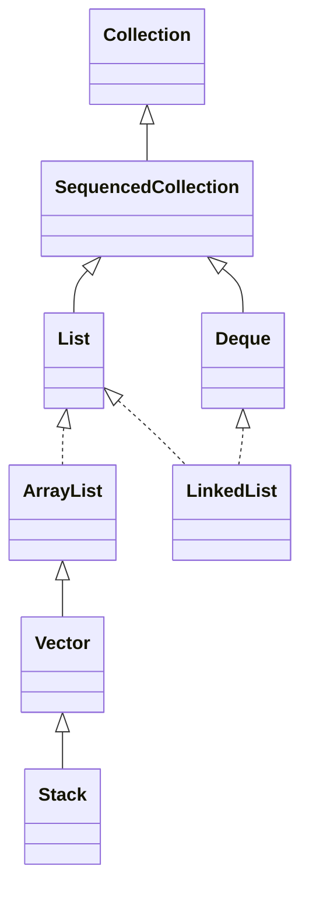

# Lists

A `List<E>` is an ordered collection with positional access. This page covers the `List` interface, its four implementations (`ArrayList`, `LinkedList`, and the legacy `Vector` and `Stack`), and the operations, views and iterators they share.

> [!NOTE]
> Concurrent lists such as `CopyOnWriteArrayList` are not included. [Not included](../advanced/compatibility.md#not-included) explains why and what to use instead.

## The List interface

Every element of a list has an index from `0` to `size() - 1`, and duplicates are allowed. Two lists are equal when they hold equal elements in the same order, whatever their class. Membership and searching use value equality (`equals()`/`hashCode()`), described in [core concepts](../guide/core-concepts.md#value-equality).

`List<E>` extends `SequencedCollection<E>`, which extends `Collection<E>` and the JS `Iterable<E>`. Every list therefore works with `for...of`, spread and `Array.from`, and has the full collection API (`contains`, `addAll`, `removeIf`, `stream()`, …).



## Implementations

| Class | Storage | Use it for |
| --- | --- | --- |
| `ArrayList` | one dense array | the default list: indexed access, appending, sorting |
| `LinkedList` | doubly linked nodes | inserts and removes at a cursor or at both ends, plus the `Deque` API |
| `Vector` | `ArrayList` subclass | porting code that uses `elementAt`, `capacity()` or `Enumeration` |
| `Stack` | `Vector` subclass | porting code that uses `Stack`; new code uses `ArrayDeque` |

For a queue or stack without the list API, use [`ArrayDeque`](./queues-and-deques.md#arraydeque). For fixed contents, use `List.of(...)` ([immutable collections](./immutable-and-wrappers.md)). The [data structures primer](../guide/data-structures.md) shows how each class lays out its data.

### ArrayList

<ClassInfo name="ArrayList" />

`ArrayList<E>` stores its elements in a dense native JS array. Indexed reads and writes are O(1), appending is amortized O(1), and memory overhead is low. Inserting or removing at index `i` shifts every later element, so front and middle operations are O(n).

::: code-group

```ts [Basic]
import { ArrayList } from '@nodestd/collections';

const list = new ArrayList<string>();
list.add('a');
list.add('b');
list.add('c');
console.log(list.get(1));          // → b
console.log(list.removeAt(0));     // → a
const upper: string[] = [];
for (const s of list) upper.push(s.toUpperCase());
console.log(upper);                // → [ 'B', 'C' ]
console.log(list.size(), list.toString()); // → 2 [b, c]
```

```ts [Intermediate]
import { ArrayList, Comparator } from '@nodestd/collections';

interface Product { name: string; price: number }

const products = new ArrayList<Product>();
products.add({ name: 'pen', price: 2 });
products.add({ name: 'notebook', price: 5 });
products.add({ name: 'clip', price: 2 });
products.add({ name: 'stapler', price: 12 });
products.add({ name: 'tape', price: 3 });

// cheapest first, ties broken by name
products.sort(Comparator.thenComparingBy(Comparator.comparing((p: Product) => p.price), (p) => p.name));

// pages of two, read through subList views without copying
const pageSize = 2;
function page(n: number): string[] {
  const from = n * pageSize;
  const to = Math.min(from + pageSize, products.size());
  return products.subList(from, to).toArray().map((p) => p.name);
}
console.log(page(0));   // → [ 'clip', 'pen' ]
console.log(page(1));   // → [ 'tape', 'notebook' ]
console.log(page(2));   // → [ 'stapler' ]
```

:::

`ArrayList` carries the `RandomAccess` marker, which algorithms such as `Collections.binarySearch` use to choose an index-based strategy (see [RandomAccess](../guide/core-concepts.md#randomaccess)).

```ts
import { ArrayList, LinkedList, isRandomAccess } from '@nodestd/collections';

console.log(isRandomAccess(new ArrayList<number>()));  // → true
console.log(isRandomAccess(new LinkedList<number>())); // → false
```

### LinkedList

<ClassInfo name="LinkedList" />

`LinkedList<E>` is a doubly linked list that implements both `List<E>` and `Deque<E>`, so one object serves as a list, a FIFO queue and a stack. Adding or removing at either end is O(1). Reaching index `i` walks from the nearer end, O(min(i, n − i)).

::: code-group

```ts [Basic]
import { LinkedList } from '@nodestd/collections';

const list = new LinkedList<string>();
list.add('b');
list.add('c');
list.addFirst('a');                 // O(1)
list.addLast('d');                  // O(1)
console.log(list.toString());       // → [a, b, c, d]
console.log(list.get(2));           // → c
console.log(list.removeFirst());    // → a
let joined = '';
for (const s of list) joined += s;
console.log(joined, list.size());   // → bcd 3
```

```ts [Intermediate]
import { LinkedList } from '@nodestd/collections';

// undo/redo stacks; push/poll work on the front, the oldest entry sits at the back
const undo = new LinkedList<string>();
const redo = new LinkedList<string>();
let text = '';

function edit(next: string): void {
  undo.push(text);
  if (undo.size() > 3) undo.removeLast();   // keep the last 3 states
  redo.clear();
  text = next;
}
function step(from: LinkedList<string>, to: LinkedList<string>): void {
  const state = from.poll();
  if (state === null) return;
  to.push(text);
  text = state;
}

for (const t of ['a', 'ab', 'abc', 'abcd']) edit(t);
console.log(undo.toString());       // → [abc, ab, a]
step(undo, redo);                   // undo
step(undo, redo);                   // undo
console.log(text);                  // → ab
step(redo, undo);                   // redo
console.log(text, redo.toString()); // → abc [abcd]
```

:::

`LinkedList` is the right choice when you insert or remove at a position you are already at (through a [`ListIterator`](#listiterator)) or at the ends. For a pure queue or stack, `ArrayDeque` is faster and lighter: one array instead of one node object per element. For indexed access, `ArrayList` is faster.

Unlike `ArrayDeque`, `LinkedList` accepts `null` elements. Queue usage is covered in [LinkedList as a queue](./queues-and-deques.md#linkedlist-as-a-queue).

### Vector

<ClassInfo name="Vector" />

`Vector<E>` is the legacy growable array. It extends `ArrayList` with the old element-style methods, a simulated capacity, and `ArrayIndexOutOfBoundsException` for bad indexes. JS is single-threaded, so `Vector` has no synchronization cost and no synchronization benefit. Its API is described in [Vector and Stack](#vector-and-stack).

::: code-group

```ts [Basic]
import { Vector } from '@nodestd/collections';

const v = new Vector<number>();
v.add(10);
v.add(20);
v.add(30);
console.log(v.get(1));                // → 20
v.removeAt(0);
const doubled: number[] = [];
for (const n of v) doubled.push(n * 2);
console.log(doubled);                 // → [ 40, 60 ]
console.log(v.size(), v.toString());  // → 2 [20, 30]
```

```ts [Intermediate]
import { Collections, TreeSet, Vector, type Enumeration } from '@nodestd/collections';

// a ported function that reads an Enumeration and returns a Vector
function upperAll(en: Enumeration<string>): Vector<string> {
  const out = new Vector<string>();
  while (en.hasMoreElements()) out.addElement(en.nextElement().toUpperCase());
  return out;
}

const tags = new Vector<string>();
tags.addElement('red');
tags.addElement('green');
console.log(upperAll(tags.elements()).toString());  // → [RED, GREEN]

// any Collection can supply an Enumeration
const sorted = TreeSet.of('b', 'a');
console.log(upperAll(Collections.enumeration(sorted)).toString()); // → [A, B]

// and an Enumeration converts back to an ArrayList
const list = Collections.list(tags.elements());
console.log(list.toString());                        // → [red, green]
```

:::

### Stack

<ClassInfo name="Stack" />

`Stack<E>` is a last-in-first-out stack built on `Vector`. The top of the stack is the end of the vector, so `push`, `pop` and `peek` are O(1). See [Vector and Stack](#vector-and-stack).

::: code-group

```ts [Basic]
import { Stack } from '@nodestd/collections';

const s = new Stack<string>();
s.push('a');
s.push('b');
s.push('c');
console.log(s.peek());              // → c
console.log(s.pop());               // → c
const bottomToTop: string[] = [];
for (const e of s) bottomToTop.push(e);
console.log(bottomToTop);           // → [ 'a', 'b' ]
console.log(s.size(), s.empty());   // → 2 false
```

```ts [Intermediate]
import { Stack } from '@nodestd/collections';

const openerOf: Record<string, string> = { ')': '(', ']': '[', '}': '{' };

function balanced(text: string): boolean {
  const open = new Stack<string>();
  for (const ch of text) {
    if ('([{'.includes(ch)) open.push(ch);
    else if (ch in openerOf && (open.empty() || open.pop() !== openerOf[ch])) return false;
  }
  return open.empty();
}

console.log(balanced('{[()()]}'));  // → true
console.log(balanced('([)]'));      // → false
console.log(balanced('(('));        // → false
```

:::

New code should use [`ArrayDeque`](./queues-and-deques.md#using-a-deque-as-a-stack) for the same task; its `push`, `pop` and `peek` work the same way.

## Creating a list

| Form | Result |
| --- | --- |
| `new ArrayList<E>()` | empty list |
| `new ArrayList<E>(initialCapacity)` | empty list; the capacity is a hint (see below) |
| `new ArrayList<E>(collection)` | copy of any `Collection`, in its iteration order |
| `ArrayList.of(a, b, c)` | list of the arguments; spread a JS array with `ArrayList.of(...array)` |
| `new LinkedList<E>()`, `new LinkedList<E>(collection)`, `LinkedList.of(…)` | the same forms for `LinkedList` |
| `new Vector<E>(initialCapacity?, capacityIncrement?)`, `new Vector<E>(collection)`, `Vector.of(…)` | see [capacity](#capacity-and-capacityincrement) |
| `new Stack<E>()`, `Stack.of(…)` | empty stack, or a stack of the arguments (last argument on top) |
| `list.clone()` | shallow, independent copy of the same class |

```ts
import { ArrayList, HashSet } from '@nodestd/collections';

const empty = new ArrayList<string>();
const sized = new ArrayList<string>(1000);          // capacity hint
const fromValues = ArrayList.of(3, 1, 2);
// with new:
// const fromValues = new ArrayList<number>();
// fromValues.add(3);
// fromValues.add(1);
// fromValues.add(2);
const copy = new ArrayList(fromValues);             // copy of any Collection
const fromSet = new ArrayList(new HashSet(ArrayList.of('x')));

console.log(empty.size(), sized.size());            // → 0 0
console.log(copy.toString(), fromSet.toString());   // → [3, 1, 2] [x]
console.log(fromValues.equals(copy));               // → true
console.log(fromValues === copy);                   // → false
```

`clone()` copies the list, not the elements:

```ts
import { ArrayList } from '@nodestd/collections';

const a = ArrayList.of({ n: 1 }, { n: 2 });
const b = a.clone();
b.add({ n: 3 });
console.log(a.size(), b.size());   // → 2 3
b.get(0).n = 100;                  // same object in both lists
console.log(a.get(0).n);           // → 100
```

### Capacity hints

`new ArrayList(initialCapacity)`, `ensureCapacity(n)` and `trimToSize()` exist for API compatibility and are hints only. The JS engine manages the array's storage, and preallocating would create holes that make the array slower. A negative capacity still throws `IllegalArgumentException`. See [performance](../advanced/performance.md).

## Core operations

### Positional access

`get`, `set`, `add(index, e)` and `removeAt` take an index. An index outside the valid range throws `IndexOutOfBoundsException`; there is no silent `undefined` as with a JS array. For `add(index, e)` the valid range is `0..size()` inclusive (inserting at `size()` appends); for the others it is `0..size()-1`.

| Method | Returns | Description |
| --- | --- | --- |
| `get(i)` | `E` | element at index `i` |
| `set(i, e)` | `E` | replaces the element at `i`; returns the old element |
| `add(e)` | `boolean` | appends `e`; always `true` |
| `add(i, e)` | `void` | inserts `e` before index `i` |
| `addAll(c)` / `addAll(i, c)` | `boolean` | appends, or inserts at `i`, every element of `c`; `true` if the list changed |
| `removeAt(i)` | `E` | removes and returns the element at `i` |

```ts
import { ArrayList } from '@nodestd/collections';

const list = ArrayList.of('a', 'b', 'd');
list.add(2, 'c');                  // insert before index 2
console.log(list.toString());      // → [a, b, c, d]
console.log(list.get(0));          // → a
console.log(list.set(3, 'D'));     // → d
console.log(list.toString());      // → [a, b, c, D]

try {
  list.get(4);
} catch (e) {
  console.log((e as Error).name);  // → IndexOutOfBoundsException
}
```

`addAll(index, c)` shifts the tail once, instead of once per element as repeated `add(index, e)` calls would:

```ts
import { ArrayList } from '@nodestd/collections';

const list = ArrayList.of(1, 2, 6, 7);
list.addAll(2, ArrayList.of(3, 4, 5));
console.log(list.toString());        // → [1, 2, 3, 4, 5, 6, 7]
```

### Removing by index or by value

In the Java Collections Framework, `remove(int)` and `remove(Object)` are overloads. TypeScript cannot tell them apart on a `List<number>`, so this library uses two names:

| Method | Returns | Description |
| --- | --- | --- |
| `remove(o)` | `boolean` | removes the first element equal to `o`; `true` if one was removed |
| `removeAt(i)` | `E` | removes the element at index `i`; throws if `i` is out of range |

```ts
import { ArrayList } from '@nodestd/collections';

const nums = ArrayList.of(10, 20, 30, 1);
console.log(nums.remove(1));       // → true
console.log(nums.toString());      // → [10, 20, 30]
console.log(nums.removeAt(1));     // → 20
console.log(nums.toString());      // → [10, 30]
console.log(nums.remove(99));      // → false
```

`removeIf(predicate)`, `removeAll(c)` and `retainAll(c)` remove many elements at once. On an `ArrayList` they test every element first and then compact once, so a predicate that throws removes nothing.

### Searching

| Method | Returns | Description |
| --- | --- | --- |
| `indexOf(o)` | `number` | index of the first element equal to `o`, or `-1` |
| `lastIndexOf(o)` | `number` | index of the last element equal to `o`, or `-1` |
| `contains(o)` | `boolean` | whether an element equal to `o` is present |

"Equal" means `Objects.equals`: the element's own `equals()` when it has one, otherwise SameValueZero (so `NaN` finds `NaN`).

```ts
import { ArrayList } from '@nodestd/collections';

class Point {
  constructor(readonly x: number, readonly y: number) {}
  equals(o: unknown): boolean {
    return o instanceof Point && o.x === this.x && o.y === this.y;
  }
  hashCode(): number {
    return 31 * this.x + this.y;
  }
  toString(): string {
    return `(${this.x}, ${this.y})`;
  }
}

const pts = ArrayList.of(new Point(0, 0), new Point(1, 2), new Point(0, 0));
console.log(pts.contains(new Point(1, 2)));     // → true
console.log(pts.indexOf(new Point(0, 0)));      // → 0
console.log(pts.lastIndexOf(new Point(0, 0)));  // → 2
console.log(pts.indexOf(new Point(9, 9)));      // → -1
console.log(pts.toString());                    // → [(0, 0), (1, 2), (0, 0)]
```

All three are linear scans, O(n), in every list class. For a sorted list use [binary search](#binary-search-on-a-sorted-list). For frequent membership tests use a [set](./sets.md).

### First and last elements

Every list has the [sequenced collection](../guide/core-concepts.md#sequenced-collections) methods for its two ends: `addFirst`, `addLast`, `getFirst`, `getLast`, `removeFirst` and `removeLast`. The `get*` and `remove*` methods throw `NoSuchElementException` on an empty list.

```ts
import { ArrayList } from '@nodestd/collections';

const l = ArrayList.of(2);
l.addFirst(1);
l.addLast(3);
console.log(l.toString());       // → [1, 2, 3]
console.log(l.getFirst());       // → 1
console.log(l.getLast());        // → 3
console.log(l.removeFirst());    // → 1
console.log(l.removeLast());     // → 3
console.log(l.toString());       // → [2]

try {
  new ArrayList<number>().getFirst();
} catch (e) {
  console.log((e as Error).name); // → NoSuchElementException
}
```

On an `ArrayList`, `addFirst` and `removeFirst` shift every element (O(n)). On a `LinkedList` they are O(1).

### Sorting and replacing

| Method | Returns | Description |
| --- | --- | --- |
| `sort(comparator)` | `void` | sorts in place; stable; `null` means natural ordering |
| `replaceAll(fn)` | `void` | replaces every element with `fn(element)`, in place |

Natural ordering sorts numbers numerically, strings by UTF-16 code unit, and objects by their `compareTo()` (see [ordering](../guide/core-concepts.md#ordering-natural-order-and-comparators)).

```ts
import { ArrayList, Comparator } from '@nodestd/collections';

const nums = ArrayList.of(10, 9, 100, 1);
nums.sort(null);
console.log(nums.toString());     // → [1, 9, 10, 100]

nums.sort(Comparator.reverseOrder<number>());
console.log(nums.toString());     // → [100, 10, 9, 1]

nums.replaceAll((n) => n * 2);
console.log(nums.toString());     // → [200, 20, 18, 2]

const people = ArrayList.of(
  { name: 'Ada', age: 36 },
  { name: 'Bob', age: 25 },
  { name: 'Cy', age: 36 },
);
people.sort(Comparator.comparing((p: { name: string; age: number }) => p.age));
console.log(people.toArray().map((p) => p.name)); // → [ 'Bob', 'Ada', 'Cy' ]
```

Ada and Cy have the same age, so the stable sort keeps Ada before Cy. Comparator construction is covered in [the Collections utilities page](../utilities/collections.md).

## Views

`subList(from, to)` and `reversed()` return [live views](../guide/core-concepts.md#live-views): `List` objects that read and write the original list's storage instead of copying it. Both are O(1) to create. For an independent copy, wrap the view: `new ArrayList(list.subList(1, 3))`. For a read-only view, see [unmodifiable views](./immutable-and-wrappers.md#unmodifiable-views-vs-immutable-copies).

### subList

`subList(from, to)` is a window over the half-open range `[from, to)`. View index `i` maps to list index `from + i`. Range operations are written as operations on the view:

```ts
import { ArrayList } from '@nodestd/collections';

const list = ArrayList.of(10, 20, 30, 40, 50);
const window = list.subList(1, 4);
console.log(window.toString());   // → [20, 30, 40]

window.set(0, 21);                // write through the view
console.log(list.toString());     // → [10, 21, 30, 40, 50]

window.clear();                   // remove a range from the list
console.log(list.toString());     // → [10, 50]
console.log(window.size());       // → 0
```

In the same way, `list.subList(a, b).sort(null)` sorts a range and `list.subList(a, b).indexOf(x)` searches one.

A sub-list stays valid only while the backing list is changed through the view, or not at all. After a structural change made directly to the backing list, the view throws on its next use:

```ts
import { ArrayList } from '@nodestd/collections';

const list = ArrayList.of(1, 2, 3, 4);
const view = list.subList(1, 3);
list.add(5);                       // structural change, not through the view

try {
  view.size();
} catch (e) {
  console.log((e as Error).name);  // → ConcurrentModificationException
}
```

### reversed

`reversed()` returns a live view in reverse order. Adding to the front of the reversed view adds to the end of the list.

```ts
import { ArrayList } from '@nodestd/collections';

const list = ArrayList.of(1, 2, 3);
const rev = list.reversed();
console.log(rev.toString());      // → [3, 2, 1]
rev.addFirst(4);
console.log(list.toString());     // → [1, 2, 3, 4]
console.log(rev.get(0));          // → 4
```

On a `LinkedList`, `reversed()` returns a `LinkedList`, so the view has the full list and deque API:

```ts
import { LinkedList } from '@nodestd/collections';

const list = LinkedList.of(1, 2, 3);
const rev = list.reversed();
console.log(rev instanceof LinkedList);  // → true
console.log(rev.toString());             // → [3, 2, 1]
console.log(rev.peekFirst());            // → 3
rev.addFirst(4);                         // the view's first is the list's last
console.log(list.toString());            // → [1, 2, 3, 4]
```

## Iteration

Lists iterate in index order. `iterator()` returns a forward `Iterator`; `listIterator(index?)` returns a bidirectional `ListIterator`. All list iterators are [fail-fast](../guide/core-concepts.md#fail-fast-iteration). On `ArrayList` and `Vector`, `sort` and `replaceAll` count as structural changes; `set` never does.

### ListIterator

A `ListIterator` is a cursor that moves both ways and edits the list in place. The cursor sits between elements: a list of `n` elements has `n + 1` cursor positions, from `0` (before the first element) to `n` (after the last). At position `k`, `next()` returns element `k` and `previous()` returns element `k - 1`.

| Method | Returns | Description |
| --- | --- | --- |
| `hasNext()` / `hasPrevious()` | `boolean` | whether there is an element to the right / left of the cursor |
| `next()` / `previous()` | `E` | returns the element crossed and moves the cursor |
| `nextIndex()` / `previousIndex()` | `number` | index of the element `next()` / `previous()` would return |
| `remove()` | `void` | removes the element returned by the last `next()` / `previous()` |
| `set(e)` | `void` | replaces the element returned by the last `next()` / `previous()` |
| `add(e)` | `void` | inserts `e` at the cursor; the cursor moves past it |

`remove()` and `set()` need a last-returned element. Calling them before any `next()`/`previous()`, or right after `add()` or `remove()`, throws `IllegalStateException`.

```ts
import { ArrayList } from '@nodestd/collections';

const letters = ArrayList.of('a', 'c', 'd');
const it = letters.listIterator();
it.next();                         // cursor now between a and c
it.add('b');                       // inserts at the cursor
console.log(letters.toString());   // → [a, b, c, d]
console.log(it.nextIndex());       // → 2

try {
  it.set('x');                     // nothing "last returned" after add()
} catch (e) {
  console.log((e as Error).name);  // → IllegalStateException
}

console.log(it.next());            // → c
it.set('C');                       // replace what next() returned
console.log(it.previous());        // → C
console.log(it.previous());        // → b
it.remove();
console.log(letters.toString());   // → [a, C, d]
```

`listIterator(index)` starts the cursor at `index`. Start at `list.size()` to walk backwards:

```ts
import { LinkedList } from '@nodestd/collections';

const list = LinkedList.of(1, 2, 3);
const it = list.listIterator(list.size());
const out: number[] = [];
while (it.hasPrevious()) out.push(it.previous());
console.log(out);                  // → [ 3, 2, 1 ]
```

On a `LinkedList`, `add`, `set` and `remove` through a `ListIterator` are O(1), whereas `list.add(i, e)` first walks to `i`.

### Removing while iterating

Calling `list.remove(...)` inside a `for...of` over the same list throws `ConcurrentModificationException`. Remove through the iterator, or use `removeIf`:

```ts
import { ArrayList } from '@nodestd/collections';

const list = ArrayList.of(1, 2, 3, 4);
try {
  for (const n of list) {
    if (n % 2 === 0) list.remove(n);   // modifies the list under the loop
  }
} catch (e) {
  console.log((e as Error).name);      // → ConcurrentModificationException
}

// 1. Iterator.remove(): removes the element last returned by next()
const a = ArrayList.of(1, 2, 3, 4, 5, 6);
const it = a.iterator();
while (it.hasNext()) {
  if (it.next() % 2 === 0) it.remove();
}
console.log(a.toString());           // → [1, 3, 5]

// 2. removeIf: one pass
const b = ArrayList.of(1, 2, 3, 4, 5, 6);
console.log(b.removeIf((n) => n % 2 === 0)); // → true
console.log(b.toString());           // → [1, 3, 5]
```

Prefer `removeIf` on an `ArrayList`. Removing through the iterator shifts the tail on every removal (O(n²) in the worst case), while `removeIf` compacts in one pass. On a `LinkedList` both are O(n).

> [!NOTE]
> The `for...of` iterator of `ArrayList` fails on the next step after any structural change. The cursor returned by `iterator()` reproduces the reference behaviour exactly, including its blind spot: removing the second-to-last element ends the loop silently instead of throwing. Do not rely on the exception for correctness.

## Vector and Stack

`Vector` and `Stack` exist for porting code. New code uses `ArrayList` and `ArrayDeque`.

### Legacy Vector methods

| Legacy method | Modern equivalent |
| --- | --- |
| `elementAt(i)` | `get(i)` |
| `firstElement()` / `lastElement()` | `getFirst()` / `getLast()` |
| `addElement(e)` | `add(e)` |
| `insertElementAt(e, i)` | `add(i, e)` (arguments swapped) |
| `setElementAt(e, i)` | `set(i, e)` (arguments swapped; returns nothing) |
| `removeElement(o)` | `remove(o)` |
| `removeElementAt(i)` | `removeAt(i)` (returns nothing) |
| `removeAllElements()` | `clear()` |
| `indexOf(o, from)` / `lastIndexOf(o, from)` | `subList(...).indexOf(o)` plus offset |
| `elements()` | `iterator()` |
| `copyInto(array)` | `toArray()` |

```ts
import { Vector } from '@nodestd/collections';

const v = new Vector<string>();
v.addElement('a');
v.addElement('c');
v.insertElementAt('b', 1);
console.log(v.toString());                 // → [a, b, c]
console.log(v.elementAt(1));               // → b
console.log(v.firstElement(), v.lastElement()); // → a c

const w = Vector.of(1, 2, 1, 2);
// with new:
// const w = new Vector<number>();
// for (const n of [1, 2, 1, 2]) w.add(n);
console.log(w.indexOf(1, 1));              // → 2
console.log(w.lastIndexOf(2, 2));          // → 1

const target: number[] = [];
w.copyInto(target);
console.log(target);                       // → [ 1, 2, 1, 2 ]
```

A bad index throws `ArrayIndexOutOfBoundsException`, a subclass of `IndexOutOfBoundsException`, so code that catches the latter keeps working:

```ts
import { Vector, IndexOutOfBoundsException } from '@nodestd/collections';

const v = Vector.of(1, 2, 3);
try {
  v.get(10);
} catch (e) {
  console.log((e as Error).name);                     // → ArrayIndexOutOfBoundsException
  console.log(e instanceof IndexOutOfBoundsException); // → true
}
```

### Capacity and capacityIncrement

A `Vector` tracks a reported capacity, `capacity()`, which defaults to 10. When an add would exceed it, the capacity grows by `capacityIncrement` if that is positive, and doubles otherwise. The real storage is managed by the engine; the number exists so that ported code reading `capacity()` sees the values it expects.

```ts
import { Vector } from '@nodestd/collections';

const doubling = new Vector<number>();          // capacity 10, doubles
for (let i = 0; i < 11; i++) doubling.add(i);
console.log(doubling.capacity());               // → 20

const stepped = new Vector<number>(3, 2);       // capacity 3, +2 each time
for (let i = 0; i < 4; i++) stepped.add(i);
console.log(stepped.capacity());                // → 5
console.log(stepped.capacityIncrement);         // → 2
```

### setSize and elements

`setSize(n)` truncates the vector, or pads it with `null`. `elements()` returns a legacy `Enumeration` (`hasMoreElements`/`nextElement`), which is also JS-iterable and can be adapted with `asIterator()`. Unlike `iterator()`, an enumeration is not fail-fast.

```ts
import { Vector } from '@nodestd/collections';

const v = Vector.of<number | null>(1, 2, 3);
v.setSize(5);
console.log(v.toString());          // → [1, 2, 3, null, null]
v.setSize(2);
console.log(v.toString());          // → [1, 2]

const en = v.elements();
const seen: (number | null)[] = [];
while (en.hasMoreElements()) seen.push(en.nextElement());
console.log(seen);                  // → [ 1, 2 ]

console.log([...Vector.of('x', 'y').elements()]); // → [ 'x', 'y' ]
```

`Vector` counts modifications for fail-fast iteration exactly as the reference `Vector` does, including its quirks: `remove(o)` of an absent element, `removeAt` with a bad index, and `add` at a negative index all count as a change (open iterators then throw), while `add` past the end does not. Sub-lists of a stale `Vector` sub-list start fresh, as in the reference; on an `ArrayList` they are stale too.

### Stack methods

| Method | Returns | Description |
| --- | --- | --- |
| `push(e)` | `E` | adds `e` on top and returns it |
| `pop()` | `E` | removes and returns the top; `EmptyStackException` if empty |
| `peek()` | `E` | returns the top without removing it; `EmptyStackException` if empty |
| `empty()` | `boolean` | `true` if there are no elements (same as `isEmpty()`) |
| `search(o)` | `number` | 1-based distance of `o` from the top (the top is 1), or `-1` |

```ts
import { Stack } from '@nodestd/collections';

const s = new Stack<string>();
s.push('a');
s.push('b');
console.log(s.push('c'));         // → c
console.log(s.toString());        // → [a, b, c]
console.log(s.peek());            // → c
console.log(s.search('c'));       // → 1
console.log(s.search('a'));       // → 3
console.log(s.search('z'));       // → -1
console.log(s.pop());             // → c
console.log(s.pop(), s.pop());    // → b a
console.log(s.empty());           // → true

try {
  s.pop();
} catch (e) {
  console.log((e as Error).name); // → EmptyStackException
}
```

`toString()` and iteration go bottom to top (index order). Because a `Stack` is a `Vector`, every list method stays available, including `add(0, e)` beneath the top.

> [!TIP]
> For a new stack, use `ArrayDeque`. It has a focused API, throws `NoSuchElementException` from an empty `pop()`, has a `peek()` that returns `null` when empty, and iterates top first. See [using a deque as a stack](./queues-and-deques.md#using-a-deque-as-a-stack).

## Recipes

### Remove duplicates

Copy through a `LinkedHashSet` to keep first-occurrence order, or a `HashSet` if order does not matter. Both use `equals()`/`hashCode()`, so value objects are deduplicated correctly.

```ts
import { ArrayList, LinkedHashSet } from '@nodestd/collections';

const withDupes = ArrayList.of('b', 'a', 'b', 'c', 'a');
const unique = new ArrayList(new LinkedHashSet(withDupes));
console.log(unique.toString());      // → [b, a, c]
```

The stream equivalent is `withDupes.stream().distinct().toList()` (see [streams](../streams/overview.md)).

### Binary search on a sorted list

`Collections.binarySearch(list, key, comparator?)` runs in O(log n) on a `RandomAccess` list. It returns the index of the key, or `-(insertionPoint) - 1` when the key is absent. The list must be sorted by the ordering you search with.

```ts
import { ArrayList, Collections, Comparator } from '@nodestd/collections';

const sorted = ArrayList.of(1, 3, 5, 7);
console.log(Collections.binarySearch(sorted, 5));  // → 2
const r = Collections.binarySearch(sorted, 4);
console.log(r);                                    // → -3

// insert 4 at its sorted position
sorted.add(-r - 1, 4);
console.log(sorted.toString());                    // → [1, 3, 4, 5, 7]

// descending list: search with the same comparator it is sorted by
const desc = ArrayList.of(9, 6, 3);
console.log(Collections.binarySearch(desc, 3, Comparator.reverseOrder<number>())); // → 2
```

If you insert and search constantly, a [`TreeSet`](./sets.md#treeset) keeps the elements sorted for you.

### Converting to and from JS arrays

```ts
import { ArrayList } from '@nodestd/collections';

const list = ArrayList.of(...[3, 1, 2]);   // from an array
console.log(list.toArray());               // → [ 3, 1, 2 ]
console.log([...list].map((n) => n * 2));  // → [ 6, 2, 4 ]
```

## Complexity

n is the size of the list, m the size of the argument collection.

### ArrayList and Vector complexity

| Operation | Cost | Notes |
| --- | --- | --- |
| `get(i)`, `set(i, e)` | O(1) | |
| `add(e)`, `addLast(e)` | O(1) amortized | native `push` |
| `add(i, e)`, `removeAt(i)` | O(n − i) | shifts the tail |
| `addFirst`, `removeFirst` | O(n) | shifts everything |
| `removeLast()` | O(1) | |
| `contains`, `indexOf`, `remove(o)` | O(n) | linear scan with `equals()` |
| `addAll(c)` | O(m) | |
| `addAll(i, c)` | O(n + m) | one shift |
| `removeIf`, `removeAll`, `retainAll` | O(n) | one compaction; `removeAll`/`retainAll` also pay `contains` on the argument |
| `sort` | O(n log n) | stable |
| `subList`, `reversed` | O(1) | live views |
| `iterator().next()` | O(1) | |

The legacy `Vector` methods have the costs of their modern equivalents. `setSize(n)` is O(|n − size|).

### LinkedList complexity

| Operation | Cost | Notes |
| --- | --- | --- |
| `addFirst`, `addLast`, `add(e)`, `offer*`, `push` | O(1) | |
| `removeFirst`, `removeLast`, `poll*`, `pop` | O(1) | |
| `getFirst`, `getLast`, `peek*` | O(1) | |
| `get(i)`, `set(i, e)` | O(min(i, n − i)) | walks from the nearer end |
| `add(i, e)`, `removeAt(i)` | O(min(i, n − i)) | the walk; the relink is O(1) |
| `ListIterator` `add` / `set` / `remove` | O(1) | at the cursor |
| `contains`, `indexOf`, `remove(o)` | O(n) | |
| `removeFirstOccurrence`, `removeLastOccurrence` | O(n) | |
| `sort` | O(n log n) | stable |
| `reversed()`, `descendingIterator()` | O(1) | views |

### Stack complexity

| Operation | Cost |
| --- | --- |
| `push`, `pop`, `peek`, `empty` | O(1) |
| `search(o)` | O(n) |
| everything else | as [ArrayList and Vector](#arraylist-and-vector-complexity) |

## Pitfalls

- **`remove(1)` on a `List<number>` removes the value 1**, not index 1. Use `removeAt(1)` for the index.
- **`sort(null)` is not `Array.prototype.sort()`.** Natural ordering compares numbers numerically; the native default compares them as strings.
- **Indexed loops over a `LinkedList` are O(n²).** Each `get(i)` walks the list. Iterate with `for...of` or a `ListIterator`.
- **A sub-list is invalidated by direct changes to its backing list.** Copy it (`new ArrayList(view)`) if the list changes while you hold it.
- **`LinkedList.poll()` is ambiguous when the list stores `null`.** It returns `null` both for "empty" and for a `null` head; check `isEmpty()` first.
