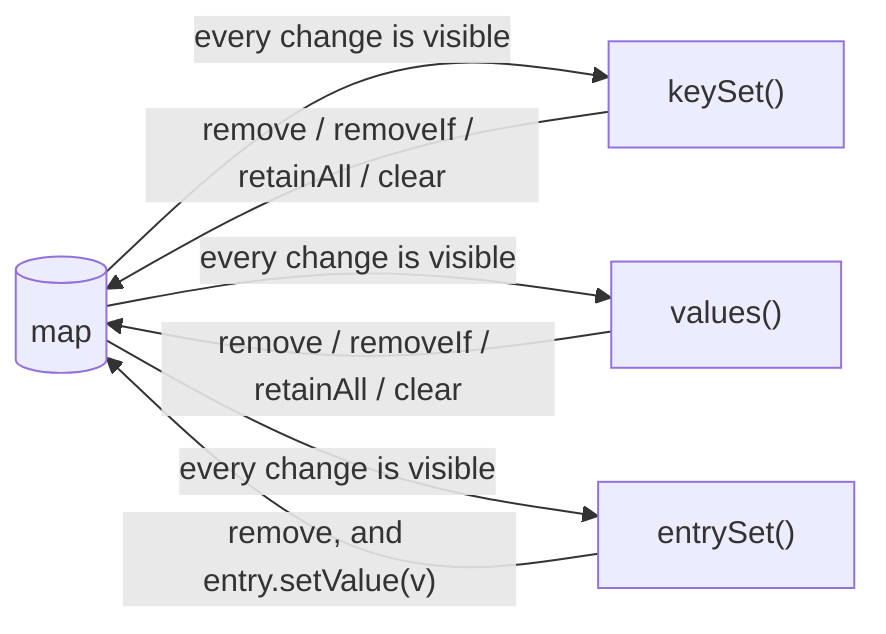
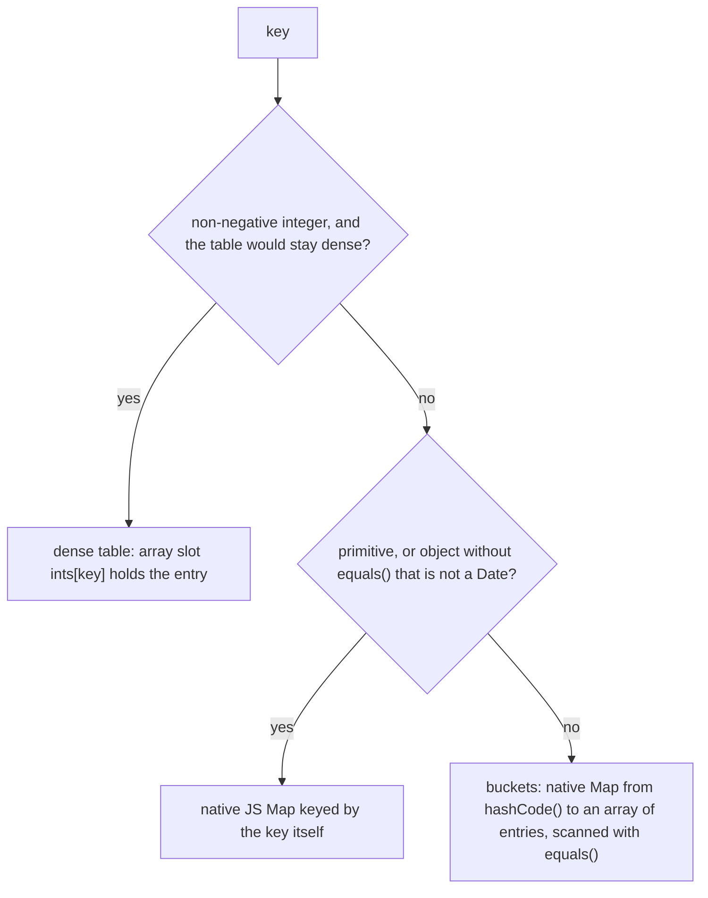
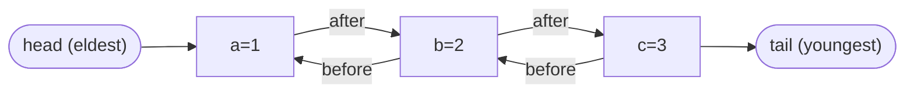
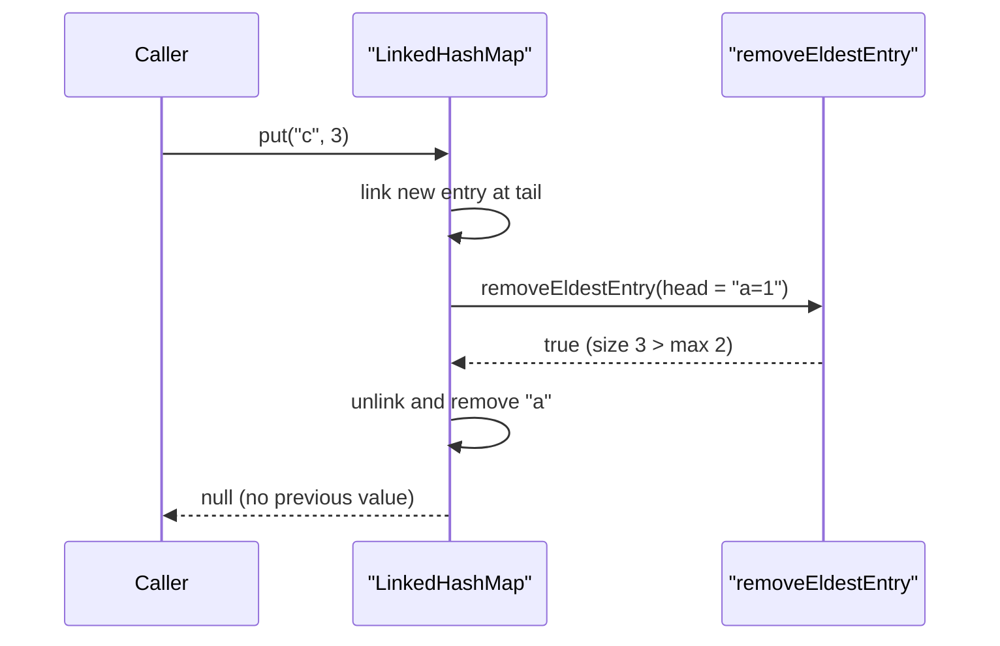

# Maps

A map associates keys with values, at most one value per key. The maps in this package look up keys by
`equals()`/`hashCode()` (or by a comparator, for `TreeMap`) instead of by reference, compare equal to any other map
with the same mappings, and expose their keys, values and entries as **live views**. They also carry the full set of
compute/merge default methods, which turn grouping, counting and caching into one-liners. Four implementations cover
the common needs: `HashMap` (fastest, no order), `LinkedHashMap` (insertion or access order, LRU caches), `TreeMap`
(sorted keys, range queries) and `IdentityHashMap` (keys compared by reference).

- [Map semantics](#map-semantics)
- [Default methods](#default-methods)
- [Live views: keySet, values, entrySet](#live-views-keyset-values-entryset)
- [HashMap](#hashmap)
- [LinkedHashMap](#linkedhashmap)
- [TreeMap](#treemap)
- [IdentityHashMap](#identityhashmap)
- [Entries](#entries)
- [JS interop](#js-interop)
- [Complexity](#complexity)
- [Recipes](#recipes)

## Map semantics

| Rule | What it means |
| --- | --- |
| **`put` returns the previous value** | `put(k, v)` returns the value it replaced, or `null` if the key was new. |
| **`get` returns `null` for a missing key** | Never `undefined`. Use `containsKey` to tell "absent" from "mapped to `null`". |
| **Keys are unique by `equals`** | Hash maps find keys by `hashCode()` then `equals()`; `TreeMap` by its comparator. |
| **Value equality** | `a.equals(b)` is `true` when `b` is any `Map` with the same key-value pairs; order is ignored. `hashCode()` is the sum over entries of `hash(key) ^ hash(value)`. |

```ts
import { HashMap, TreeMap, LinkedHashMap } from 'ts-collections-framework';

const ages = new HashMap<string, number>();
console.log(ages.put('ada', 36));  // → null
console.log(ages.put('ada', 37));  // → 36
console.log(ages.get('ada'));      // → 37
console.log(ages.get('bob'));      // → null

const sorted = new TreeMap<string, number>();
sorted.put('ada', 37);
console.log(ages.equals(sorted));                       // → true
console.log(LinkedHashMap.of(['ada', 37]).equals(ages)); // → true
```

`HashMap`, `LinkedHashMap` and `IdentityHashMap` accept `null`/`undefined` keys and values. Because `get` returns
`null` both for a missing key and for a key mapped to `null`, ask `containsKey` when the difference matters:

```ts
import { HashMap } from 'ts-collections-framework';

const m = new HashMap<string, string | null>();
m.put('nickname', null);
console.log(m.get('nickname'), m.get('missing')); // → null null
console.log(m.containsKey('nickname'));           // → true
console.log(m.containsKey('missing'));            // → false
```

## Default methods

Every map has these methods (they come from `AbstractMap`; the concrete maps override them with faster versions).
A callback returning `null` or `undefined` means "no mapping": the key is removed, or not added.

| Method | Does |
| --- | --- |
| `getOrDefault(k, d)` | value of `k`, or `d` if `k` is **absent** (a key mapped to `null` returns `null`) |
| `putIfAbsent(k, v)` | puts `v` if `k` is absent or mapped to `null`; returns the current value (or `null`) |
| `computeIfAbsent(k, f)` | if `k` is absent or `null`, stores `f(k)`; returns the (new or existing) value |
| `computeIfPresent(k, f)` | if `k` has a non-null value, replaces it with `f(k, v)`, or removes `k` if `f` returns null |
| `compute(k, f)` | stores `f(k, currentOrNull)`, or removes `k` if it returns null |
| `merge(k, v, f)` | puts `v` if `k` is absent/`null`, else stores `f(old, v)` (removes on null) |
| `replace(k, v)` | replaces only if `k` is present; returns the old value or `null` |
| `replace(k, old, new)` | replaces only if `k` is currently mapped to `old`; returns `boolean` |
| `remove(k, v)` | removes only if `k` is currently mapped to `v`; returns `boolean` |
| `replaceAll(f)` | replaces every value with `f(k, v)` |
| `forEach(f)` | calls `f(k, v)` for every mapping |

```ts
import { TreeMap } from 'ts-collections-framework';

const stock = new TreeMap<string, number>();
stock.put('apples', 3);

console.log(stock.getOrDefault('pears', 0));      // → 0
console.log(stock.putIfAbsent('apples', 10));     // → 3
console.log(stock.putIfAbsent('pears', 5));       // → null
console.log(stock.toString());                    // → {apples=3, pears=5}

console.log(stock.computeIfPresent('pears', (_k, v) => v - 1)); // → 4
console.log(stock.computeIfPresent('plums', (_k, v) => v - 1)); // → null
console.log(stock.compute('plums', (_k, v) => (v ?? 0) + 1));   // → 1
// returning null removes the key
console.log(stock.computeIfPresent('plums', () => null));       // → null
console.log(stock.containsKey('plums'));                        // → false

// absent: nothing happens
console.log(stock.replace('kiwis', 1));         // → null
console.log(stock.replace('apples', 3, 30));    // → true
console.log(stock.remove('pears', 99));         // → false
stock.replaceAll((_k, v) => v * 2);
console.log(stock.toString());                  // → {apples=60, pears=8}

const lines: string[] = [];
stock.forEach((k, v) => lines.push(`${k}: ${v}`));
console.log(lines);                             // → [ 'apples: 60', 'pears: 8' ]
```

### Grouping with computeIfAbsent

`computeIfAbsent` returns the value that is in the map afterwards, so "get the bucket, creating it if needed, then
add to it" is a single expression. (The `!` is needed because `computeIfAbsent` is typed `V | null`: a function that
returns `null` leaves the key absent. Ours never does.)

```ts
import { TreeMap, ArrayList, List } from 'ts-collections-framework';

const words = ['apple', 'avocado', 'banana', 'blueberry', 'cherry'];
const byLetter = new TreeMap<string, List<string>>();
for (const w of words) byLetter.computeIfAbsent(w[0], () => new ArrayList<string>())!.add(w);
console.log(byLetter.toString()); // → {a=[apple, avocado], b=[banana, blueberry], c=[cherry]}
```

### Counting with merge

`merge(k, 1, (a, b) => a + b)` inserts 1 for a new key and adds 1 to an existing one:

```ts
import { TreeMap } from 'ts-collections-framework';

const counts = new TreeMap<string, number>();
for (const ch of 'mississippi') counts.merge(ch, 1, (a, b) => a + b);
console.log(counts.toString()); // → {i=4, m=1, p=2, s=4}

// merge with a null-returning function removes the key: decrement-and-delete
counts.merge('m', 1, (a, b) => (a - b === 0 ? null : a - b));
console.log(counts.containsKey('m')); // → false
```

### Callbacks must not modify the map

The function you pass to `computeIfAbsent`, `computeIfPresent`, `compute` or `merge` must not add or remove keys of
the same map. If it does, the method detects the structural change and throws `ConcurrentModificationException`
rather than storing into a map whose layout changed under it (the change the callback made is not rolled back).
The same rule applies to `forEach` and `replaceAll`, and to iterating any view.

```ts
import { HashMap } from 'ts-collections-framework';

const memo = new HashMap<number, number>();
const fib = (n: number): number =>
  n < 2 ? n : memo.computeIfAbsent(n, () => fib(n - 1) + fib(n - 2))!; // recursive: modifies memo

try {
  fib(10);
} catch (e) {
  console.log((e as Error).name); // → ConcurrentModificationException
}

// compute first, then store
const memo2 = new HashMap<number, number>();
const fib2 = (n: number): number => {
  if (n < 2) return n;
  const hit = memo2.get(n);
  if (hit !== null) return hit;
  const v = fib2(n - 1) + fib2(n - 2);
  memo2.put(n, v);
  return v;
};
console.log(fib2(50)); // → 12586269025
```

## Live views: keySet, values, entrySet

`keySet()`, `values()` and `entrySet()` are not copies. They are views backed by the map: they always reflect its
current contents, and removing through them removes from the map.



- **Removal writes through:** `remove`, `removeAll`, `retainAll`, `removeIf`, `clear` and `iterator().remove()`
  on a view remove mappings from the map.
- **Adding is unsupported:** a view has no way to invent the missing half of a mapping, so `add`/`addAll` throw
  `UnsupportedOperationException`.
- **`entry.setValue(v)` writes through** for entries obtained by iterating `entrySet()`.

```ts
import { TreeMap } from 'ts-collections-framework';

const m = new TreeMap<string, number>();
m.put('a', 1);
m.put('b', 2);
m.put('c', 3);

const keys = m.keySet();
m.put('d', 4);
console.log(keys.toString()); // → [a, b, c, d]

keys.remove('a');
m.values().removeIf((v) => v % 2 === 0);
console.log(m.toString()); // → {c=3}

for (const e of m.entrySet()) e.setValue(e.getValue() * 100);
console.log(m.toString()); // → {c=300}

try {
  keys.add('z');
} catch (e) {
  console.log((e as Error).name); // → UnsupportedOperationException
}
```

Views are fail-fast like all iterators: modifying the map other than through the view's iterator while iterating
throws `ConcurrentModificationException`. To remove while iterating, use `iterator().remove()` or `removeIf`.

## HashMap

`HashMap` is the default map: `get`, `put`, `remove` and `containsKey` are O(1) on average, and iteration order is
**unspecified** (sort the keys, or use `LinkedHashMap`/`TreeMap`, when you print or compare order).

### Hybrid storage

Like `HashSet`, `HashMap` stores each key where its kind of equality is cheapest to evaluate:



- **Dense integer-key table.** Keys like `0, 1, 2, …` (ids, indexes, counters) are stored directly at that index of
  an array — no hashing at all. A key is accepted into the table only while the table stays at least about a
  quarter full; a far-away integer like `1_000_000` goes to the native map instead, so the array never becomes huge
  and sparse.
- **Native fast path.** Strings, other numbers, booleans, bigints, symbols, `null`/`undefined` and objects without
  an `equals()` method use a native `Map`, which is exactly SameValueZero equality.
- **Buckets.** Keys with `equals()`/`hashCode()` (value classes, the package's collections) and `Date`s are grouped
  by hash code and compared with `equals()`.

You never see the split: it is one map with one fail-fast iteration over all three stores.

```ts
import { HashMap, List } from 'ts-collections-framework';

const byId = new HashMap<number, string>();
for (let id = 0; id < 5; id++) byId.put(id, `user${id}`); // dense table
byId.put(1_000_000, 'far');                                // native map
console.log(byId.get(3), byId.get(1_000_000), byId.size()); // → user3 far 6

const routes = new HashMap<List<string>, string>();
routes.put(List.of('api', 'users'), 'UsersController');     // buckets
console.log(routes.get(List.of('api', 'users')));            // → UsersController
```

### Constructing

| Form | Result |
| --- | --- |
| `new HashMap<K, V>()` | empty map |
| `new HashMap<K, V>(initialCapacity, loadFactor?)` | empty map; validated sizing hints |
| `new HashMap<K, V>(map)` | copy of any `Map` |
| `HashMap.of([k1, v1], [k2, v2])` | map of the pairs |
| `HashMap.newHashMap<K, V>(n)` | empty map sized for `n` mappings (a hint; negative throws `IllegalArgumentException`) |
| `m.clone()` | shallow copy |

## LinkedHashMap

`LinkedHashMap` is a `HashMap` that also threads its entries on a doubly linked list, which gives it a predictable
iteration order and the `SequencedMap` methods.



Two orders are available:

- **Insertion order** (default): entries iterate in the order their keys were first put. Re-putting an existing
  key changes the value but keeps the position.
- **Access order** (`new LinkedHashMap(capacity, loadFactor, true)`): every `get`, `put`, `getOrDefault`,
  `putIfAbsent`, `replace`, `compute*` or `merge` that hits a key moves it to the tail. The head is then the least
  recently used entry. Note that in access order `get` is a structural change for iterators.

```ts
import { LinkedHashMap } from 'ts-collections-framework';

const insertion = new LinkedHashMap<string, number>();
insertion.put('a', 1);
insertion.put('b', 2);
insertion.put('c', 3);
insertion.put('a', 10); // existing key: value changes, position stays
insertion.get('b');
console.log(insertion.toString()); // → {a=10, b=2, c=3}

const access = new LinkedHashMap<string, number>(16, 0.75, true);
access.put('a', 1);
access.put('b', 2);
access.put('c', 3);
access.get('a'); // a becomes the most recently used
console.log(access.toString()); // → {b=2, c=3, a=1}
```

### LRU caches

An access-ordered map plus "drop the head when too big" is an LRU cache. `LinkedHashMap.lru(n)` builds exactly
that:

```ts
import { LinkedHashMap } from 'ts-collections-framework';

const cache = LinkedHashMap.lru<string, string>(2);
cache.put('a', 'A');
cache.put('b', 'B');
cache.get('a');      // a is now more recent than b
cache.put('c', 'C'); // over capacity: evicts the least recently used (b)
console.log(cache.toString()); // → {a=A, c=C}
```

For custom eviction rules (by total weight, by age, with a callback), subclass and override
`removeEldestEntry(eldest)`. It is called after every insertion with the head entry; return `true` to evict it.



```ts
import { LinkedHashMap, MapEntry } from 'ts-collections-framework';

class BoundedCache<K, V> extends LinkedHashMap<K, V> {
  readonly evicted: K[] = [];
  constructor(private readonly max: number) {
    super(16, 0.75, true); // access order
  }
  protected override removeEldestEntry(eldest: MapEntry<K, V>): boolean {
    if (this.size() <= this.max) return false;
    this.evicted.push(eldest.getKey());
    return true;
  }
}

const c = new BoundedCache<string, number>(2);
c.put('a', 1);
c.put('b', 2);
c.put('c', 3);
console.log(c.toString(), c.evicted); // → {b=2, c=3} [ 'a' ]
```

### Sequenced operations

`LinkedHashMap` is a `SequencedMap`:

| Method | Does |
| --- | --- |
| `firstEntry()` / `lastEntry()` | head / tail entry as an immutable snapshot, or `null` |
| `pollFirstEntry()` / `pollLastEntry()` | remove and return the head / tail |
| `putFirst(k, v)` / `putLast(k, v)` | put and **move** the key to the front / back |
| `reversed()` | live reverse-ordered view of the map |
| `sequencedKeySet()`, `sequencedValues()`, `sequencedEntrySet()` | views with `getFirst`, `reversed()`, … |

```ts
import { LinkedHashMap } from 'ts-collections-framework';

const m = LinkedHashMap.of<string, number>(['a', 1], ['b', 2]);
m.putFirst('b', 20);
m.putLast('c', 3);
console.log(m.toString());            // → {b=20, a=1, c=3}
console.log(m.reversed().toString()); // → {c=3, a=1, b=20}
console.log(m.firstEntry()?.toString(), m.lastEntry()?.toString()); // → b=20 c=3
console.log(m.sequencedKeySet().reversed().toString()); // → [c, a, b]
console.log(m.pollFirstEntry()?.toString()); // → b=20
console.log(m.toString());            // → {a=1, c=3}
```

`LinkedHashMap.newLinkedHashMap(n)` is the pre-sized factory, as for `HashMap`.

## TreeMap

`TreeMap` keeps its keys sorted in a red-black tree: `get`, `put`, `remove` and every navigation method are
O(log n), and iteration is always in key order. Keys are ordered naturally (numbers, strings, bigints, booleans,
`Date`s, objects with `compareTo`) or by a comparator passed to the constructor — and, as with `TreeSet`, the
comparator also decides which keys are equal. `null` keys are rejected under natural ordering.

```ts
import { TreeMap, Comparator } from 'ts-collections-framework';

const m = new TreeMap<string, number>(Comparator.reverseOrder<string>());
m.put('b', 2);
m.put('a', 1);
m.put('c', 3);
console.log(m.toString());            // → {c=3, b=2, a=1}
console.log(m.comparator() !== null); // → true
```

### Navigation

| Method | Returns (key, or `null` / immutable entry, or `null`) |
| --- | --- |
| `firstKey()` / `lastKey()` | smallest / largest key; throws `NoSuchElementException` when empty |
| `firstEntry()` / `lastEntry()` | smallest / largest entry, or `null` |
| `lowerKey(k)` / `lowerEntry(k)` | greatest key `< k` |
| `floorKey(k)` / `floorEntry(k)` | greatest key `<= k` |
| `ceilingKey(k)` / `ceilingEntry(k)` | least key `>= k` |
| `higherKey(k)` / `higherEntry(k)` | least key `> k` |
| `pollFirstEntry()` / `pollLastEntry()` | remove and return the smallest / largest entry |

Entries returned by navigation methods are **immutable snapshots**: `setValue` throws
`UnsupportedOperationException`. (Entries reached by iterating `entrySet()` are live and writable.)

```ts
import { TreeMap } from 'ts-collections-framework';

const grades = new TreeMap<number, string>();
grades.put(90, 'A');
grades.put(80, 'B');
grades.put(70, 'C');
grades.put(0, 'F');

// the grade for a score: the greatest threshold <= score
const gradeOf = (score: number) => grades.floorEntry(score)!.getValue();
console.log(gradeOf(85), gradeOf(90), gradeOf(42)); // → B A F

console.log(grades.firstKey(), grades.lastKey());         // → 0 90
console.log(grades.lowerKey(80), grades.higherKey(80));   // → 70 90
console.log(grades.ceilingKey(81), grades.ceilingKey(91)); // → 90 null

const top = grades.lastEntry()!;
try {
  top.setValue('A+');
} catch (e) {
  console.log((e as Error).name); // → UnsupportedOperationException
}
console.log(grades.pollFirstEntry()?.toString(), grades.size()); // → 0=F 3
```

### Range views

`headMap`, `tailMap` and `subMap` follow the same rules as `TreeSet`'s range views: they are live, writes go
through, putting a key outside the range throws `IllegalArgumentException`, and the defaults are `headMap(to)`
exclusive, `tailMap(from)` inclusive, `subMap(from, to)` half-open — with overloads taking explicit `inclusive`
flags. `descendingMap()` is a live reverse-ordered view; `navigableKeySet()` and `descendingKeySet()` are the key
views.

```ts
import { TreeMap } from 'ts-collections-framework';

const m = new TreeMap<number, string>();
for (const k of [10, 20, 30, 40]) m.put(k, `v${k}`);

console.log(m.headMap(30).toString());              // → {10=v10, 20=v20}
console.log(m.tailMap(20, false).toString());       // → {30=v30, 40=v40}
console.log(m.subMap(20, true, 40, true).toString()); // → {20=v20, 30=v30, 40=v40}
console.log(m.descendingMap().toString());          // → {40=v40, 30=v30, 20=v20, 10=v10}
console.log(m.descendingKeySet().toString());       // → [40, 30, 20, 10]

const low = m.headMap(30);
low.put(15, 'v15');      // inside the range: written to m
console.log(m.toString()); // → {10=v10, 15=v15, 20=v20, 30=v30, 40=v40}
try {
  low.put(35, 'v35');    // outside [.., 30)
} catch (e) {
  console.log((e as Error).name); // → IllegalArgumentException
}
low.clear();             // clears only the range
console.log(m.toString()); // → {30=v30, 40=v40}
```

`putFirst`/`putLast` throw `UnsupportedOperationException` on a `TreeMap`: key order decides position.

## IdentityHashMap

`IdentityHashMap` compares keys **and values** by reference (`===`, with `NaN` equal to itself), ignoring
`equals()`/`hashCode()`. That is the native `Map` rule, wrapped in this package's `Map` interface.

Use it when the *object* is what matters, not its value:

- tracking visited nodes in a graph walk or deep-copy, where distinct nodes may be `equals()`;
- attaching metadata to objects that are mutable or whose `equals()` is expensive;
- keys whose `hashCode()` changes over time.

```ts
import { IdentityHashMap, HashMap, ArrayList, List } from 'ts-collections-framework';

const a = ArrayList.of(1, 2);
const b = ArrayList.of(1, 2); // equal to a, but a different object

const byValue = new HashMap<List<number>, string>();
byValue.put(a, 'first');
byValue.put(b, 'second'); // replaces: a.equals(b)
console.log(byValue.size()); // → 1

const byIdentity = new IdentityHashMap<List<number>, string>();
byIdentity.put(a, 'first');
byIdentity.put(b, 'second');
console.log(byIdentity.size(), byIdentity.get(a), byIdentity.get(b)); // → 2 first second
console.log(byIdentity.get(ArrayList.of(1, 2))); // → null

a.add(3); // mutating a key is harmless here
console.log(byIdentity.get(a)); // → first
```

## Entries

A `MapEntry<K, V>` (the `Map.Entry` of the Java Collections Framework) has `getKey()`, `getValue()`, `setValue(v)`,
value `equals`/`hashCode` and `toString()` as `key=value`.

| Factory | Mutable? | Nulls |
| --- | --- | --- |
| `Map.entry(k, v)` | no (`setValue` throws `UnsupportedOperationException`) | rejected (`NullPointerException`) |
| `Map.Entry.copyOf(e)` | no; returns `e` itself if it already is such an entry | rejected |
| `new SimpleEntry(k, v)` / `new SimpleEntry(entry)` | yes | allowed |
| `new SimpleImmutableEntry(k, v)` | no | allowed |

`Map.Entry.comparingByKey()` and `Map.Entry.comparingByValue()` build comparators for sorting entries, optionally
taking a comparator for the key/value.

```ts
import { Map, SimpleEntry, SimpleImmutableEntry, HashMap, ArrayList, Comparator } from 'ts-collections-framework';

const e = new SimpleEntry('k', 1);
e.setValue(2);
console.log(e.toString(), e.equals(Map.entry('k', 2))); // → k=2 true

try {
  new SimpleImmutableEntry('k', 1).setValue(3);
} catch (err) {
  console.log((err as Error).name); // → UnsupportedOperationException
}

// top scores: sort the entries by value, descending
const scores = HashMap.of<string, number>(['ann', 12], ['bob', 30], ['cid', 21]);
const entries = new ArrayList(scores.entrySet());
entries.sort(Map.Entry.comparingByValue<string, number>(Comparator.reverseOrder<number>()));
console.log(entries.toString()); // → [bob=30, cid=21, ann=12]
```

## JS interop

Every map is iterable as `[key, value]` pairs, like a native `Map`. That makes destructuring loops, spreading, and
conversion to native structures direct:

```ts
import { LinkedHashMap } from 'ts-collections-framework';

const m = LinkedHashMap.of<string, number>(['a', 1], ['b', 2]);

const lines: string[] = [];
for (const [k, v] of m) lines.push(`${k} -> ${v}`);
console.log(lines.join(', '));             // → a -> 1, b -> 2

console.log([...m]);                       // → [ [ 'a', 1 ], [ 'b', 2 ] ]
console.log(new globalThis.Map(m));        // → Map(2) { 'a' => 1, 'b' => 2 }
console.log(Object.fromEntries(m));        // → { a: 1, b: 2 }

// and back: from a native Map or an object
const fromNative = new LinkedHashMap<string, number>();
for (const [k, v] of new globalThis.Map([['x', 9]])) fromNative.put(k, v);
for (const [k, v] of Object.entries({ y: 8 })) fromNative.put(k, v);
console.log(fromNative.toString());        // → {x=9, y=8}
```

Importing `Map` from the package shadows the native `Map` in that module, which is why the example writes
`globalThis.Map`.

## Complexity

n is the number of mappings, r the number of mappings in a range view.

| Operation | `HashMap` | `LinkedHashMap` | `TreeMap` | `IdentityHashMap` |
| --- | --- | --- | --- | --- |
| `get`, `put`, `remove`, `containsKey` | O(1) avg | O(1) avg | O(log n) | O(1) avg |
| `containsValue` | O(n) | O(n) | O(n) | O(n) |
| `size`, `isEmpty` | O(1) | O(1) | O(1) (range view: O(r)) | O(1) |
| iteration | O(n) | O(n) | O(n) | O(n) |
| first/last entry, `pollFirstEntry`/`pollLastEntry` | — | O(1) | O(log n) | — |
| `putFirst`/`putLast` | — | O(1) | unsupported | — |
| `floorKey` & co., `firstKey`/`lastKey` | — | — | O(log n) | — |
| `headMap`/`tailMap`/`subMap`/`descendingMap` (create) | — | — | O(1) | — |
| iteration order | unspecified | insertion or access | sorted by key | unspecified |

See [performance](../advanced/performance.md) for measurements and [choosing a collection](../guide/choosing-a-collection.md)
for picking one.

## Recipes

### Word frequency

```ts
import { HashMap, ArrayList, Map } from 'ts-collections-framework';

const text = 'the quick fox jumps over the lazy dog the end';
const freq = new HashMap<string, number>();
for (const w of text.split(' ')) freq.merge(w, 1, (a, b) => a + b);

const top = new ArrayList(freq.entrySet());
top.sort(Map.Entry.comparingByValue<string, number>((a, b) => b - a));
console.log(top.get(0).toString()); // → the=3
console.log(freq.get('fox'));       // → 1
```

Streams can do the same in one expression with `Collectors.groupingBy` and `Collectors.counting` — see
[Collectors](../streams/collectors.md).

### Group by

```ts
import { TreeMap, ArrayList, List } from 'ts-collections-framework';

interface Order { customer: string; total: number }
const orders: Order[] = [
  { customer: 'ann', total: 10 },
  { customer: 'bob', total: 5 },
  { customer: 'ann', total: 7 },
];

const byCustomer = new TreeMap<string, List<number>>();
for (const o of orders) byCustomer.computeIfAbsent(o.customer, () => new ArrayList<number>())!.add(o.total);
console.log(byCustomer.toString()); // → {ann=[10, 7], bob=[5]}
```

### Inverted index

Map each word to the sorted set of documents containing it:

```ts
import { TreeMap, TreeSet } from 'ts-collections-framework';

const docs = ['red fish blue fish', 'one fish', 'red car'];
const index = new TreeMap<string, TreeSet<number>>();
docs.forEach((text, id) => {
  for (const word of text.split(' ')) index.computeIfAbsent(word, () => new TreeSet<number>())!.add(id);
});
console.log(index.get('fish')?.toString()); // → [0, 1]
console.log(index.get('red')?.toString());  // → [0, 2]

// documents containing both words: intersect the postings
const both = new TreeSet<number>(index.get('red')!);
both.retainAll(index.get('fish')!);
console.log(both.toString()); // → [0]
```

### Range queries and time series

A `TreeMap` keyed by timestamp (or by ISO date strings, which sort chronologically) answers "what happened between
A and B" and "what was the latest value at time T" in O(log n):

```ts
import { TreeMap } from 'ts-collections-framework';

const price = new TreeMap<string, number>();
price.put('2024-01-01', 100);
price.put('2024-01-05', 104);
price.put('2024-01-09', 98);
price.put('2024-01-15', 110);

// value as of a date: the latest entry at or before it
console.log(price.floorEntry('2024-01-07')?.getValue()); // → 104

// everything in the first ten days of January, both ends inclusive
const early = price.subMap('2024-01-01', true, '2024-01-10', true);
console.log(early.toString()); // → {2024-01-01=100, 2024-01-05=104, 2024-01-09=98}

// drop history older than a cutoff (the view writes through)
price.headMap('2024-01-09').clear();
console.log(price.toString()); // → {2024-01-09=98, 2024-01-15=110}
```

### LRU cache

```ts
import { LinkedHashMap } from 'ts-collections-framework';

const cache = LinkedHashMap.lru<string, number>(3);
const load = (key: string): number => cache.computeIfAbsent(key, (k) => k.length)!; // k.length stands in for slow work

['alpha', 'be', 'gamma', 'alpha', 'delta'].forEach(load);
// 'be' was the least recently used when 'delta' arrived
console.log(cache.keySet().toString()); // → [gamma, alpha, delta]
```
