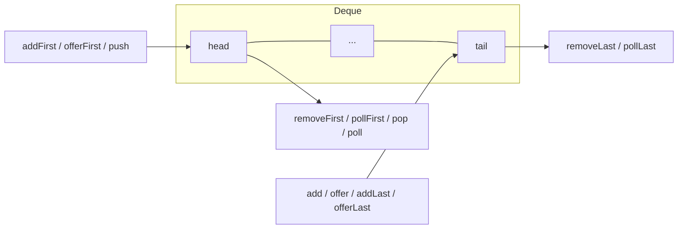
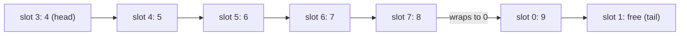
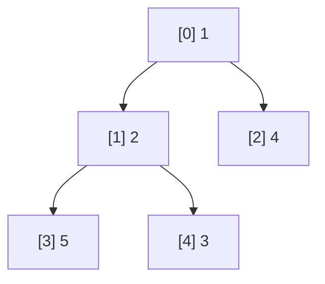

# Queues and deques

A `Queue<E>` holds elements waiting to be processed and hands them out from its *head*; a `Deque<E>` ("deck", double-ended queue) lets you add and remove at both ends, so it serves as a FIFO queue and as a LIFO stack. This page explains the two interfaces and their paired throw/return-null methods, then the implementations: `ArrayDeque` (a ring buffer, the default for queues and stacks), `PriorityQueue` (a binary heap that always hands out the smallest element), `LinkedList` used as a queue, and the `Collections.asLifoQueue` adapter. It ends with recipes: BFS, sliding-window maximum, a task scheduler, and k-way merge.

**Contents**

- [The Queue interface](#the-queue-interface)
- [The Deque interface](#the-deque-interface)
  - [Using a deque as a stack](#using-a-deque-as-a-stack)
  - [Reverse order: descendingIterator and reversed](#reverse-order-descendingiterator-and-reversed)
- [ArrayDeque](#arraydeque)
- [PriorityQueue](#priorityqueue)
- [LinkedList as a queue](#linkedlist-as-a-queue)
- [Collections.asLifoQueue](#collectionsaslifoqueue)
- [Recipes](#recipes)
- [Choosing a queue](#choosing-a-queue)

---

## The Queue interface

`Queue<E>` extends `Collection<E>` with three operations — insert at the tail, remove from the head, look at the head — each in two flavours. One flavour throws when it cannot do its job; the other reports failure through its return value.

| Operation | Throws on failure | Returns a special value |
| --- | --- | --- |
| insert at tail | `add(e)` | `offer(e)` → `false` if rejected |
| remove head | `remove()` → `NoSuchElementException` if empty | `poll()` → `null` if empty |
| examine head | `element()` → `NoSuchElementException` if empty | `peek()` → `null` if empty |

Use `poll`/`peek` in loops where "empty" is a normal condition, and `remove`/`element` where an empty queue would be a bug you want to hear about.

```ts
import { ArrayDeque, Queue } from 'ts-collections-framework';

const q: Queue<string> = new ArrayDeque<string>();
q.offer('first');
q.add('second');
console.log(q.peek());             // → first
console.log(q.poll());             // → first
console.log(q.remove());           // → second

console.log(q.poll());             // → null
console.log(q.peek());             // → null
try {
  q.remove();
} catch (e) {
  console.log((e as Error).name);  // → NoSuchElementException
}
try {
  q.element();
} catch (e) {
  console.log((e as Error).name);  // → NoSuchElementException
}
```

Because `null` means "empty", queues that accept `null` elements (only `LinkedList` here) make `poll()` ambiguous. `ArrayDeque` and `PriorityQueue` reject `null` and `undefined` for exactly this reason.

`remove(o)` with an argument is the ordinary `Collection.remove`: it removes one element equal to `o` (by `equals()`) and returns a boolean.

## The Deque interface

`Deque<E>` extends `Queue<E>` and `SequencedCollection<E>`. Each end has the same throw / return-value pairs:

| | First element (head) — throws | head — special value | Last element (tail) — throws | tail — special value |
| --- | --- | --- | --- | --- |
| insert | `addFirst(e)` | `offerFirst(e)` | `addLast(e)` | `offerLast(e)` |
| remove | `removeFirst()` | `pollFirst()` | `removeLast()` | `pollLast()` |
| examine | `getFirst()` | `peekFirst()` | `getLast()` | `peekLast()` |

The `Queue` methods map onto these: `add`/`offer` = `addLast`/`offerLast`; `remove`/`poll` = `removeFirst`/`pollFirst`; `element`/`peek` = `getFirst`/`peekFirst`. So a deque used through `Queue` is FIFO.



```ts
import { ArrayDeque } from 'ts-collections-framework';

const d = new ArrayDeque<number>();
d.offerLast(2);
d.offerLast(3);
d.offerFirst(1);
console.log(d.toString());         // → [1, 2, 3]
console.log(d.peekFirst(), d.peekLast()); // → 1 3
console.log(d.pollLast());         // → 3
console.log(d.pollFirst());        // → 1
console.log(d.toString());         // → [2]
```

`removeFirstOccurrence(o)` and `removeLastOccurrence(o)` remove one matching element, scanning from the head or from the tail.

### Using a deque as a stack

`push(e)` is `addFirst(e)`, `pop()` is `removeFirst()`, and `peek()` looks at the head — so the head of the deque is the top of the stack, and iteration and `toString()` go top-first.

```ts
import { ArrayDeque } from 'ts-collections-framework';

const stack = new ArrayDeque<string>();
stack.push('a');
stack.push('b');
stack.push('c');
console.log(stack.toString());     // → [c, b, a]
console.log(stack.pop());          // → c
console.log(stack.peek());         // → b
console.log(stack.size());         // → 2
```

This is the recommended stack for new code, rather than the legacy [`Stack`](./lists.md#stack) class.

### Reverse order: descendingIterator and reversed

`descendingIterator()` walks from tail to head. `reversed()` returns a live, reverse-ordered `Deque` view: its first element is the original's last, and writes go through to the original.

```ts
import { ArrayDeque } from 'ts-collections-framework';

const d = ArrayDeque.of(1, 2, 3);

const it = d.descendingIterator();
const back: number[] = [];
while (it.hasNext()) back.push(it.next());
console.log(back);                 // → [ 3, 2, 1 ]

const rev = d.reversed();
console.log(rev.toString());       // → [3, 2, 1]
rev.addFirst(4);                   // = d.addLast(4)
rev.push(5);                       // = d.addLast(5)
console.log(d.toString());         // → [1, 2, 3, 4, 5]
console.log(rev.peek());           // → 5
```

---

## ArrayDeque

`ArrayDeque<E>` is a resizable circular array (ring buffer). It is the best general-purpose `Queue`, `Deque` and stack: every end operation is O(1), there is no per-element node allocation, and elements sit in one array.

### How the ring buffer works

The backing array's length is always a power of two (minimum 8, default 16). Two indexes describe the contents: `head` is the slot of the first element, `tail` is the next free slot after the last element. Adding at the tail writes at `tail` and advances it; adding at the head moves `head` back one slot. Both wrap around the end of the array with a bitmask (`(i + 1) & (length - 1)`), which is why the length must be a power of two. `head === tail` means empty, so one slot is always left free; when an insert fills it, the array doubles.

Here is an 8-slot deque (`new ArrayDeque(7)`) through a sequence of operations (`·` is a free slot):

| After | slot 0 | 1 | 2 | 3 | 4 | 5 | 6 | 7 | head | tail | contents |
| --- | --- | --- | --- | --- | --- | --- | --- | --- | --- | --- | --- |
| `addLast` 1..6 | 1 | 2 | 3 | 4 | 5 | 6 | · | · | 0 | 6 | [1, 2, 3, 4, 5, 6] |
| `pollFirst` ×3 | · | · | · | 4 | 5 | 6 | · | · | 3 | 6 | [4, 5, 6] |
| `addLast` 7, 8, 9 | **9** | · | · | 4 | 5 | 6 | 7 | 8 | 3 | 1 | [4, 5, 6, 7, 8, 9] — tail wrapped |
| `addFirst` 0 | 9 | · | **0** | 4 | 5 | 6 | 7 | 8 | 2 | 1 | [0, 4, 5, 6, 7, 8, 9] |
| `addLast` 10 | full → grow to 16 slots | | | | | | | | 2 | 10 | [0, 4, 5, 6, 7, 8, 9, 10] |



On growth the array doubles and the shorter of the two wrapped segments is moved into the new half, so elements never need re-sorting and the copy is amortized O(1) per insert. The deque never shrinks; `clear()` empties it but keeps the capacity. `new ArrayDeque(n)` sizes the array for `n` elements up front (rounded up to a power of two) — useful when you know the peak size.

### No nulls

`ArrayDeque` rejects `null` and `undefined` with `NullPointerException`, so `poll()` returning `null` always means "empty".

```ts
import { ArrayDeque } from 'ts-collections-framework';

const d = new ArrayDeque<string | null>();
try {
  d.add(null);
} catch (e) {
  console.log((e as Error).name);  // → NullPointerException
}
```

### Creating one

```ts
import { ArrayDeque, ArrayList } from 'ts-collections-framework';

const a = new ArrayDeque<number>();            // 16 slots
const b = new ArrayDeque<number>(1000);        // room for 1000 without growing
const c = ArrayDeque.of(1, 2, 3);
const d = new ArrayDeque(ArrayList.of('x', 'y')); // copy of any collection
const e = c.clone();                           // independent shallow copy
e.addLast(4);
console.log(a.size(), b.size());               // → 0 0
console.log(c.toString(), d.toString(), e.toString()); // → [1, 2, 3] [x, y] [1, 2, 3, 4]
```

Iterators over an `ArrayDeque` are fail-fast: changing the deque during iteration (other than through the iterator's own `remove()`) throws `ConcurrentModificationException`.

### ArrayDeque complexity

| Operation | Cost | Notes |
| --- | --- | --- |
| `addFirst`, `addLast`, `offer*`, `push`, `add` | O(1) amortized | growth doubles the array |
| `pollFirst`, `pollLast`, `removeFirst`, `removeLast`, `poll`, `pop` | O(1) | |
| `peek*`, `getFirst`, `getLast`, `element` | O(1) | |
| `size`, `isEmpty` | O(1) | computed from head and tail |
| `contains`, `remove(o)`, `removeFirstOccurrence`, `removeLastOccurrence` | O(n) | |
| `removeIf`, `removeAll`, `retainAll` | O(n) | single pass |
| `reversed()`, `descendingIterator()` | O(1) | views |
| indexed access | — | not offered; use `ArrayList` |

---

## PriorityQueue

`PriorityQueue<E>` is an unbounded queue whose head is always the **least** element, according to natural ordering or a `Comparator` you supply. It is a binary min-heap stored in an array.

### How the heap is stored

A binary heap is a complete binary tree where every parent is ≤ its children. It is stored level by level in an array: the children of index `i` are at `2i + 1` and `2i + 2`, and the parent of `i` is at `(i - 1) >> 1`. `PriorityQueue.of(5, 1, 4, 2, 3)` builds this heap:



| array index | 0 | 1 | 2 | 3 | 4 |
| --- | --- | --- | --- | --- | --- |
| element | 1 | 2 | 4 | 5 | 3 |

`offer` appends at the end and *sifts up* (swaps with the parent while smaller): O(log n). `poll` takes index 0, moves the last element to the root and *sifts down*: O(log n). `peek` just reads index 0: O(1).

### Iteration order is NOT sorted

The heap only guarantees that the root is the minimum. Iteration, `toString()`, `toArray()` and streams all walk the **array**, which is in heap order, not sorted order. To get elements in priority order, `poll()` them out:

```ts
import { PriorityQueue } from 'ts-collections-framework';

const pq = PriorityQueue.of(5, 1, 4, 2, 3);
console.log(pq.toString());        // → [1, 2, 4, 5, 3]
console.log([...pq]);              // → [ 1, 2, 4, 5, 3 ]
console.log(pq.peek());            // → 1

const drained: number[] = [];
let x: number | null;
while ((x = pq.poll()) !== null) drained.push(x);
console.log(drained);              // → [ 1, 2, 3, 4, 5 ]
```

If you need a sorted *view* rather than a drain, copy and sort (`const l = new ArrayList(pq); l.sort(null)`) or keep the data in a [`TreeSet`](./sets.md) / [`TreeMap`](./maps.md) instead.

### Natural ordering vs a comparator

With no comparator, elements are compared by natural ordering: numbers numerically, strings by code unit, and objects through their `compareTo()` method. Objects with no natural ordering throw `ClassCastException` when added. Pass a comparator for anything else — max-heaps, objects, multi-key priorities.

```ts
import { PriorityQueue, Comparator } from 'ts-collections-framework';

// max-heap
const max = new PriorityQueue<number>(Comparator.reverseOrder<number>());
[3, 9, 1].forEach((n) => max.offer(n));
console.log(max.poll());           // → 9

// objects by a key
interface Job { name: string; priority: number }
const jobs = new PriorityQueue<Job>(Comparator.comparing((j: Job) => j.priority));
jobs.add({ name: 'deploy', priority: 2 });
jobs.add({ name: 'hotfix', priority: 1 });
console.log(jobs.poll()?.name);    // → hotfix

// no comparator and no natural ordering
const bad = new PriorityQueue<object>();
try {
  bad.add({});
} catch (e) {
  console.log((e as Error).name);  // → ClassCastException
}
```

`comparator()` returns the comparator in use, or `null` for natural ordering. Like `ArrayDeque`, a `PriorityQueue` rejects `null` and `undefined`. Ties are broken arbitrarily — a `PriorityQueue` is **not stable**; add a sequence number to the comparator if insertion order among equals matters (see the [task scheduler recipe](#task-scheduler-with-priorityqueue)).

### Heapify: building from a collection

`new PriorityQueue(collection)` copies the elements and builds the heap bottom-up in O(n), which is cheaper than n separate `offer` calls (O(n log n)). If the source is a `PriorityQueue` or a sorted collection such as a `TreeSet`, its comparator is inherited.

```ts
import { PriorityQueue, ArrayList, TreeSet, Comparator } from 'ts-collections-framework';

const pq = new PriorityQueue(ArrayList.of(5, 1, 4));
console.log(pq.peek());                        // → 1

const desc = new TreeSet<number>(Comparator.reverseOrder<number>());
desc.addAll(ArrayList.of(1, 2, 3));
const fromTree = new PriorityQueue(desc);      // keeps the reverse ordering
console.log(fromTree.poll());                  // → 3
```

### PriorityQueue complexity

| Operation | Cost | Notes |
| --- | --- | --- |
| `offer`, `add` | O(log n) | sift up |
| `poll`, `remove()` | O(log n) | sift down |
| `peek`, `element` | O(1) | |
| `size`, `isEmpty` | O(1) | |
| `remove(o)`, `contains(o)` | O(n) | linear search, then O(log n) repair |
| `new PriorityQueue(collection)`, `PriorityQueue.of(...)` | O(n) | heapify |
| `removeIf`, `removeAll`, `retainAll` | O(n) | filter, then re-heapify |
| iterate all | O(n) | heap order, not sorted |
| drain all with `poll` | O(n log n) | sorted order |

---

## LinkedList as a queue

[`LinkedList`](./lists.md#linkedlist) implements `Deque`, so everything above works on it with O(1) end operations. Reasons to pick it over `ArrayDeque`:

- you also need the `List` API (indexed access, `ListIterator`, `subList`) on the same object;
- you must store `null` elements (then check `isEmpty()` before `poll()`, since `null` is ambiguous).

Otherwise `ArrayDeque` is lighter: no node object per element.

```ts
import { LinkedList, Queue } from 'ts-collections-framework';

const q: Queue<string> = new LinkedList<string>();
q.offer('a');
q.offer('b');
console.log(q.poll());             // → a
console.log(q.peek());             // → b

const withNull = new LinkedList<string | null>();
withNull.add(null);
console.log(withNull.poll());      // → null
console.log(withNull.isEmpty());   // → true
```

---

## Collections.asLifoQueue

Some APIs take a `Queue` and simply call `add`/`poll`. `Collections.asLifoQueue(deque)` returns a `Queue` view of a deque whose `add`/`offer` push onto the **front**, so those APIs process items last-in-first-out — turning a breadth-first algorithm into a depth-first one without changing it.

```ts
import { ArrayDeque, Collections } from 'ts-collections-framework';

const backing = new ArrayDeque<number>();
const lifo = Collections.asLifoQueue(backing);
lifo.add(1);
lifo.add(2);
lifo.add(3);
console.log(lifo.toString());      // → [3, 2, 1]
console.log(lifo.poll());          // → 3
console.log(backing.toString());   // → [2, 1]
```

The view is live, and its `equals`/`hashCode` are by identity. More adapters are described on [the Collections utilities page](../utilities/collections.md).

---

## Recipes

### Breadth-first search with ArrayDeque

The deque holds the frontier. `poll()` returning `null` ends the loop.

```ts
import { ArrayDeque, HashMap, HashSet, ArrayList, List } from 'ts-collections-framework';

const graph = new HashMap<string, List<string>>();
graph.put('a', ArrayList.of('b', 'c'));
graph.put('b', ArrayList.of('d'));
graph.put('c', ArrayList.of('d', 'e'));
graph.put('d', ArrayList.of('f'));

function bfs(start: string): string[] {
  const order: string[] = [];
  const seen = new HashSet<string>();
  const frontier = new ArrayDeque<string>();
  frontier.offer(start);
  seen.add(start);
  let node: string | null;
  while ((node = frontier.poll()) !== null) {
    order.push(node);
    for (const next of graph.getOrDefault(node, ArrayList.of<string>())) {
      if (seen.add(next)) frontier.offer(next);   // add() is false if already seen
    }
  }
  return order;
}

console.log(bfs('a'));             // → [ 'a', 'b', 'c', 'd', 'e', 'f' ]
```

Swap `offer`/`poll` for `push`/`pop` (or wrap the deque in `Collections.asLifoQueue`) and the same loop becomes a depth-first search.

### Sliding-window maximum with a deque

Keep a deque of *indexes* whose values are decreasing. The front is the maximum of the current window; drop it when it slides out, and drop smaller values from the back when a bigger one arrives. Each index enters and leaves once, so the whole pass is O(n).

```ts
import { ArrayDeque } from 'ts-collections-framework';

function windowMax(values: number[], k: number): number[] {
  const idx = new ArrayDeque<number>();
  const out: number[] = [];
  values.forEach((v, i) => {
    if (!idx.isEmpty() && idx.peekFirst()! <= i - k) idx.pollFirst();        // left the window
    while (!idx.isEmpty() && values[idx.peekLast()!] <= v) idx.pollLast();   // dominated
    idx.offerLast(i);
    if (i >= k - 1) out.push(values[idx.peekFirst()!]);
  });
  return out;
}

console.log(windowMax([1, 3, -1, -3, 5, 3, 6, 7], 3)); // → [ 3, 3, 5, 5, 6, 7 ]
```

### Task scheduler with PriorityQueue

Order tasks by due time, then priority, then insertion sequence. The sequence number makes the order fully deterministic, because the heap alone is not stable.

```ts
import { PriorityQueue, Comparator } from 'ts-collections-framework';

interface Task { name: string; due: number; priority: number; seq: number }

const schedule = new PriorityQueue<Task>(
  Comparator.thenComparing(
    Comparator.comparing((t: Task) => t.due),
    Comparator.comparing((t: Task) => t.priority),
    Comparator.comparing((t: Task) => t.seq),
  ),
);

let seq = 0;
const submit = (name: string, due: number, priority: number) =>
  schedule.offer({ name, due, priority, seq: seq++ });

submit('backup', 30, 2);
submit('email', 10, 1);
submit('report', 10, 0);
submit('cleanup', 10, 1);

const ran: string[] = [];
let t: Task | null;
while ((t = schedule.poll()) !== null) ran.push(`${t.due}:${t.name}`);
console.log(ran); // → [ '10:report', '10:email', '10:cleanup', '30:backup' ]
```

### Top-k largest with a bounded min-heap

Keep a min-heap of at most `k` elements; whenever it grows past `k`, evict the smallest. What remains are the `k` largest, found in O(n log k) time and O(k) memory — far better than sorting everything when `k` is small.

```ts
import { PriorityQueue, ArrayList } from 'ts-collections-framework';

function topK(values: Iterable<number>, k: number): number[] {
  const heap = new PriorityQueue<number>();
  for (const v of values) {
    heap.offer(v);
    if (heap.size() > k) heap.poll();     // drop the smallest
  }
  const result = new ArrayList(heap);
  result.sort(null);
  return result.reversed().toArray();     // largest first
}

console.log(topK([5, 1, 9, 3, 7, 8, 2], 3)); // → [ 9, 8, 7 ]
```

For the k smallest, use a max-heap (`Comparator.reverseOrder()`) the same way.

### k-way merge of sorted lists

Put the head of each sorted input in a priority queue, together with where it came from. Repeatedly take the smallest, then push the next element from the same input. Merging `k` lists with `n` total elements costs O(n log k).

```ts
import { PriorityQueue, Comparator, ArrayList, Iterator, List } from 'ts-collections-framework';

function merge(lists: List<number>[]): List<number> {
  type Head = { value: number; rest: Iterator<number> };
  const heads = new PriorityQueue<Head>(Comparator.comparing((h: Head) => h.value));
  for (const l of lists) {
    const it = l.iterator();
    if (it.hasNext()) heads.offer({ value: it.next(), rest: it });
  }
  const out = new ArrayList<number>();
  let h: Head | null;
  while ((h = heads.poll()) !== null) {
    out.add(h.value);
    if (h.rest.hasNext()) heads.offer({ value: h.rest.next(), rest: h.rest });
  }
  return out;
}

const merged = merge([ArrayList.of(1, 4, 7), ArrayList.of(2, 5, 8), ArrayList.of(0, 3, 6, 9)]);
console.log(merged.toString()); // → [0, 1, 2, 3, 4, 5, 6, 7, 8, 9]
```

---

## Choosing a queue

| Need | Use | Why |
| --- | --- | --- |
| FIFO queue | `ArrayDeque` | O(1) ends, one array, no nulls so `poll()` is unambiguous |
| Stack | `ArrayDeque` (`push`/`pop`) | lighter and cleaner than legacy `Stack` |
| Both ends | `ArrayDeque` | |
| Always take the smallest / highest-priority item | `PriorityQueue` | O(log n) insert and remove-min |
| Queue that must also be a `List`, or hold `null` | `LinkedList` | implements `List` and `Deque` |
| Pass a stack to code that expects a `Queue` | `Collections.asLifoQueue(deque)` | |
| Sorted iteration, not just sorted removal | `TreeSet` / `TreeMap` ([sets](./sets.md), [maps](./maps.md)) | a heap iterates in heap order |

For timings across implementations see [performance](../advanced/performance.md), and for the full decision guide see [choosing a collection](../guide/choosing-a-collection.md).
