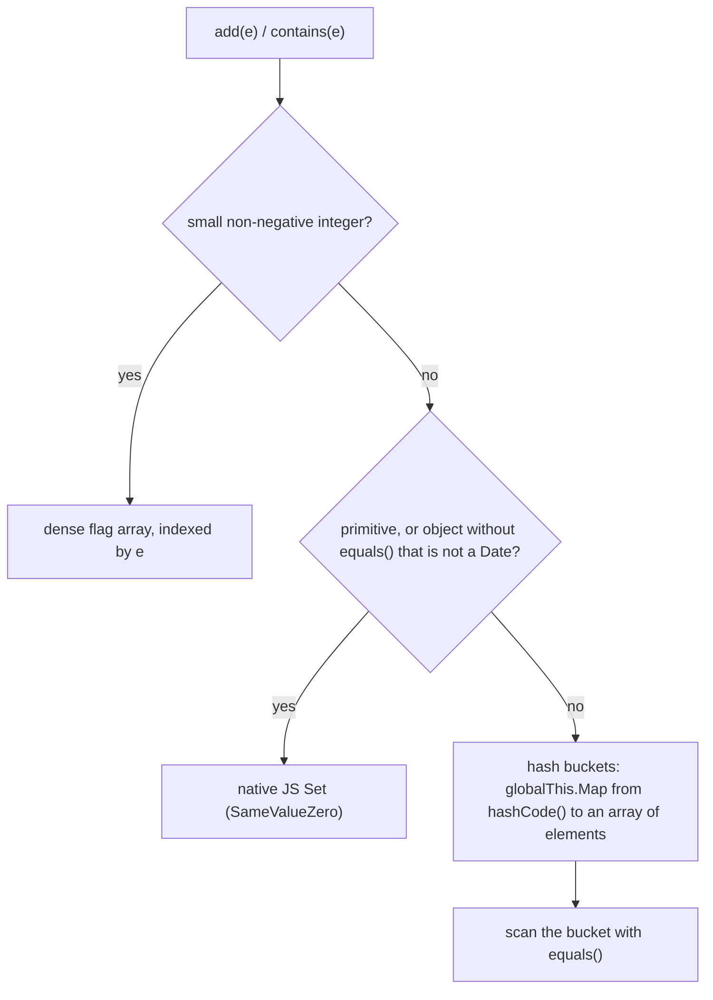
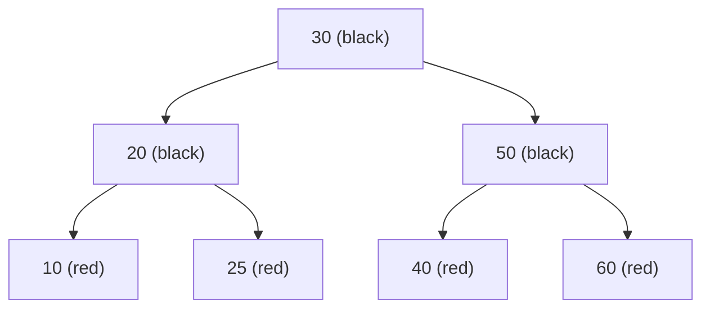
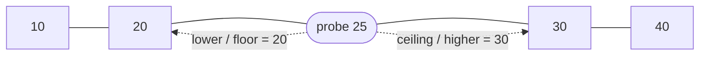

# Sets

A set is a collection without duplicates. Unlike the native JS `Set`, which compares elements by reference
(SameValueZero), the sets in this package decide "is this a duplicate?" with `equals()`/`hashCode()` — so two
distinct `Point(1, 2)` objects count as one element, and a set compares equal to any other set with the same
elements, whatever its implementation. Three implementations cover the common needs: `HashSet` (fastest, no order),
`LinkedHashSet` (insertion order, sequenced operations) and `TreeSet` (sorted, with range queries and navigation).

- [Set semantics](#set-semantics)
- [HashSet](#hashset)
- [LinkedHashSet](#linkedhashset)
- [TreeSet](#treeset)
- [Set algebra recipes](#set-algebra-recipes)
- [Pre-sized factories](#pre-sized-factories)
- [Complexity](#complexity)
- [Pitfalls](#pitfalls)

## Set semantics

Three rules hold for every set in the package (and for every set you build on `AbstractSet`):

| Rule | What it means |
| --- | --- |
| **Uniqueness by `equals`** | `add(e)` returns `false` and changes nothing when an element `equals(e)` is already present. Hash sets find candidates by `hashCode()` first, tree sets by the comparator. |
| **Value equality** | `a.equals(b)` is `true` when `b` is any `Set` of the same size and `a` contains every element of `b` — a `HashSet` equals a `TreeSet` with the same elements. Order never matters. (With a comparator that disagrees with `equals`, such as a case-insensitive `TreeSet`, the result can depend on which side you ask.) |
| **`hashCode` = sum** | A set's `hashCode()` is the sum of its elements' hash codes, so equal sets have equal hashes whatever their implementation or order. |

See [core concepts](../guide/core-concepts.md) for how `equals()`/`hashCode()` work for primitives, plain objects
and your own classes.

```ts
import { HashSet, TreeSet, LinkedHashSet, Objects } from '@nodestd/collections';

class Point {
  constructor(readonly x: number, readonly y: number) {}
  equals(o: unknown): boolean {
    return o instanceof Point && o.x === this.x && o.y === this.y;
  }
  hashCode(): number {
    return Objects.hash(this.x, this.y);
  }
  toString(): string {
    return `(${this.x}, ${this.y})`;
  }
}

const points = new HashSet<Point>();
console.log(points.add(new Point(1, 2))); // → true
// an equal element is already there
console.log(points.add(new Point(1, 2))); // → false
console.log(points.size());               // → 1
console.log(points.contains(new Point(1, 2))); // → true

// value equality across implementations, order ignored
const hashed = HashSet.of(3, 1, 2);
const sorted = TreeSet.of(1, 2, 3);
const linked = LinkedHashSet.of(2, 3, 1);
console.log(hashed.equals(sorted), sorted.equals(linked)); // → true true
console.log(hashed.hashCode() === linked.hashCode());      // → true
// 1 + 2 + 3
console.log(TreeSet.of(1, 2, 3).hashCode());               // → 6
```

All sets also have the full `Collection` API (`addAll`, `removeIf`, `stream()`, `toArray()`, `for...of`, …) and
fail-fast iterators: changing a set while iterating it — other than through the iterator's own `remove()` — throws
`ConcurrentModificationException`.

```ts
import { HashSet } from '@nodestd/collections';

const s = HashSet.of(1, 2, 3, 4);
try {
  for (const x of s) s.remove(x); // structural change behind the iterator's back
} catch (e) {
  console.log((e as Error).name); // → ConcurrentModificationException
}

// the safe ways
const t = HashSet.of(1, 2, 3, 4);
t.removeIf((x) => x % 2 === 0);
const it = t.iterator();
while (it.hasNext()) if (it.next() === 3) it.remove();
console.log(t.toString()); // → [1]
```

## HashSet

`HashSet` is the default choice: `add`, `remove` and `contains` are O(1) on average and iteration order is
**unspecified** (do not rely on it, sort or use `LinkedHashSet`/`TreeSet` when order matters). `null` and
`undefined` are allowed as elements.

### Hybrid storage

A naive hash set would call `hashCode()` on every element, which is slow for the most common case — strings and
numbers — whose equality is already what the native JS `Set` implements. So `HashSet` routes each element to one of
three stores, by what kind of equality it needs:



- **Dense flag array** — non-negative integers go into an array indexed by the value itself, as long as the array
  stays reasonably full. An integer that would make it sparse goes to the native `Set` instead.
- **Native fast path** — strings, numbers, booleans, bigints, symbols, `null`/`undefined`, and objects *without* an
  `equals()` method. Such objects are compared by identity, exactly as in a native `Set`.
- **Buckets** — objects with `equals()`/`hashCode()` (your own value classes, and the package's own collections) and
  `Date`s (equal when `getTime()` is equal). Elements with the same hash code share a bucket and are told apart with
  `equals()`.

The split is invisible: the set behaves as one hash set. It just means primitive-heavy sets run at native speed.

```ts
import { HashSet, List } from '@nodestd/collections';

const plain = new HashSet<object>();
plain.add({ id: 1 });
// no equals(): identity, like a native Set
console.log(plain.contains({ id: 1 })); // → false

const dates = new HashSet<Date>();
dates.add(new Date(0));
// Dates compare by time
console.log(dates.contains(new Date(0))); // → true

const lists = new HashSet<List<number>>();
lists.add(List.of(1, 2));
// collections have value equality
console.log(lists.contains(List.of(1, 2))); // → true
```

### Constructing

| Form | Result |
| --- | --- |
| `new HashSet<E>()` | empty set |
| `new HashSet<E>(initialCapacity, loadFactor?)` | empty set; the arguments are validated sizing hints (negative capacity or non-positive load factor throws `IllegalArgumentException`) |
| `new HashSet<E>(collection)` | copy of any collection, duplicates dropped |
| `HashSet.of(a, b, c)` | set of the arguments |
| `HashSet.newHashSet<E>(n)` | empty set sized for `n` elements |
| `s.clone()` | shallow copy |

## LinkedHashSet

`LinkedHashSet` is a `HashSet` (it passes `instanceof HashSet`) that remembers **insertion order**. It is a
`SequencedSet`, so it adds `getFirst`/`getLast`, `removeFirst`/`removeLast`, `addFirst`/`addLast` and `reversed()`.

Re-adding an element that is already present with `add()` keeps its original position. `addFirst(e)` and
`addLast(e)` are different: they **move** an existing element to the front or back.

```ts
import { LinkedHashSet } from '@nodestd/collections';

const s = LinkedHashSet.of('a', 'b', 'c');
s.add('a');            // already present: position unchanged
console.log(s.toString()); // → [a, b, c]

s.addFirst('c');       // moves c to the front
console.log(s.toString()); // → [c, a, b]
s.addLast('c');        // and back to the end
console.log(s.toString()); // → [a, b, c]

console.log(s.getFirst(), s.getLast()); // → a c
console.log(s.removeFirst());           // → a
console.log(s.toString());              // → [b, c]
```

`reversed()` returns a **live view** in reverse order. Writes go through to the original: `add` on the view
behaves like `add` on the set (appends at the original's end), while `addFirst` on the view is `addLast` on the
original.

```ts
import { LinkedHashSet } from '@nodestd/collections';

const s = LinkedHashSet.of(1, 2, 3);
const r = s.reversed();
console.log(r.toString()); // → [3, 2, 1]

r.addFirst(4);             // front of the view = end of the set
console.log(s.toString()); // → [1, 2, 3, 4]
s.remove(2);
console.log(r.toString()); // → [4, 3, 1]
```

A typical use is de-duplicating while keeping first-seen order:

```ts
import { LinkedHashSet, ArrayList } from '@nodestd/collections';

const visits = ArrayList.of('home', 'docs', 'home', 'blog', 'docs');
console.log(new LinkedHashSet(visits).toString()); // → [home, docs, blog]
```

## TreeSet

`TreeSet` keeps its elements **sorted** in a red-black tree (a self-balancing binary search tree), so every
`add`, `remove` and `contains` is O(log n) and iteration is always in order. It implements `NavigableSet`: besides
the sorted order you get nearest-element queries and live range views.



Rebalancing on insert and delete (recolouring and rotations) keeps the longest root-to-leaf path at most twice the
shortest, which is what guarantees the O(log n) bound even for already-sorted input.

### Ordering: natural or comparator

With no argument, `TreeSet` uses **natural ordering**: numbers numerically, strings by UTF-16 code unit, bigints,
booleans and `Date`s by value, and any object with a `compareTo()` method (the `Comparable` interface) by that.
Mixing types that cannot be compared throws `ClassCastException`; `null` throws `NullPointerException`.

Pass a comparator to choose another order. `Comparator` has the usual helpers (`comparing`, `reverseOrder`,
`thenComparing`, `nullsFirst`, …).

```ts
import { TreeSet, Comparator } from '@nodestd/collections';

console.log(TreeSet.of(30, 4, 100).toString());       // → [4, 30, 100]
console.log(TreeSet.of('pear', 'Apple', 'fig').toString()); // → [Apple, fig, pear]

const desc = new TreeSet<number>(Comparator.reverseOrder<number>());
desc.add(1);
desc.add(3);
desc.add(2);
console.log(desc.toString()); // → [3, 2, 1]

const byLength = new TreeSet<string>(Comparator.comparing((s: string) => s.length));
byLength.add('ccc');
byLength.add('a');
console.log(byLength.toString()); // → [a, ccc]
```

**The comparator defines equality.** A tree set never calls `equals()`: two elements are duplicates when the
comparator returns 0. That is useful — a case-insensitive set — but it also means a comparator that ignores some
fields silently merges elements that differ only in those fields.

```ts
import { TreeSet, Comparator } from '@nodestd/collections';

const tags = new TreeSet<string>(Comparator.comparing((s: string) => s.toLowerCase()));
console.log(tags.add('TypeScript')); // → true
// compares as 0: a duplicate
console.log(tags.add('typescript')); // → false
console.log(tags.contains('TYPESCRIPT')); // → true
console.log(tags.toString());        // → [TypeScript]

// byLength treats every 3-letter word as the same element
const byLength = new TreeSet<string>(Comparator.comparing((s: string) => s.length));
byLength.add('cat');
console.log(byLength.add('dog')); // → false
```

`comparator()` returns the comparator, or `null` for natural ordering. `new TreeSet(sortedSet)` copies another
sorted set **with its comparator**; copying any other collection uses natural ordering.

### Navigation

`first()`/`last()` return the extremes (and throw `NoSuchElementException` when empty). Four methods find the
nearest element to a probe value, which need not be in the set; each returns `null` when there is no such element:

| Method | Returns |
| --- | --- |
| `lower(e)` | greatest element **strictly less** than `e` |
| `floor(e)` | greatest element **less than or equal** to `e` |
| `ceiling(e)` | least element **greater than or equal** to `e` |
| `higher(e)` | least element **strictly greater** than `e` |



When the probe is itself an element, `floor` and `ceiling` return it, while `lower` and `higher` skip past it.

```ts
import { TreeSet } from '@nodestd/collections';

const s = TreeSet.of(10, 20, 30, 40);
console.log(s.lower(25), s.floor(25), s.ceiling(25), s.higher(25)); // → 20 20 30 30
console.log(s.lower(30), s.floor(30), s.ceiling(30), s.higher(30)); // → 20 30 30 40
console.log(s.floor(5), s.higher(40));                             // → null null
console.log(s.first(), s.last());                                  // → 10 40
```

`pollFirst()` and `pollLast()` remove and return the smallest / largest element (`null` when empty) — a sorted set
used as a priority queue without duplicates:

```ts
import { TreeSet } from '@nodestd/collections';

const pending = TreeSet.of(5, 1, 3);
console.log(pending.pollFirst()); // → 1
console.log(pending.pollLast());  // → 5
console.log(pending.toString());  // → [3]
console.log(new TreeSet<number>().pollFirst()); // → null
```

### Range views: headSet, tailSet, subSet

Range views are **live windows** onto the set, not copies: they see later changes to the set, and changes made
through them write through to it.

| Call | Elements | Default bounds |
| --- | --- | --- |
| `headSet(to)` | `< to` | `to` exclusive |
| `headSet(to, inclusive)` | `< to` or `<= to` | as given |
| `tailSet(from)` | `>= from` | `from` inclusive |
| `tailSet(from, inclusive)` | `>= from` or `> from` | as given |
| `subSet(from, to)` | `from <= e < to` | half-open |
| `subSet(from, fromInc, to, toInc)` | as given | as given |

```ts
import { TreeSet } from '@nodestd/collections';

const s = TreeSet.of(10, 20, 30, 40, 50);
console.log(s.headSet(30).toString());        // → [10, 20]
console.log(s.headSet(30, true).toString());  // → [10, 20, 30]
console.log(s.tailSet(30).toString());        // → [30, 40, 50]
console.log(s.tailSet(30, false).toString()); // → [40, 50]
console.log(s.subSet(20, 40).toString());     // → [20, 30]

const low = s.headSet(30);
s.add(5);                        // a change to the set shows in the view
console.log(low.toString());     // → [5, 10, 20]
low.remove(10);                  // a change through the view writes through
console.log(s.toString());       // → [5, 20, 30, 40, 50]
```

A view remembers its bounds. Adding an element outside them throws `IllegalArgumentException`, and so does asking
a view for a nested range that reaches beyond its own bounds. `subSet(from, to)` with `from > to` is rejected the
same way.

```ts
import { TreeSet } from '@nodestd/collections';

const s = TreeSet.of(10, 20, 30, 40, 50);
const mid = s.subSet(20, true, 40, false); // [20, 40)

const nameOf = (f: () => unknown): string => {
  try {
    f();
    return 'no error';
  } catch (e) {
    return (e as Error).name;
  }
};
console.log(nameOf(() => mid.add(45)));         // → IllegalArgumentException
console.log(nameOf(() => mid.subSet(10, 30)));  // → IllegalArgumentException
console.log(nameOf(() => mid.headSet(45)));     // → IllegalArgumentException
console.log(nameOf(() => s.subSet(40, 20)));    // → IllegalArgumentException
console.log(mid.add(25), s.toString()); // → true [10, 20, 25, 30, 40, 50]
```

A practical use: everything in a window, e.g. all usernames starting with a prefix. With a string `prefix`, the
range `[prefix, prefix + '￿')` contains the strings that start with it, unless the character after the prefix is
U+FFFF itself (rare in practice).

```ts
import { TreeSet } from '@nodestd/collections';

const users = TreeSet.of('alice', 'albert', 'bob', 'alfred', 'carol');
const prefix = 'al';
console.log(users.subSet(prefix, prefix + '￿').toString()); // → [albert, alfred, alice]
```

### Descending order

`descendingSet()` (and its synonym `reversed()`) is a live view in reverse order, and `descendingIterator()` walks
the set from the largest element down. In the descending view the navigation methods flip too: `first()` is the
largest element and `headSet` takes the high end.

```ts
import { TreeSet } from '@nodestd/collections';

const s = TreeSet.of(1, 2, 3);
const d = s.descendingSet();
console.log(d.toString());            // → [3, 2, 1]
console.log(d.first());               // → 3
console.log(d.headSet(2).toString()); // → [3]
s.add(0);
console.log(d.toString());            // → [3, 2, 1, 0]
console.log(s.descendingIterator().next()); // → 3
```

`addFirst`/`addLast` throw `UnsupportedOperationException` on a `TreeSet`: the position of an element is decided by
its ordering, not by the caller.

## Set algebra recipes

The bulk operations are the set-theory operators. They mutate the receiver, so copy first when you want to keep the
inputs. Copying into a `TreeSet` gives a sorted, printable result.

| Operation | Recipe | Returns |
| --- | --- | --- |
| union A ∪ B | `copy.addAll(b)` | `true` if anything was added |
| intersection A ∩ B | `copy.retainAll(b)` | `true` if anything was removed |
| difference A − B | `copy.removeAll(b)` | `true` if anything was removed |
| subset A ⊆ B | `b.containsAll(a)` | |
| disjoint | `Collections.disjoint(a, b)` | |

```ts
import { HashSet, TreeSet, Collections } from '@nodestd/collections';

const a = HashSet.of(1, 2, 3, 4);
const b = HashSet.of(3, 4, 5);

const union = new TreeSet<number>(a);
union.addAll(b);
console.log(union.toString()); // → [1, 2, 3, 4, 5]

const intersection = new TreeSet<number>(a);
intersection.retainAll(b);
console.log(intersection.toString()); // → [3, 4]

const difference = new TreeSet<number>(a);
difference.removeAll(b);
console.log(difference.toString()); // → [1, 2]

// symmetric difference: (A ∪ B) − (A ∩ B)
const symmetric = new TreeSet<number>(union);
symmetric.removeAll(intersection);
console.log(symmetric.toString()); // → [1, 2, 5]

console.log(a.containsAll(HashSet.of(1, 2)));        // → true
console.log(Collections.disjoint(a, HashSet.of(9))); // → true
```

The argument of `addAll`/`retainAll`/`removeAll` can be any collection — a list works too. `retainAll`, and
`removeAll` when the set is not larger than the argument, check membership with the argument's own `contains()`
(O(n) for a list, so prefer a set argument for large inputs); a `removeAll` on a larger set walks the argument and
removes each of its elements instead (as the reference).

## Pre-sized factories

`HashSet.newHashSet(n)` and `LinkedHashSet.newLinkedHashSet(n)` create an empty set intended to hold `n` elements.
The backing stores grow on their own, so the size is only a hint; the factories validate it (a negative or `NaN`
count throws `IllegalArgumentException`) and exist so code ported from the Java Collections Framework keeps compiling.

```ts
import { HashSet, LinkedHashSet } from '@nodestd/collections';

const seen = HashSet.newHashSet<string>(1000);
const ordered = LinkedHashSet.newLinkedHashSet<string>(1000);
console.log(seen.isEmpty(), ordered.size()); // → true 0
try {
  HashSet.newHashSet(-1);
} catch (e) {
  console.log((e as Error).name); // → IllegalArgumentException
}
```

## Complexity

n is the size of the set, r the number of elements in a range view.

| Operation | `HashSet` | `LinkedHashSet` | `TreeSet` |
| --- | --- | --- | --- |
| `add`, `remove`, `contains` | O(1) average | O(1) average | O(log n) |
| `size`, `isEmpty` | O(1) | O(1) | O(1) (range view: O(r)) |
| iteration (whole set) | O(n) | O(n) | O(n) |
| `getFirst`/`getLast`, `removeFirst`/`removeLast` | — | O(1) | O(log n) |
| `addFirst`/`addLast` (move) | — | O(1) | unsupported |
| `first`/`last`, `lower`/`floor`/`ceiling`/`higher` | — | — | O(log n) |
| `pollFirst`/`pollLast` | — | — | O(log n) |
| `headSet`/`tailSet`/`subSet`/`descendingSet` (creating the view) | — | — | O(1) |
| iteration order | unspecified | insertion | sorted |

Hash costs assume reasonable `hashCode()` implementations; if many elements share a hash code they land in one
bucket, which is scanned linearly. See [performance](../advanced/performance.md) for measurements.

## Pitfalls

**Do not mutate an element's `equals`/`hashCode` fields while it is in a hash set.** The set filed the element under
its hash code at insertion time. After the change, lookups search the bucket for the *new* hash and miss it, and the
old hash no longer matches — the element is still there (it shows up in iteration and `size()`), but `contains` and
`remove` cannot find it any more.

```ts
import { HashSet, Objects } from '@nodestd/collections';

class MutablePoint {
  constructor(public x: number, public y: number) {}
  equals(o: unknown): boolean {
    return o instanceof MutablePoint && o.x === this.x && o.y === this.y;
  }
  hashCode(): number {
    return Objects.hash(this.x, this.y);
  }
  toString(): string {
    return `(${this.x}, ${this.y})`;
  }
}

const set = new HashSet<MutablePoint>();
const p = new MutablePoint(1, 2);
set.add(p);

p.x = 9; // mutated while inside the set
console.log(set.contains(p));      // → false
console.log(set.remove(p));        // → false
console.log(set.size(), set.toString()); // → 1 [(9, 2)]
```

The fix is to make the fields used by `equals`/`hashCode` immutable (`readonly`), or to remove the element, change
it, and add it back. The same applies to a `TreeSet` and the fields its comparator reads, and to map keys.

Other things to keep in mind:

- **`HashSet` order is unspecified.** It may look sorted for small integers (they live in the dense array) — do not
  depend on that. Use `LinkedHashSet` or `TreeSet`, or sort a copy.
- **Plain objects compare by identity.** `{ id: 1 }` and `{ id: 1 }` are two elements. Give the class `equals()` and
  `hashCode()` if you want value semantics.
- **`Set` shadows the native `Set`.** Importing `Set` from the package hides the global one in that module; use
  `globalThis.Set` or an alias. See [choosing a collection](../guide/choosing-a-collection.md) for when to use which
  set, and [Collectors](../streams/collectors.md) for building sets from streams (`Collectors.toSet()`,
  `Collectors.toCollection(() => new TreeSet())`).
