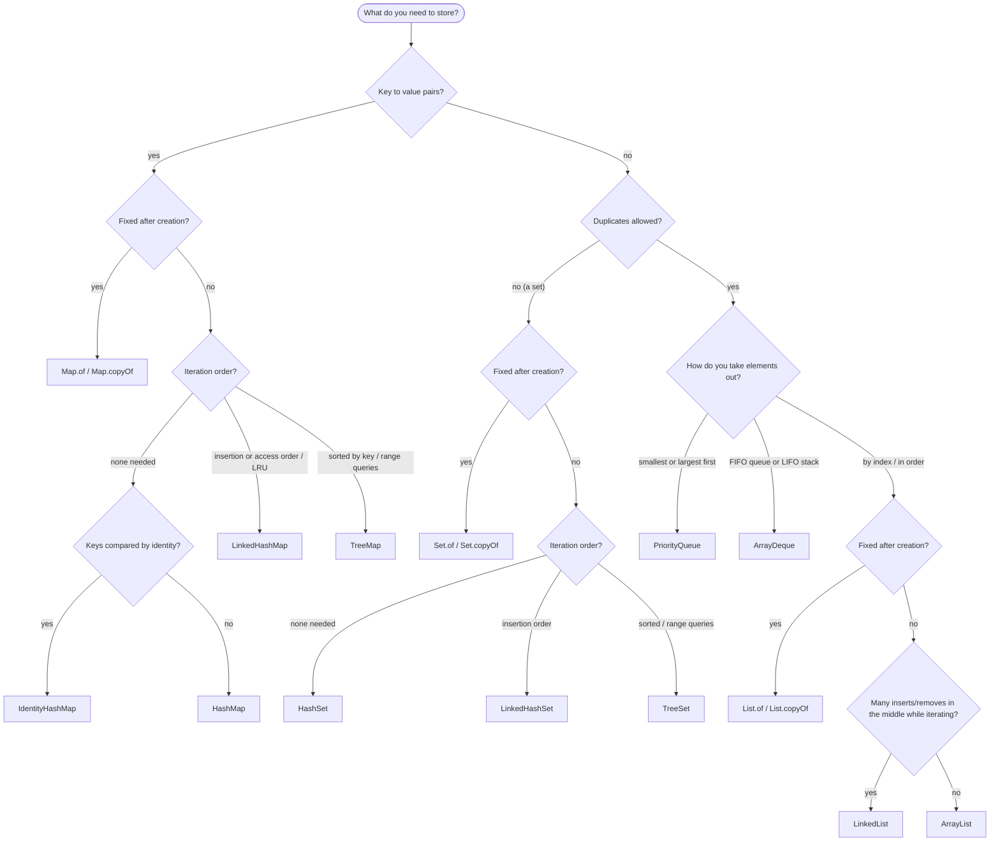

# Choosing a collection

The right class depends on four questions: whether you map keys to values, whether order matters and which order,
whether duplicates are allowed, and how you access the data (by index, by key, from the ends or by priority). This
page answers them with a decision flowchart, then compares every concrete class on ordering, `null` handling,
duplicates and operation cost.

## Decision flowchart



`Vector` and `Stack` are legacy classes kept for compatibility. Prefer `ArrayList` and `ArrayDeque`.

## Comparison tables

In these tables, n is the size of the collection. "Amortized" means occasionally O(n) when the backing array
grows. Hash-based costs assume well-distributed `hashCode()` values.

### Lists

| Class | Order | `null` | Dupes | `get(i)` | `add(e)` (end) | `add(i, e)` / `removeAt(i)` | `contains` | Best for |
|---|---|---|---|---|---|---|---|---|
| `ArrayList` | index | yes | yes | O(1) | O(1) amortized | O(n) | O(n) | the default list |
| `LinkedList` | index | yes | yes | O(n) | O(1) | O(1) at an iterator, O(n) to get there | O(n) | edits at a `ListIterator`; also a `Deque` |
| `Vector` | index | yes | yes | O(1) | O(1) amortized | O(n) | O(n) | legacy code (`elementAt`, `Enumeration`) |
| `Stack` | index (top = end) | yes | yes | O(1) | `push` O(1) amortized | O(n) | O(n) | legacy LIFO; prefer `ArrayDeque` |
| `List.of` / `copyOf` | index | **no** | yes | O(1) | — immutable | — | O(n) | constants, snapshots, keys |

### Queues and deques

| Class | Order | `null` | Dupes | `offer`/`add` | `poll`/`remove()` | `peek` | `contains` / `remove(o)` | Best for |
|---|---|---|---|---|---|---|---|---|
| `ArrayDeque` | FIFO / LIFO (both ends) | **no** | yes | O(1) amortized | O(1) | O(1) | O(n) | queues and stacks |
| `LinkedList` | FIFO / LIFO (both ends) | yes | yes | O(1) | O(1) | O(1) | O(n) | a deque that must hold `null`, or also needs `List` |
| `PriorityQueue` | by priority (head = smallest) | **no** | yes | O(log n) | O(log n) | O(1) | O(n) | schedulers, top-k, Dijkstra |

### Sets

| Class | Iteration order | `null` | `add` | `remove` | `contains` | Iteration | Best for |
|---|---|---|---|---|---|---|---|
| `HashSet` | unspecified | yes | O(1) | O(1) | O(1) | O(n) | membership tests |
| `LinkedHashSet` | insertion | yes | O(1) | O(1) | O(1) | O(n) | de-duplicating while keeping order |
| `TreeSet` | sorted (natural or comparator) | **no** (unless the comparator handles it) | O(log n) | O(log n) | O(log n) | O(n) | sorted data, `ceiling`/`floor`, ranges |
| `Set.of` / `copyOf` | unspecified | **no** | — immutable | — | O(1) | O(n) | constant sets |

### Maps

| Class | Iteration order | `null` keys / values | `get` | `put` | `remove` | `containsKey` | Iteration | Best for |
|---|---|---|---|---|---|---|---|---|
| `HashMap` | unspecified | yes / yes | O(1) | O(1) | O(1) | O(1) | O(n) | the default map |
| `LinkedHashMap` | insertion (or access order) | yes / yes | O(1) | O(1) | O(1) | O(1) | O(n) | ordered maps, LRU caches (`LinkedHashMap.lru(n)`) |
| `TreeMap` | sorted by key | **no** / yes | O(log n) | O(log n) | O(log n) | O(log n) | O(n) | sorted keys, `floorKey`, `headMap`, ranges |
| `IdentityHashMap` | unspecified | yes / yes | O(1) | O(1) | O(1) | O(1) | O(n) | keys compared with `===` (object graphs, caches per instance) |
| `Map.of` / `copyOf` | unspecified | **no** / **no** | O(1) | — immutable | — | O(1) | O(n) | constant lookup tables |

`containsValue` is O(n) on every map.

### Thread safety

JS runs application code on a single thread, so there is no locking strategy to choose. The `Collections.synchronized*`
wrappers exist for API compatibility and behave like plain delegating wrappers. `parallelStream()` is accepted but
evaluates sequentially (see [Compatibility](../advanced/compatibility.md#stream-differences)).

## Rules of thumb

- Start with `ArrayList`, `HashMap` and `HashSet`. Switch only when you need a capability they lack.
- For a predictable order, use `LinkedHash*` (insertion order) or `Tree*` (sorted order).
- For nearest-key lookups, ranges or min/max, use `TreeMap`/`TreeSet` and the navigable API (`floor`, `ceiling`,
  `headMap`, `subSet`, `pollFirst`, …).
- For a queue or stack, use `ArrayDeque`: `offer`/`poll` for FIFO, `push`/`pop` for LIFO. Use `PriorityQueue` when
  the next element is the highest-priority one rather than the oldest.
- For data that never changes, use `List.of`/`Set.of`/`Map.of`. They are cheaper, safe to share and `null`-free.
- `LinkedList` is rarely faster than `ArrayList`. It wins only for insertions and removals at a position already
  reached with a `ListIterator`. Its `get(i)` is O(n).

> [!WARNING]
> Iteration order of `HashMap`, `HashSet`, `IdentityHashMap`, `Set.of` and `Map.of` is unspecified. Do not let
> program output depend on it.

Measured numbers and tuning tips are in [Performance](../advanced/performance.md).

## Common picks in code

```ts
import { ArrayDeque, PriorityQueue, LinkedHashMap, TreeMap, LinkedHashSet, Comparator } from '@nodestd/collections';

// FIFO queue
const jobs = new ArrayDeque<string>();
jobs.offer('a');
jobs.offer('b');
console.log(jobs.poll()); // → a

// LIFO stack
const undo = new ArrayDeque<string>();
undo.push('type');
undo.push('delete');
console.log(undo.pop()); // → delete

// priority: largest first
const urgent = new PriorityQueue<number>(Comparator.reverseOrder<number>());
[3, 10, 7].forEach((n) => urgent.offer(n));
console.log(urgent.poll()); // → 10

// LRU cache that keeps the 2 most recently used entries
const cache = LinkedHashMap.lru<string, number>(2);
cache.put('a', 1);
cache.put('b', 2);
cache.get('a');      // touch a
cache.put('c', 3);   // evicts b, the least recently used
console.log(cache.toString()); // → {a=1, c=3}

// "which bracket does this value fall in?"
const tax = new TreeMap<number, string>();
tax.put(0, 'low');
tax.put(10_000, 'mid');
tax.put(50_000, 'high');
console.log(tax.floorEntry(23_500)?.getValue()); // → mid

// de-duplicate but keep first-seen order
const unique = new LinkedHashSet<string>();
['b', 'a', 'b', 'c', 'a'].forEach((s) => unique.add(s));
console.log(unique.toString()); // → [b, a, c]
```

The full APIs are on the per-family pages: [Lists](../collections/lists.md),
[Queues and deques](../collections/queues-and-deques.md), [Sets](../collections/sets.md),
[Maps](../collections/maps.md), [Immutable collections and wrappers](../collections/immutable-and-wrappers.md).
