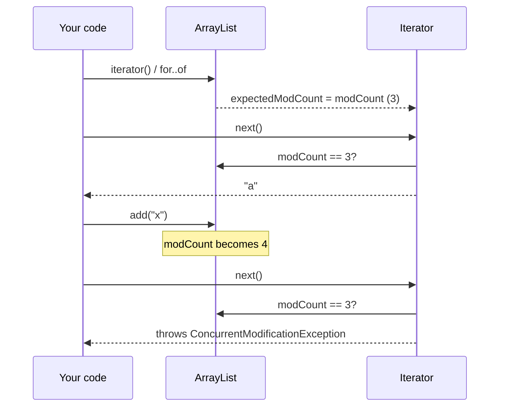
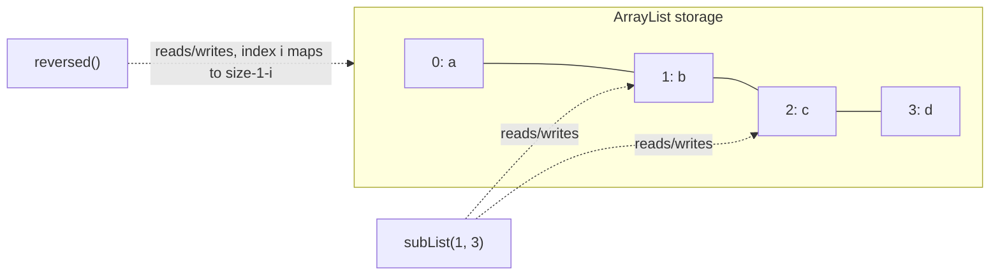
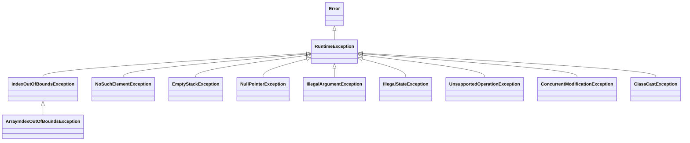

# Core concepts

JS `Array`, `Map` and `Set` compare objects by identity, let you change a collection while you loop over it, and
copy when you slice. This library follows the Java Collections Framework instead: **value equality** through
`equals()`/`hashCode()`, **natural ordering** through `compareTo()` or comparators, a strict policy for **absent
values** (`null`), **fail-fast iterators**, **live views** that write through to their backing collection, a
hierarchy of **typed exceptions**, and **optional operations** on unmodifiable collections. This page explains each
rule, why it exists, and shows it running.

- [Value equality](#value-equality)
- [Writing your own equals, hashCode and compareTo](#writing-your-own-equals-hashcode-and-compareto)
- [Ordering: natural order and comparators](#ordering-natural-order-and-comparators)
- [Null and undefined](#null-and-undefined)
- [Fail-fast iteration](#fail-fast-iteration)
- [Live views](#live-views)
- [Exceptions](#exceptions)
- [Optional operations: unmodifiable vs immutable](#optional-operations-unmodifiable-vs-immutable)
- [Sequenced collections](#sequenced-collections)
- [RandomAccess](#randomaccess)

## Value equality

Every membership test — `contains`, `indexOf`, `remove(o)`, `containsKey`, `get`, `equals` between collections —
uses the same rule (exposed as `Objects.equals(a, b)`):

1. If `a` has an `equals()` method, `a.equals(b)` decides.
2. Two `Date`s are equal when `getTime()` is equal.
3. Otherwise **SameValueZero** — the rule of JS `Map`/`Set`: `NaN` equals `NaN`, `0` equals `-0`, objects and arrays
   compare by identity.

Hashed collections (`HashMap`, `HashSet`, …) also call `hashCode()`, so an element with `equals` must have a
consistent `hashCode` (see the contract below). The library's own collections and map entries implement both, so a
`List` can be a map key and two lists with the same elements are equal regardless of their class.

```ts
import { ArrayList, LinkedList, HashSet, HashMap, List, Objects } from 'ts-collections-framework';

// collections compare by content, across implementations
console.log(ArrayList.of(1, 2).equals(LinkedList.of(1, 2))); // → true
console.log(List.of(1, 2).hashCode() === ArrayList.of(1, 2).hashCode()); // → true

// so they work as keys
const routes = new HashMap<List<string>, string>();
routes.put(List.of('users', 'id'), 'userHandler');
console.log(routes.get(List.of('users', 'id'))); // → userHandler

// Dates compare by time
const days = new HashSet<Date>();
days.add(new Date(0));
console.log(days.contains(new Date(0))); // → true

// primitives: SameValueZero
console.log(Objects.equals(NaN, NaN)); // → true
console.log(Objects.equals(0, -0));    // → true

// plain objects and arrays have no equals(): identity
const arrays = new HashSet<number[]>();
arrays.add([1, 2]);
console.log(arrays.contains([1, 2])); // → false
```

Hash codes follow the classic formulas, so they are stable across runs and match the JDK: a string
hashes as `s[0]*31^(n-1) + … + s[n-1]`, a list as `31 * h + hash(e)` over its elements, a set as the sum of its
element hashes, and so on.

```ts
import { Objects, List } from 'ts-collections-framework';

console.log(Objects.hashCode('ab'));      // → 3105
console.log(List.of(1, 2).hashCode());    // → 994
console.log(Objects.hash(1, 2));          // → 994
console.log(Objects.hashCode(null));      // → 0
```

### The equals/hashCode contract

| Rule | Why |
|---|---|
| `a.equals(a)` is true (reflexive) | otherwise you cannot find what you just added |
| `a.equals(b)` ⇔ `b.equals(a)` (symmetric) | lookup order must not matter |
| transitive, and consistent over time | hashed and sorted structures assume it |
| `a.equals(b)` ⇒ `a.hashCode() === b.hashCode()` | a `HashMap` looks in the bucket chosen by the hash *first*; an equal key in the wrong bucket is never found |
| `a.equals(null)` is false | |

Never mutate an element in a way that changes its `equals`/`hashCode` while it is in a hashed collection, or its
`compareTo` while it is in a sorted one: the structure will not find it any more.

## Writing your own equals, hashCode and compareTo

Implement `equals(o: unknown): boolean` and `hashCode(): number` on your class. `Objects.hash(...)` combines field
hashes with the classic formula; `Objects.equals` compares fields null-safely. To give a class a *natural order*,
implement `Comparable<T>` (`compareTo(o: T): number`).

```ts
import { HashSet, HashMap, TreeSet, Objects, Comparable } from 'ts-collections-framework';

class Point implements Comparable<Point> {
  constructor(readonly x: number, readonly y: number) {}

  equals(o: unknown): boolean {
    return o instanceof Point && o.x === this.x && o.y === this.y;
  }
  hashCode(): number {
    return Objects.hash(this.x, this.y);
  }
  compareTo(o: Point): number {
    return this.x - o.x || this.y - o.y;
  }
  toString(): string {
    return `(${this.x},${this.y})`;
  }
}

const visited = new HashSet<Point>();
visited.add(new Point(1, 2));
visited.add(new Point(1, 2)); // equal: not added again
console.log(visited.size());                       // → 1
console.log(visited.contains(new Point(1, 2)));    // → true

const labels = new HashMap<Point, string>();
labels.put(new Point(0, 0), 'origin');
console.log(labels.get(new Point(0, 0)));          // → origin

const sorted = new TreeSet<Point>();               // uses compareTo
[new Point(2, 0), new Point(1, 5), new Point(1, 1)].forEach((p) => sorted.add(p));
console.log(sorted.toString());                    // → [(1,1), (1,5), (2,0)]
```

Sorted collections use **only** `compareTo` (or the comparator) to decide equality — two elements comparing as `0`
are the same element to a `TreeSet`, even if `equals` says otherwise. Keep `compareTo` *consistent with equals*
unless you mean it.

## Ordering: natural order and comparators

*Natural ordering* (used by `TreeSet`, `TreeMap`, `PriorityQueue`, `sort(null)`, `Stream.sorted()`,
`Collections.sort` when no comparator is given) is defined for:

| Type | Order |
|---|---|
| objects with `compareTo` | `a.compareTo(b)` |
| `number` | numeric; `-0` compares equal to `0`, `NaN` sorts after everything else |
| `string` | UTF-16 code unit order (like the classic `String.compareTo`, *not* `localeCompare`) |
| `bigint`, `boolean` (`false < true`), `Date` (by time) | the obvious order |
| anything else | throws `ClassCastException` |

A **comparator** is just a function `(a, b) => number` (negative, zero, positive). The `Comparator` object holds the
classic helpers as functions that take and return comparators:

```ts
import { ArrayList, Comparator, TreeSet, PriorityQueue } from 'ts-collections-framework';

interface Person { name: string; age: number | null }
const people = ArrayList.of<Person>(
  { name: 'Cleo', age: 31 }, { name: 'Ann', age: 31 }, { name: 'Bob', age: 25 }, { name: 'Dan', age: null },
);

const byAgeThenName = Comparator.thenComparing(
  Comparator.comparing((p: Person) => p.age, Comparator.nullsLast(Comparator.naturalOrder<number>())),
  Comparator.comparing((p: Person) => p.name),
);
people.sort(byAgeThenName);
console.log(people.stream().map((p) => p.name).toList().toString()); // → [Bob, Ann, Cleo, Dan]

people.sort(Comparator.reversed(byAgeThenName));
console.log(people.get(0).name); // → Dan

// plain lambdas work everywhere a comparator is expected
const desc = new TreeSet<number>((a, b) => b - a);
[1, 3, 2].forEach((n) => desc.add(n));
console.log(desc.toString()); // → [3, 2, 1]

const maxHeap = new PriorityQueue<number>(Comparator.reverseOrder<number>());
[4, 9, 1].forEach((n) => maxHeap.add(n));
console.log(maxHeap.poll()); // → 9
```

Main helpers: `naturalOrder`, `reverseOrder`, `reversed(c)`, `comparing(key, keyComparator?)`,
`comparingInt/Long/Double`, `thenComparing(c1, c2, …)`, `thenComparingBy(c, key, keyComparator?)`,
`nullsFirst(c)`, `nullsLast(c)`, `max(c, a, b)`, `min(c, a, b)`. Details:
[Comparator and Objects](../utilities/comparator-and-objects.md).

```ts
import { TreeSet } from 'ts-collections-framework';

const bad = new TreeSet<object>();
try {
  bad.add({}); // plain objects have no natural order (even the first add is checked)
} catch (e) {
  console.log((e as Error).name); // → ClassCastException
}
```

## Null and undefined

The library has one notion of "nothing": **`null`**.

- Lookups that can find nothing **return `null`**: `Map.get`, `Queue.poll`/`peek`, `NavigableSet.ceiling`/`floor`,
  `NavigableMap.firstEntry`, `Map.put` (the previous value), and so on. They never return `undefined`.
- Methods that *must* return an element **throw** instead: `getFirst()`, `element()`, `remove()` (no argument),
  `firstKey()` and `Stack.pop()` on an empty collection throw `NoSuchElementException` (or `EmptyStackException`).
- `undefined` is treated like `null` by collections that reject nulls. Collections that permit nulls store
  `undefined` as given, but you should not rely on telling the two apart.

```ts
import { HashMap, ArrayDeque, TreeSet } from 'ts-collections-framework';

const m = new HashMap<string, number>();
console.log(m.get('missing'));        // → null
console.log(m.put('a', 1));           // → null
console.log(m.put('a', 2));           // → 1

const q = new ArrayDeque<number>();
console.log(q.poll());                // → null
try {
  q.remove();
} catch (e) {
  console.log((e as Error).name); // → NoSuchElementException
}

const s = TreeSet.of(10, 20);
console.log(s.ceiling(25));           // → null
```

Because `null` means "absent", a map that stores `null` *values* makes `get` ambiguous: use `containsKey` or
`getOrDefault` there.

Which collections accept `null`?

| Accepts `null` elements / keys | Rejects (throws `NullPointerException`) |
|---|---|
| `ArrayList`, `LinkedList`, `Vector`, `Stack` | `ArrayDeque`, `PriorityQueue` |
| `HashSet`, `LinkedHashSet` | `TreeSet` (natural order; a `nullsFirst`/`nullsLast` comparator allows it) |
| `HashMap`, `LinkedHashMap`, `IdentityHashMap` (keys and values) | `TreeMap` keys (values may be `null`) |
| `Collections.unmodifiable*` wrappers (whatever the backing collection accepts) | `List.of`, `Set.of`, `Map.of`, `copyOf` — elements, keys, values, and even `contains(null)` |

```ts
import { ArrayList, ArrayDeque, List } from 'ts-collections-framework';

const ok = new ArrayList<string | null>();
ok.add(null);
console.log(ok.toString()); // → [null]

try {
  new ArrayDeque<string | null>().add(null);
} catch (e) {
  console.log((e as Error).name); // → NullPointerException
}
try {
  List.of<string | null>(null);
} catch (e) {
  console.log((e as Error).name); // → NullPointerException
}
```

## Fail-fast iteration

Every collection counts its *structural modifications* (adds and removes, not `set`). An iterator remembers the
count when it is created and checks it on every step. If someone else changed the collection in between, the next
step throws `ConcurrentModificationException` instead of silently skipping or repeating elements. This applies to
`for..of`, spread, `iterator()`, `forEach`, streams and views.



```ts
import { ArrayList } from 'ts-collections-framework';

const list = ArrayList.of('a', 'b', 'c');
try {
  for (const s of list) if (s === 'a') list.add('x');
} catch (e) {
  console.log((e as Error).name); // → ConcurrentModificationException
}

// The safe ways to remove while iterating:
const it = list.iterator();
while (it.hasNext()) if (it.next() === 'b') it.remove(); // the iterator's own remove keeps it in sync
list.removeIf((s) => s === 'x');                        // or a bulk operation
console.log(list.toString()); // → [a, c]
```

Fail-fast is a debugging aid, not a guarantee: it detects most mistakes, but do not write code that depends on the
exception being thrown.

## Live views

Many methods return a **view**: an object that implements the collection interface but stores nothing itself. It
reads from and writes to the backing collection, so changes go both ways and no copying happens.

| View | From |
|---|---|
| `subList(from, to)` | `List` |
| `reversed()` | every sequenced collection and map |
| `keySet()`, `values()`, `entrySet()` (and `sequenced*` variants) | `Map` |
| `headSet`/`tailSet`/`subSet`, `descendingSet()` | `NavigableSet` |
| `headMap`/`tailMap`/`subMap`, `descendingMap()`, `navigableKeySet()` | `NavigableMap` |
| `Collections.unmodifiable*`, `synchronized*`, `checked*` | any collection |



```ts
import { ArrayList, TreeMap } from 'ts-collections-framework';

const list = ArrayList.of('a', 'b', 'c', 'd');
const middle = list.subList(1, 3);
console.log(middle.toString());   // → [b, c]
middle.set(0, 'B');               // writes through
middle.clear();                   // removes b and c from list
console.log(list.toString());     // → [a, d]

const rev = list.reversed();
rev.addFirst('z');                // adds at the END of list
console.log(list.toString());     // → [a, d, z]

const prices = new TreeMap<string, number>();
['apple', 'banana', 'cherry', 'date'].forEach((k, i) => prices.put(k, i));
const early = prices.headMap('cherry');   // keys < 'cherry'
console.log(early.toString());            // → {apple=0, banana=1}
prices.put('avocado', 9);                 // a later change shows up in the view
console.log(early.keySet().toString());   // → [apple, avocado, banana]
prices.keySet().remove('apple');          // removing from keySet removes the mapping
console.log(prices.toString());           // → {avocado=9, banana=1, cherry=2, date=3}
```

Two rules to remember:

- A `subList` is only valid while the backing list is modified *through it*. A structural change made directly to
  the backing list invalidates the sub-list, and its next use throws `ConcurrentModificationException`.
- Sorted views have a range. Adding a key outside it (for example `headMap('c').put('x', …)`) throws
  `IllegalArgumentException`.

Want a copy instead? Use a copy constructor (`new ArrayList(view)`) or `List.copyOf(view)`.

## Exceptions

All library exceptions extend `RuntimeException`, which extends the built-in `Error`. Each sets `name`
explicitly, so `e.name` survives minification; `instanceof` works too, as long as one copy of the library is
loaded (see [Browsers and bundlers](getting-started.md#browsers-and-bundlers)). Checking `e.name` works everywhere.



| Exception | Typical cause |
|---|---|
| `IndexOutOfBoundsException` | `get(5)` on a 3-element list, bad `subList` range |
| `ArrayIndexOutOfBoundsException` | index errors in array-backed legacy classes (`Vector.elementAt`, …) |
| `NoSuchElementException` | `getFirst()`, `iterator().next()`, `firstKey()`, `Optional.get()` with nothing there |
| `EmptyStackException` | `Stack.pop()`/`peek()` on an empty stack |
| `NullPointerException` | a `null` where it is not allowed (see [above](#null-and-undefined)) |
| `IllegalArgumentException` | negative capacity, duplicate in `Set.of`, key outside a sorted view's range |
| `IllegalStateException` | `iterator.remove()` twice, a stream used twice, `Collectors.toMap` duplicate key |
| `UnsupportedOperationException` | mutating an unmodifiable or immutable collection |
| `ConcurrentModificationException` | changing a collection while iterating it |
| `ClassCastException` | natural ordering of values that have none, `checked*` wrappers |

```ts
import {
  ArrayList, Stack, Vector, RuntimeException, IndexOutOfBoundsException, ArrayIndexOutOfBoundsException,
} from 'ts-collections-framework';

try {
  new ArrayList<number>().get(0);
} catch (e) {
  console.log(e instanceof IndexOutOfBoundsException, e instanceof RuntimeException, e instanceof Error); // → true true true
}
try {
  new Stack<number>().pop();
} catch (e) {
  console.log((e as Error).name); // → EmptyStackException
}
try { new Vector<number>().elementAt(3); } catch (e) {
  console.log(e instanceof ArrayIndexOutOfBoundsException); // → true
}
```

## Optional operations: unmodifiable vs immutable

Mutating methods (`add`, `remove`, `put`, `set`, `clear`, …) are *optional operations*: a collection may refuse them
by throwing `UnsupportedOperationException`. Two kinds of collection do:

| | Immutable: `List.of`, `Set.of`, `Map.of`, `copyOf`, `Collections.emptyList()` … | Unmodifiable view: `Collections.unmodifiableList(x)` … |
|---|---|---|
| Can *you* change it through this reference? | No | No |
| Can it change at all? | Never — it is a snapshot | Yes, when the backing collection `x` changes |
| Nulls | Rejected | Whatever `x` allows |
| Use it to | share fixed data, constants, map keys | hand out read-only access to state you still own |

```ts
import { ArrayList, List, Collections } from 'ts-collections-framework';

const source = ArrayList.of(1, 2);
const readOnly = Collections.unmodifiableList(source);
const snapshot = List.copyOf(source);

try {
  readOnly.add(3);
} catch (e) {
  console.log((e as Error).name); // → UnsupportedOperationException
}

source.add(3);
console.log(readOnly.toString()); // → [1, 2, 3]
console.log(snapshot.toString()); // → [1, 2]
```

More in [Immutable collections and wrappers](../collections/immutable-and-wrappers.md).

## Sequenced collections

Collections with a defined encounter order implement `SequencedCollection` (lists, deques, `LinkedHashSet`,
`TreeSet`) or `SequencedMap` (`LinkedHashMap`, `TreeMap`). They share one vocabulary for both ends:

| Collections | Maps |
|---|---|
| `getFirst()`, `getLast()` | `firstEntry()`, `lastEntry()` |
| `addFirst(e)`, `addLast(e)` | `putFirst(k, v)`, `putLast(k, v)` |
| `removeFirst()`, `removeLast()` | `pollFirstEntry()`, `pollLastEntry()` |
| `reversed()` (a live view) | `reversed()`, `sequencedKeySet()`, `sequencedValues()`, `sequencedEntrySet()` |

```ts
import { ArrayList, LinkedHashSet, LinkedHashMap, TreeSet, SequencedCollection } from 'ts-collections-framework';

function ends<E>(c: SequencedCollection<E>): string {
  return `${c.getFirst()}..${c.getLast()}`;
}
console.log(ends(ArrayList.of(1, 2, 3)));         // → 1..3
console.log(ends(LinkedHashSet.of('x', 'y')));    // → x..y
console.log(ends(TreeSet.of(9, 4, 7)));           // → 4..9

const m = LinkedHashMap.of<string, number>(['a', 1], ['b', 2]);
m.putFirst('z', 0);
console.log(m.toString());                        // → {z=0, a=1, b=2}
console.log(m.reversed().toString());             // → {b=2, a=1, z=0}
console.log(m.pollLastEntry()?.toString());       // → b=2

try {
  TreeSet.of(1).addFirst(0);
} catch (e) {
  console.log((e as Error).name); // → UnsupportedOperationException
}
```

Sorted collections decide position themselves, so `addFirst`/`addLast` (and `putFirst`/`putLast` on `TreeMap`)
throw `UnsupportedOperationException`. Empty collections throw `NoSuchElementException` from `getFirst()` and
friends, while the map methods return `null`.

## RandomAccess

`List` implementations whose `get(index)` is O(1) (`ArrayList`, `Vector`, `Stack`, the immutable lists, …) carry
the `RandomAccess` marker. `LinkedList` does not: its `get(i)` walks the list. Generic algorithms
(`Collections.binarySearch`, `shuffle`, …) use the marker to pick an index loop or an iterator walk. Your own code
can do the same with `isRandomAccess`:

```ts
import { ArrayList, LinkedList, List, isRandomAccess } from 'ts-collections-framework';

function middle<E>(list: List<E>): E {
  if (isRandomAccess(list)) return list.get(list.size() >> 1); // O(1)
  const it = list.listIterator();                               // O(n) either way: walk once
  for (let i = 0; i < list.size() >> 1; i++) it.next();
  return it.next();
}
console.log(isRandomAccess(ArrayList.of(1)), isRandomAccess(LinkedList.of(1))); // → true false
console.log(middle(LinkedList.of('a', 'b', 'c'))); // → b
```

To mark your own list, add `readonly [RANDOM_ACCESS] = true as const` (see
[Custom collections](../advanced/custom-collections.md)).
