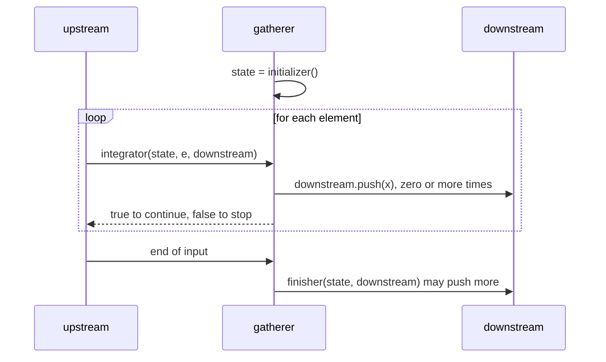

# Gatherers

A **gatherer** is a custom intermediate operation, applied with `stream.gather(gatherer)`. Where a
[collector](collectors.md) reduces a whole stream to one result at the end, a gatherer transforms the stream
*in flight*: it can map one element to many or many to one, keep state between elements, emit extra elements at
the end, and stop the upstream early. `Gatherers` has the common built-ins (`fold`, `scan`, windows,
`mapConcurrent`); `Gatherer.of`, `Gatherer.ofSequential` and `Integrator` let you write your own in a few lines.

- [How a gatherer works](#how-a-gatherer-works)
- [Built-in gatherers](#built-in-gatherers)
- [Writing your own](#writing-your-own)
- [Short-circuiting](#short-circuiting)
- [Downstream.isRejecting](#downstreamisrejecting)
- [Composition with andThen](#composition-with-andthen)
- [Gatherer.of vs Gatherer.ofSequential, and the arity rule](#gathererof-vs-gathererofsequential-and-the-arity-rule)

## How a gatherer works

A gatherer has four parts; only the **integrator** is required.

| Part | Signature | Default |
|---|---|---|
| initializer | `() => state` | no state (`null`) |
| integrator | `(state, element, downstream) => boolean` | — |
| combiner | `(left, right) => state` | none: the gatherer is sequential-only |
| finisher | `(state, downstream) => void` | does nothing |



- `downstream.push(x)` sends `x` to the next stage and returns `false` once the downstream wants no more
  elements (for example a `limit` was reached).
- The integrator returns `false` to stop the upstream. Returning `downstream.push(x)` is the usual way to stop
  exactly when the downstream does.
- The finisher runs once, after the last element (or after a stop), and can push what is still in the state.

## Built-in gatherers

All built-ins are sequential.

| Gatherer | Emits | Example input → output |
|---|---|---|
| `Gatherers.fold(initial, folder)` | one value at the end | `a, b, c` → `abc` |
| `Gatherers.scan(initial, scanner)` | every intermediate accumulation | `1, 2, 3, 4` → `1, 3, 6, 10` |
| `Gatherers.windowFixed(n)` | unmodifiable lists of `n` (last may be shorter) | `1..5`, n=2 → `[1, 2], [3, 4], [5]` |
| `Gatherers.windowSliding(n)` | overlapping unmodifiable lists of `n` | `1..4`, n=2 → `[1, 2], [2, 3], [3, 4]` |
| `Gatherers.mapConcurrent(max, f)` | `f(e)` in encounter order | like `map` |

```ts
import { Stream, Gatherers } from 'ts-collections-framework';

console.log(Stream.of('a', 'b', 'c').gather(Gatherers.fold(() => '', (acc: string, s: string) => acc + s)).findFirst()); // → Optional[abc]
console.log(Stream.empty<number>().gather(Gatherers.fold(() => 0, (acc: number, x: number) => acc + x)).toList()); // → [0]

console.log(Stream.of(1, 2, 3, 4).gather(Gatherers.scan(() => 0, (acc: number, x: number) => acc + x)).toList()); // → [1, 3, 6, 10]

console.log(Stream.of(1, 2, 3, 4, 5).gather(Gatherers.windowFixed(2)).toList()); // → [[1, 2], [3, 4], [5]]
console.log(Stream.of(1, 2, 3, 4).gather(Gatherers.windowSliding(2)).toList()); // → [[1, 2], [2, 3], [3, 4]]
// fewer elements than the window: one window with all of them
console.log(Stream.of(1, 2).gather(Gatherers.windowSliding(3)).toList()); // → [[1, 2]]
console.log(Stream.empty<number>().gather(Gatherers.windowFixed(2)).toList()); // → []

try {
  Gatherers.windowFixed(0);
} catch (e) {
  console.log((e as Error).name, (e as Error).message); // → IllegalArgumentException 'windowSize' must be greater than zero
}
```

`fold` emits its result even for an empty stream (the initial value). Windows are unmodifiable lists; adding to one
throws `UnsupportedOperationException`.

**`mapConcurrent`** keeps the signature of the classic API, but JS runs it on one thread: the mapper is called
synchronously, one element at a time, in encounter order; `maxConcurrency` is validated (must be at least 1) and
otherwise ignored. It does not await promises — map to promises and `Promise.all` the result if you need real
concurrency. A mapper error that is not a `RuntimeException` is wrapped in one (the original is its `cause`).

```ts
import { Stream, Gatherers } from 'ts-collections-framework';

console.log(Stream.of(1, 2, 3).gather(Gatherers.mapConcurrent(4, (x: number) => x * 2)).toList()); // → [2, 4, 6]
try {
  Stream.of(1).gather(Gatherers.mapConcurrent(2, () => {
    throw new Error('boom');
  })).toList();
} catch (e) {
  console.log((e as Error).name, (e as Error).message); // → RuntimeException Error: boom
}
```

## Writing your own

Use `Gatherer.ofSequential(initializer, integrator, finisher?)` for stateful gatherers and wrap the integrator in
`Integrator.ofGreedy(…)` when it never stops on its own (it only returns what `downstream.push` returns, or `true`).
Greedy is a hint that lets the engine skip short-circuit checks; `Integrator.of(…)` marks an integrator that may
stop by itself.

**distinctBy** — keep the first element for each key:

```ts
import { Stream, Gatherer, Integrator, HashSet, Downstream } from 'ts-collections-framework';

function distinctBy<T, K>(key: (t: T) => K) {
  return Gatherer.ofSequential(
    () => new HashSet<K>(),
    Integrator.ofGreedy((seen: HashSet<K>, e: T, down: Downstream<T>) => (seen.add(key(e)) ? down.push(e) : true)),
  );
}

const fruit = Stream.of('apple', 'avocado', 'banana', 'blueberry', 'cherry');
console.log(fruit.gather(distinctBy((s: string) => s[0])).toList()); // → [apple, banana, cherry]
```

**Running average** — one output per input:

```ts
import { Stream, Gatherer, Integrator, Downstream } from 'ts-collections-framework';

const runningAverage = () =>
  Gatherer.ofSequential(
    () => ({ n: 0, sum: 0 }),
    Integrator.ofGreedy((s: { n: number; sum: number }, x: number, down: Downstream<number>) => {
      s.n++;
      s.sum += x;
      return down.push(s.sum / s.n);
    }),
  );

console.log(Stream.of(2, 4, 6, 8).gather(runningAverage()).toList()); // → [2, 3, 4, 5]
```

**chunkWhile** — group consecutive elements while a condition holds; the finisher emits the last chunk:

```ts
import { Stream, Gatherer, Integrator, Downstream, List } from 'ts-collections-framework';

function chunkWhile<T>(together: (prev: T, next: T) => boolean) {
  type State = { chunk: T[] };
  return Gatherer.ofSequential(
    (): State => ({ chunk: [] }),
    Integrator.ofGreedy((s: State, e: T, down: Downstream<List<T>>) => {
      if (s.chunk.length > 0 && !together(s.chunk[s.chunk.length - 1], e)) {
        const full = s.chunk;
        s.chunk = [];
        if (!down.push(List.of(...full))) return false;
      }
      s.chunk.push(e);
      return true;
    }),
    (s: State, down: Downstream<List<T>>) => {
      if (s.chunk.length > 0 && !down.isRejecting()) down.push(List.of(...s.chunk));
    },
  );
}

const runs = Stream.of(1, 2, 4, 5, 6, 9).gather(chunkWhile((a: number, b: number) => b === a + 1));
console.log(runs.toList()); // → [[1, 2], [4, 5, 6], [9]]
```

**Throttle by key** — a rate-limiter-style dedupe that drops repeats of a key within a time window:

```ts
import { Stream, Gatherer, Integrator, Downstream } from 'ts-collections-framework';

type Event = { key: string; at: number };

function throttle(ms: number) {
  return Gatherer.ofSequential(
    () => new globalThis.Map<string, number>(),
    Integrator.ofGreedy((lastSeen: globalThis.Map<string, number>, e: Event, down: Downstream<Event>) => {
      const prev = lastSeen.get(e.key);
      if (prev !== undefined && e.at - prev < ms) return true; // drop, keep going
      lastSeen.set(e.key, e.at);
      return down.push(e);
    }),
  );
}

const events: Event[] = [
  { key: 'a', at: 0 }, { key: 'a', at: 50 }, { key: 'b', at: 60 }, { key: 'a', at: 120 },
];
console.log(Stream.ofArray(events).gather(throttle(100)).map((e) => `${e.key}@${e.at}`).toList()); // → [a@0, b@60, a@120]
```

A gatherer can also be a plain object with an `integrator()` method; missing members take their defaults:

```ts
import { Stream, Downstream } from 'ts-collections-framework';

const tag = { integrator: () => (_state: unknown, e: number, down: Downstream<string>) => down.push(`#${e}`) };
console.log(Stream.of(1, 2).gather(tag).toList()); // → [#1, #2]
```

## Short-circuiting

An integrator that returns `false` stops the upstream: no more elements are read, the finisher still runs. This
makes gatherers work on infinite streams.

```ts
import { Stream, Gatherer, Integrator, Downstream } from 'ts-collections-framework';

// emit elements up to and including the first one matching the predicate
const takeUntil = <T>(stop: (t: T) => boolean) =>
  Gatherer.ofSequential(Integrator.of((_s: null, e: T, down: Downstream<T>) => down.push(e) && !stop(e)));

const read: number[] = [];
const result = Stream.iterate(1, (x) => x + 1)
  .peek((x) => read.push(x))
  .gather(takeUntil((x: number) => x * x > 10))
  .toList();
console.log(result, read.length); // → [1, 2, 3, 4] 4
```

## Downstream.isRejecting

`downstream.isRejecting()` is `true` once a `push` would be ignored. Check it before doing expensive work, and in
finishers before pushing leftovers (as `chunkWhile` above does):

```ts
import { Stream, Gatherer, Integrator, Downstream } from 'ts-collections-framework';

let calls = 0;
const expensive = Gatherer.ofSequential(
  Integrator.ofGreedy((_s: null, e: number, down: Downstream<number>) => {
    if (down.isRejecting()) return false;
    calls++;
    return down.push(e * 2);
  }),
);
console.log(Stream.of(1, 2, 3, 4).gather(expensive).limit(2).toList(), calls); // → [2, 4] 2
```

## Composition with andThen

`a.andThen(b)` feeds the output of gatherer `a` into gatherer `b`, giving one gatherer. It is equivalent to
`stream.gather(a).gather(b)` and is handy for packaging a reusable pipeline.

```ts
import { Stream, Gatherers, List } from 'ts-collections-framework';

const pairSums = Gatherers.windowFixed<number>(2).andThen(
  Gatherers.scan(() => 0, (acc: number, w: List<number>) => acc + w.stream().mapToInt((x) => x).sum()),
);
console.log(Stream.of(1, 2, 3, 4, 5, 6).gather(pairSums).toList()); // → [3, 10, 21]
```

## Gatherer.of vs Gatherer.ofSequential, and the arity rule

| Factory | Combiner | Forms |
|---|---|---|
| `Gatherer.ofSequential(…)` | default (sequential-only) | `(integrator)`, `(initializer, integrator)`, `(integrator, finisher)`, `(initializer, integrator, finisher)` |
| `Gatherer.of(…)` | parallel-capable | `(integrator)`, `(integrator, finisher)` — stateless; `(initializer, integrator, combiner, finisher)` |

Evaluation is sequential either way, so `Gatherer.of` only matters if you want to declare that your gatherer is
parallel-safe (its combiner must then merge two states correctly). The default pieces are available as
`Gatherer.defaultInitializer()`, `defaultCombiner()` and `defaultFinisher()`; calling the default combiner throws
`UnsupportedOperationException`.

```ts
import { Stream, Gatherer, Downstream } from 'ts-collections-framework';

const sum = Gatherer.of(
  () => [0],
  (s: number[], e: number) => {
    s[0] += e;
    return true;
  },
  (a: number[], b: number[]) => [a[0] + b[0]],
  (s: number[], down: Downstream<number>) => {
    down.push(s[0]);
  },
);
console.log(Stream.of(1, 2, 3).gather(sum).toList()); // → [6]
```

**The arity rule.** `ofSequential(a, b)` has two overloads with two functions each — `(initializer, integrator)`
and `(integrator, finisher)` — and TS types are gone at run time. The library decides by the first function's
declared parameter count (`fn.length`): a function that declares **no parameters** (and is not marked greedy) is
an initializer; otherwise it is an integrator.

```ts
import { Stream, Gatherer, Downstream } from 'ts-collections-framework';

// () => … has no parameters: (initializer, integrator)
const withState = Gatherer.ofSequential(
  () => ({ seen: 0 }),
  (s: { seen: number }, e: number, down: Downstream<string>) => down.push(`${++s.seen}:${e}`),
);
console.log(Stream.of(7, 8).gather(withState).toList()); // → [1:7, 2:8]

// (s, e, down) => … has parameters: (integrator, finisher)
const withEnd = Gatherer.ofSequential(
  (_s: null, e: number, down: Downstream<number>) => down.push(e),
  (_s: null, down: Downstream<number>) => {
    down.push(-1);
  },
);
console.log(Stream.of(7, 8).gather(withEnd).toList()); // → [7, 8, -1]
```

An integrator that declares no parameters (for example `() => true`, or one using `arguments`) would be read as
an initializer. Wrap it with `Integrator.ofGreedy(…)` (greedy integrators are never mistaken for initializers) or
use the three-argument form `ofSequential(initializer, integrator, finisher)`.
