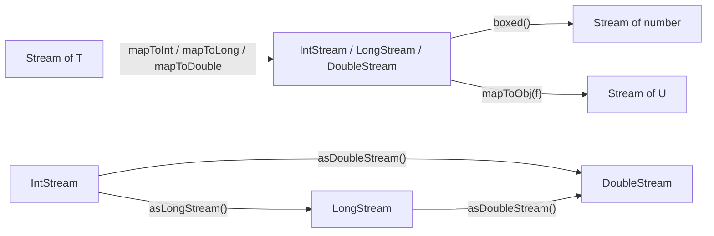

# Number streams: IntStream, LongStream, DoubleStream

`IntStream`, `LongStream` and `DoubleStream` are streams of numbers with extra terminal operations — `sum`,
`average`, `min`, `max`, `summaryStatistics` — that return plain numbers or number optionals instead of boxed
results. They have the same laziness, single-use and short-circuit rules as `Stream` (see the
[overview](overview.md)) and most of its [operations](operations.md). All three carry JS `number`s; the three
types exist so that code reads like the classic stream API and so that each can apply its own rules (for example
compensated summation for doubles).

- [Creating number streams](#creating-number-streams)
- [Aggregates: sum, average, min, max](#aggregates-sum-average-min-max)
- [Summary statistics](#summary-statistics)
- [Converting between stream types](#converting-between-stream-types)
- [Primitive iterators](#primitive-iterators)
- [Compensated (Kahan) double sums](#compensated-kahan-double-sums)
- [Differences from the classic number streams](#differences-from-the-classic-number-streams)
- [Operation reference](#operation-reference)

## Creating number streams

| Factory | IntStream | LongStream | DoubleStream |
|---|---|---|---|
| `of(…values)`, `ofArray(array)`, `empty()` | yes | yes | yes |
| `iterate(seed, f)`, `iterate(seed, hasNext, next)`, `generate(s)` | yes | yes | yes |
| `concat(a, b)`, `builder()` | yes | yes | yes |
| `range(start, end)` — end exclusive | yes | yes | |
| `rangeClosed(start, end)` — end inclusive | yes | yes | |
| from objects: `stream.mapToInt/Long/Double(f)` | yes | yes | yes |

```ts
import { IntStream, LongStream, DoubleStream, Stream } from 'ts-collections-framework';

console.log(IntStream.range(0, 4).toArray()); // → [ 0, 1, 2, 3 ]
console.log(IntStream.rangeClosed(1, 4).toArray()); // → [ 1, 2, 3, 4 ]
console.log(IntStream.range(5, 1).count()); // → 0
console.log(LongStream.rangeClosed(1, 15).reduce(1, (a, b) => a * b)); // → 1307674368000
console.log(IntStream.iterate(0, (i) => i < 10, (i) => i + 3).toArray()); // → [ 0, 3, 6, 9 ]
console.log(DoubleStream.iterate(1, (x) => x / 2).limit(4).toArray()); // → [ 1, 0.5, 0.25, 0.125 ]
console.log(IntStream.builder().add(1).add(2).build().sum()); // → 3
console.log(IntStream.concat(IntStream.of(1), IntStream.of(2)).toArray()); // → [ 1, 2 ]
console.log(Stream.of('a', 'bb', 'ccc').mapToInt((s) => s.length).toArray()); // → [ 1, 2, 3 ]
```

`range` makes a readable replacement for counted loops:

```ts
import { IntStream } from 'ts-collections-framework';

const table = IntStream.rangeClosed(1, 3)
  .mapToObj((i) => IntStream.rangeClosed(1, 3).map((j) => i * j).toArray().join(' '))
  .toList();
console.log(table); // → [1 2 3, 2 4 6, 3 6 9]
```

## Aggregates: sum, average, min, max

| Operation | Returns | Empty stream |
|---|---|---|
| `sum()` | `number` | `0` |
| `average()` | `OptionalDouble` | `OptionalDouble.empty` |
| `min()`, `max()` | `OptionalInt` / `OptionalLong` / `OptionalDouble` | empty optional |
| `count()` | `number` | `0` |
| `reduce(identity, op)` / `reduce(op)` | `number` / number optional | identity / empty |

```ts
import { IntStream, DoubleStream } from 'ts-collections-framework';

const scores = () => IntStream.of(70, 85, 90);
console.log(scores().sum()); // → 245
console.log(scores().average()); // → OptionalDouble[81.66666666666667]
console.log(scores().max()); // → OptionalInt[90]
console.log(scores().min().getAsInt()); // → 70
console.log(IntStream.empty().max()); // → OptionalInt.empty
console.log(IntStream.empty().average().orElse(0)); // → 0
console.log(DoubleStream.of(1, 2).average()); // → OptionalDouble[1.5]
console.log(IntStream.of(1, 2, 3, 4).reduce((a, b) => a * b)); // → OptionalInt[24]
```

The number optionals are described in [Optional](optional.md).

## Summary statistics

`summaryStatistics()` computes count, sum, min, max and average in one pass. The same objects come from
`Collectors.summarizingInt/Long/Double` ([collectors](collectors.md#counting-summing-averaging-summarizing)) and can
be used on their own: `accept(value)` adds a value, `combine(other)` merges another statistics object.

```ts
import { IntStream, LongStream, DoubleStream, IntSummaryStatistics } from 'ts-collections-framework';

const st = IntStream.of(4, 8, 15, 16, 23, 42).summaryStatistics();
console.log(st.getCount(), st.getSum(), st.getMin(), st.getMax()); // → 6 108 4 42
console.log(st.getAverage()); // → 18
console.log(st.toString()); // → IntSummaryStatistics{count=6, sum=108, min=4, average=18.000000, max=42}

console.log(LongStream.range(0, 5).summaryStatistics().toString()); // → LongSummaryStatistics{count=5, sum=10, min=0, average=2.000000, max=4}
console.log(DoubleStream.of(1.25, 2).summaryStatistics().toString()); // → DoubleSummaryStatistics{count=2, sum=3.250000, min=1.250000, average=1.625000, max=2.000000}

const manual = new IntSummaryStatistics();
manual.accept(10);
manual.accept(20);
const other = new IntSummaryStatistics();
other.accept(3);
manual.combine(other);
console.log(manual.toString()); // → IntSummaryStatistics{count=3, sum=33, min=3, average=11.000000, max=20}
```

`toString()` formats the average (and, for doubles, sum/min/max) with six decimals, like the classic API. Empty
statistics report the identity values of min/max:

```ts
import { IntSummaryStatistics, DoubleSummaryStatistics } from 'ts-collections-framework';

console.log(new IntSummaryStatistics().toString()); // → IntSummaryStatistics{count=0, sum=0, min=2147483647, average=0.000000, max=-2147483648}
console.log(new DoubleSummaryStatistics().toString()); // → DoubleSummaryStatistics{count=0, sum=0.000000, min=Infinity, average=0.000000, max=-Infinity}
```

The four-argument constructor `new IntSummaryStatistics(count, min, max, sum)` rebuilds statistics from stored
values; it throws `IllegalArgumentException` when `count < 0` or `min > max`.

```ts
import { IntSummaryStatistics } from 'ts-collections-framework';

console.log(new IntSummaryStatistics(2, 1, 5, 6).getAverage()); // → 3
try {
  new IntSummaryStatistics(2, 6, 5, 6);
} catch (e) {
  console.log((e as Error).name, (e as Error).message); // → IllegalArgumentException Minimum greater than maximum
}
```

## Converting between stream types



| From | Operation | To |
|---|---|---|
| `Stream<T>` | `mapToInt`, `mapToLong`, `mapToDouble`, `flatMapToX`, `mapMultiToX` | number stream |
| any number stream | `boxed()` | `Stream<number>` |
| any number stream | `mapToObj(f)` | `Stream<U>` |
| `IntStream` | `asLongStream()`, `asDoubleStream()`, `mapToLong`, `mapToDouble` | `LongStream` / `DoubleStream` |
| `LongStream` | `asDoubleStream()`, `mapToInt`, `mapToDouble` | |
| `DoubleStream` | `mapToInt`, `mapToLong` | |

`boxed()` is how you reach `collect(Collector)`: number streams only have the three-argument
`collect(supplier, accumulator, combiner)`.

```ts
import { IntStream, Collectors } from 'ts-collections-framework';

console.log(IntStream.range(0, 3).mapToObj((i) => 'abc'[i]).toList()); // → [a, b, c]
console.log(IntStream.of(1, 2).boxed().collect(Collectors.toList())); // → [1, 2]
console.log(IntStream.of(1, 2).asDoubleStream().map((x) => x / 4).toArray()); // → [ 0.25, 0.5 ]
console.log(IntStream.of(1, 2).collect(() => [] as number[], (a, x) => a.push(x), (a, b) => a.push(...b))); // → [ 1, 2 ]

try {
  // number streams have no collect(Collector)
  (IntStream.of(1) as unknown as { collect(c: unknown): unknown }).collect(Collectors.toList());
} catch (e) {
  console.log((e as Error).name); // → IllegalArgumentException
}
```

## Primitive iterators

A number stream's `iterator()` returns a primitive iterator: besides `hasNext()`/`next()` it has `nextInt()`
(IntStream), `nextLong()` (LongStream) or `nextDouble()` (DoubleStream).

```ts
import { IntStream, LongStream, DoubleStream } from 'ts-collections-framework';

const it = IntStream.range(0, 3).iterator();
console.log(it.nextInt(), it.next(), it.hasNext()); // → 0 1 true
console.log(LongStream.of(7).iterator().nextLong()); // → 7
console.log(DoubleStream.of(1.5).iterator().nextDouble()); // → 1.5
```

## Compensated (Kahan) double sums

Adding floating-point numbers one by one accumulates rounding error. `DoubleStream.sum()`, `average()`,
`summaryStatistics()` and `Collectors.summingDouble/averagingDouble/summarizingDouble` use **compensated
summation**, which tracks the lost low-order bits and adds them back:

```ts
import { DoubleStream, Stream, Collectors } from 'ts-collections-framework';

const tenths = Array.from({ length: 10 }, () => 0.1);

console.log(tenths.reduce((a, b) => a + b)); // → 0.9999999999999999
console.log(DoubleStream.ofArray(tenths).sum()); // → 1
console.log(Stream.ofArray(tenths).collect(Collectors.summingDouble((x: number) => x))); // → 1

// a plain reduce does not compensate
console.log(DoubleStream.ofArray(tenths).reduce(0, (a, b) => a + b)); // → 0.9999999999999999
```

`IntStream` and `LongStream` sums are plain additions (integers are exact up to `Number.MAX_SAFE_INTEGER`).
`NaN` and infinities propagate as usual: `DoubleStream.of(1, NaN).sum()` is `NaN`.

## Differences from the classic number streams

| Topic | Classic API | Here |
|---|---|---|
| `IntStream` values | 32-bit `int`; arithmetic wraps | JS numbers: no coercion to 32 bits, `sum()` does not wrap, and a non-integer passed in stays as it is |
| `LongStream` values | 64-bit `long` | JS numbers, exact only up to `Number.MAX_SAFE_INTEGER` (2^53 − 1); use `bigint` in a `Stream<bigint>` for larger values |
| `DoubleStream.distinct()` / `sorted()` | `-0.0` and `0.0` are different, `NaN` equals `NaN` | the same: `-0.0` sorts before `0.0` and both survive `distinct()` |
| `Stream<number>.distinct()` | — | `-0` equals `0` (value equality), `NaN` equals `NaN` |

```ts
import { IntStream, LongStream, DoubleStream, Stream } from 'ts-collections-framework';

// no 32-bit wrap
console.log(IntStream.of(2147483647, 1).sum()); // → 2147483648
console.log(IntStream.of(2 ** 31 - 1).map((x) => x + 1).toArray()); // → [ 2147483648 ]

// LongStream is exact up to 2^53 - 1 only
console.log(LongStream.of(Number.MAX_SAFE_INTEGER).sum()); // → 9007199254740991
console.log(LongStream.of(Number.MAX_SAFE_INTEGER, 2).sum()); // → 9007199254740992
console.log(Stream.of(BigInt(Number.MAX_SAFE_INTEGER), 2n).reduce(0n, (a, b) => a + b)); // → 9007199254740993n

// -0.0 vs 0.0
console.log(DoubleStream.of(0.0, -0.0, 0.0).distinct().count()); // → 2
console.log(DoubleStream.of(0.0, -0.0, -1).sorted().toArray()); // → [ -1, -0, 0 ]
console.log(Stream.of(0, -0).distinct().count()); // → 1
console.log(DoubleStream.of(NaN, NaN).distinct().count()); // → 1
console.log(DoubleStream.of(3, NaN, 1).sorted().toArray()); // → [ 1, 3, NaN ]
```

## Operation reference

Number streams have the `Stream` operations below (see [operations](operations.md) for the semantics) with
number-typed functions; `sorted()` takes no comparator (ascending numeric order — sort boxed values with
`boxed().sorted(cmp)` for anything else).

| Group | Operations |
|---|---|
| Intermediate | `filter`, `map`, `mapToObj`, `flatMap`, `mapMulti`, `distinct`, `sorted`, `peek`, `limit`, `skip`, `takeWhile`, `dropWhile`, `boxed`, `asLongStream`, `asDoubleStream`, `mapToInt/Long/Double`, `unordered`, `parallel`, `sequential`, `onClose` |
| Terminal | `forEach`, `forEachOrdered`, `toArray`, `reduce`, `collect(supplier, acc, combiner)`, `sum`, `average`, `min`, `max`, `count`, `summaryStatistics`, `anyMatch`, `allMatch`, `noneMatch`, `findFirst`, `findAny`, `iterator`, `spliterator` |

```ts
import { IntStream } from 'ts-collections-framework';

const evensSquared = IntStream.rangeClosed(1, 10)
  .filter((i) => i % 2 === 0)
  .map((i) => i * i)
  .takeWhile((sq) => sq < 50)
  .toArray();
console.log(evensSquared); // → [ 4, 16, 36 ]
console.log(IntStream.of(3, 1, 3, 2).distinct().sorted().toArray()); // → [ 1, 2, 3 ]
console.log(IntStream.of(1, 2, 3).anyMatch((i) => i > 2)); // → true
console.log(IntStream.of(5, 6).findFirst()); // → OptionalInt[5]
```
