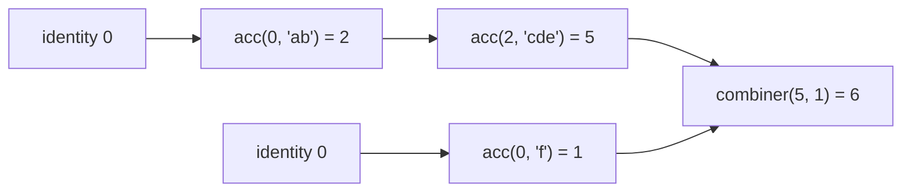

# Stream operations

This page is a reference for every operation on `Stream<T>`, each with a small runnable example. Intermediate
operations return a new stream and run nothing; terminal operations run the pipeline and produce a result (see the
[overview](overview.md) for laziness and the single-use rule). The number streams share most of these operations
and add a few of their own — see [number streams](number-streams.md).

- [At a glance](#at-a-glance)
- [Intermediate operations](#intermediate-operations): [filter](#filter) · [map](#map) ·
  [mapToInt / mapToLong / mapToDouble](#maptoint--maptolong--maptodouble) · [flatMap](#flatmap) ·
  [flatMapToInt / Long / Double](#flatmaptoint--long--double) · [mapMulti](#mapmulti) · [distinct](#distinct) ·
  [sorted](#sorted) · [peek](#peek) · [limit and skip](#limit-and-skip) ·
  [takeWhile and dropWhile](#takewhile-and-dropwhile) · [gather](#gather)
- [Terminal operations](#terminal-operations): [forEach / forEachOrdered](#foreach--foreachordered) ·
  [toArray](#toarray) · [reduce](#reduce) · [collect](#collect) · [toList](#tolist) · [min / max / count](#min--max--count) ·
  [anyMatch / allMatch / noneMatch](#anymatch--allmatch--nonematch) · [findFirst / findAny](#findfirst--findany) ·
  [iterator / spliterator](#iterator--spliterator)
- [Exceptions](#exceptions)

## At a glance

| Intermediate | Kind | Short-circuits |
|---|---|---|
| `filter(p)` | stateless | |
| `map(f)`, `mapToInt/Long/Double(f)` | stateless | |
| `flatMap(f)`, `flatMapToInt/Long/Double(f)` | stateless | |
| `mapMulti(f)`, `mapMultiToInt/Long/Double(f)` | stateless | |
| `peek(action)` | stateless | |
| `distinct()` | stateful | |
| `sorted()`, `sorted(cmp)` | stateful barrier | |
| `limit(n)` | stateful | yes |
| `skip(n)` | stateful | |
| `takeWhile(p)` | stateful | yes |
| `dropWhile(p)` | stateful | |
| `gather(g)` | depends on the gatherer | if the gatherer stops |

| Terminal | Returns | Short-circuits |
|---|---|---|
| `forEach(a)`, `forEachOrdered(a)` | `void` | |
| `toArray()`, `toArray(generator)` | `T[]` / the generated array | |
| `reduce(…)` | `T`, `Optional<T>` or `U` | |
| `collect(collector)`, `collect(supplier, acc, combiner)` | the collector's result / the container | |
| `toList()` | unmodifiable `List<T>` | |
| `min(cmp)`, `max(cmp)` | `Optional<T>` | |
| `count()` | `number` | |
| `anyMatch`, `allMatch`, `noneMatch` | `boolean` | yes |
| `findFirst()`, `findAny()` | `Optional<T>` | yes |
| `iterator()`, `spliterator()`, `for…of` | an iterator / spliterator | consumer-driven |

## Intermediate operations

### filter

Keeps the elements for which the predicate returns `true`.

```ts
import { Stream } from '@nodestd/collections';

console.log(Stream.of(1, 2, 3, 4, 5).filter((x) => x % 2 === 1).toList()); // → [1, 3, 5]
```

### map

Transforms each element. The mapper may return `null`; nulls flow through like any other element.

```ts
import { Stream } from '@nodestd/collections';

console.log(Stream.of('a', 'bb', 'ccc').map((s) => s.length).toList()); // → [1, 2, 3]
console.log(Stream.of(1, 2).map((x) => (x === 1 ? null : x)).toList()); // → [null, 2]
```

### mapToInt / mapToLong / mapToDouble

Map to a [number stream](number-streams.md), which adds `sum`, `average`, `summaryStatistics` and friends.

```ts
import { Stream } from '@nodestd/collections';

const words = Stream.of('one', 'three', 'five');
console.log(words.mapToInt((w) => w.length).sum()); // → 12
console.log(Stream.of('1.5', '2.5').mapToDouble(Number).average().getAsDouble()); // → 2
console.log(Stream.of(2, 3).mapToLong((x) => x ** 40).max().getAsLong() > 2 ** 60); // → true
```

### flatMap

Replaces each element by the elements of the stream the mapper returns. A `null`/`undefined` result counts as an
empty stream. Each inner stream is **closed** right after its elements have been pushed downstream, even when a
short-circuit stops the pipeline early, so `onClose` handlers of inner streams always run.

```ts
import { Stream, List } from '@nodestd/collections';

const lines = List.of('to be', 'or not');
console.log(lines.stream().flatMap((l) => Stream.of(...l.split(' '))).toList()); // → [to, be, or, not]

// null / undefined = nothing
console.log(Stream.of(1, 2, 3).flatMap((x) => (x === 2 ? null : Stream.of(x, x))).toList()); // → [1, 1, 3, 3]

// inner streams are closed as they are consumed
const log: string[] = [];
const first = Stream.of(1, 2, 3)
  .flatMap((x) => Stream.of(x * 10).onClose(() => log.push(`closed ${x}`)))
  .findFirst();
console.log(first, log); // → Optional[10] [ 'closed 1' ]
```

### flatMapToInt / Long / Double

`flatMap` whose mapper returns a number stream.

```ts
import { Stream, IntStream } from '@nodestd/collections';

const ranges = Stream.of(2, 3).flatMapToInt((n) => IntStream.range(0, n));
console.log(ranges.toArray()); // → [ 0, 1, 0, 1, 2 ]
```

### mapMulti

A push-style alternative to `flatMap`: the mapper calls `consumer` zero or more times per element. No inner
stream is created, which makes it cheaper when an element expands to a few values or when you want to filter and
map in one step. `mapMultiToInt/Long/Double` produce number streams.

```ts
import { Stream } from '@nodestd/collections';

const expanded = Stream.of(1, 2, 3).mapMulti<number>((x, emit) => {
  if (x !== 2) {
    emit(x);
    emit(-x);
  }
});
console.log(expanded.toList()); // → [1, -1, 3, -3]

const lengths = Stream.of('a', 'bcd').mapMultiToInt((s, emit) => emit(s.length));
console.log(lengths.sum()); // → 4
```

### distinct

Removes duplicates, keeping the first occurrence, using the same `equals`/`hashCode` semantics as `HashSet`:
primitives compare by value, objects with `equals`/`hashCode` (such as this library's collections) by content,
and plain JS objects by identity. It is stateful but not a barrier (see the [overview](overview.md#stateless-vs-stateful-operations)).

```ts
import { Stream, List } from '@nodestd/collections';

console.log(Stream.of(3, 1, 3, 2, 1).distinct().toList()); // → [3, 1, 2]
// equal lists are duplicates
console.log(Stream.of(List.of(1), List.of(1)).distinct().count()); // → 1
// plain objects compare by identity
console.log(Stream.of({ a: 1 }, { a: 1 }).distinct().count()); // → 2
```

To de-duplicate by a key, use a gatherer such as the `distinctBy` example in [gatherers](gatherers.md).

### sorted

`sorted()` uses natural order (numbers numerically, strings by code unit, objects through `compareTo`); elements
that cannot be compared throw `ClassCastException`. `sorted(comparator)` uses the comparator. The sort is stable.
`sorted(null)` throws `NullPointerException`. See [comparators](../utilities/comparator-and-objects.md) for
building comparators.

```ts
import { Stream, Comparator } from '@nodestd/collections';

console.log(Stream.of(10, 9, 1).sorted().toList()); // → [1, 9, 10]
console.log(Stream.of('pear', 'fig', 'apple').sorted(Comparator.comparing((s: string) => s.length)).toList()); // → [fig, pear, apple]
console.log(Stream.of(1, 3, 2).sorted(Comparator.reverseOrder()).toList()); // → [3, 2, 1]

try {
  Stream.of({ x: 2 }, { x: 1 }).sorted().toList();
} catch (e) {
  console.log((e as Error).name); // → ClassCastException
}
try {
  Stream.of(2, 1).sorted(null as never);
} catch (e) {
  console.log((e as Error).name); // → NullPointerException
}
```

### peek

Runs an action on each element as it passes, without changing it. Meant for debugging and logging: since the
pipeline may skip elements (`limit`, short-circuits) or not run at all, do not put required side effects here.

```ts
import { Stream } from '@nodestd/collections';

const seen: number[] = [];
const firstTwo = Stream.of(1, 2, 3, 4).peek((x) => seen.push(x)).limit(2).toList();
console.log(firstTwo, seen); // → [1, 2] [ 1, 2 ]

// count() can be answered from the source size: the peek never runs
const before = seen.length;
console.log(Stream.of(1, 2, 3).peek((x) => seen.push(x)).count(), seen.length - before); // → 3 0
```

### limit and skip

`limit(n)` keeps at most the first `n` elements (short-circuiting); `skip(n)` discards the first `n`. A negative or
non-integer `n` throws `IllegalArgumentException`.

```ts
import { Stream } from '@nodestd/collections';

console.log(Stream.iterate(1, (x) => x + 1).skip(2).limit(3).toList()); // → [3, 4, 5]
console.log(Stream.of(1, 2).skip(5).toList()); // → []
try {
  Stream.of(1).limit(-1);
} catch (e) {
  console.log((e as Error).name); // → IllegalArgumentException
}
```

### takeWhile and dropWhile

`takeWhile(p)` keeps elements while `p` holds and stops at the first failure (short-circuiting — it works on
infinite streams). `dropWhile(p)` discards elements while `p` holds, then passes everything after. Unlike `filter`,
both look at a **prefix** only.

```ts
import { Stream } from '@nodestd/collections';

console.log(Stream.of(1, 2, 3, 1).takeWhile((x) => x < 3).toList()); // → [1, 2]
console.log(Stream.of(1, 2, 3, 1).dropWhile((x) => x < 3).toList()); // → [3, 1]
console.log(Stream.of(1, 2, 3, 1).filter((x) => x < 3).toList()); // → [1, 2, 1]
console.log(Stream.iterate(1, (x) => x * 2).takeWhile((x) => x < 100).count()); // → 7
```

### gather

Applies a **gatherer**, a custom intermediate operation that can be one-to-one, one-to-many, many-to-one, stateful
or short-circuiting. Built-ins live in `Gatherers`; see [gatherers](gatherers.md) for writing your own.

```ts
import { Stream, Gatherers } from '@nodestd/collections';

console.log(Stream.of(1, 2, 3, 4, 5).gather(Gatherers.windowFixed(2)).toList()); // → [[1, 2], [3, 4], [5]]
console.log(Stream.of(1, 2, 3, 4).gather(Gatherers.scan(() => 0, (acc: number, x: number) => acc + x)).toList()); // → [1, 3, 6, 10]
```

## Terminal operations

### forEach / forEachOrdered

Run an action for each element. `forEach` makes no ordering promise in the Java API (for parallel streams);
`forEachOrdered` follows the encounter order. Since evaluation is sequential here, both visit elements in
encounter order — use `forEachOrdered` when your code depends on it, to state the intent.

```ts
import { Stream } from '@nodestd/collections';

const out: string[] = [];
Stream.of('a', 'b', 'c').forEachOrdered((s) => out.push(s));
console.log(out.join('')); // → abc
```

### toArray

`toArray()` returns a new JS array. `toArray(generator)` lets you choose the array: the generator receives the
element count and must return an array-like of exactly that length (a sized stream) or at least that length;
otherwise `IllegalStateException` / `IndexOutOfBoundsException` is thrown. Typed arrays work.

```ts
import { Stream } from '@nodestd/collections';

console.log(Stream.of(1, 2, 3).toArray()); // → [ 1, 2, 3 ]
const ints = Stream.of(1, 2, 3).toArray((n) => new Int32Array(n));
console.log(ints instanceof Int32Array, Array.from(ints)); // → true [ 1, 2, 3 ]

try {
  Stream.of(1, 2).toArray((n) => new Array<number>(n + 1));
} catch (e) {
  console.log((e as Error).name, (e as Error).message); // → IllegalStateException array length 3 is not the stream size 2
}
```

### reduce

Folds the elements into one value. Three forms:

| Form | Result | Empty stream |
|---|---|---|
| `reduce(identity, accumulator)` | `T` | `identity` |
| `reduce(accumulator)` | `Optional<T>` | `Optional.empty` |
| `reduce(identity, accumulator, combiner)` | `U` (may differ from `T`) | `identity` |

`identity` must be a neutral value for the operation (`0` for `+`, `1` for `*`, `''` for concatenation) and the
operations must be **associative**, because a parallel evaluation may reduce chunks separately and merge them with
the combiner. Here evaluation is sequential, so the combiner is never needed, but it must still be correct.



The diagram shows how `reduce(0, (n, s) => n + s.length, (a, b) => a + b)` *could* be evaluated in two chunks;
a sequential run is the left chain alone.

```ts
import { Stream } from '@nodestd/collections';

console.log(Stream.of(1, 2, 3, 4).reduce(0, (a, b) => a + b)); // → 10
console.log(Stream.of(1, 2, 3, 4).reduce((a, b) => a * b)); // → Optional[24]
console.log(Stream.empty<number>().reduce((a, b) => a * b)); // → Optional.empty

// different result type: needs the 3-argument form
const totalLength = Stream.of('ab', 'cde', 'f').reduce(0, (n, s) => n + s.length, (a, b) => a + b);
console.log(totalLength); // → 6
```

### collect

`collect(collector)` performs a mutable reduction with a `Collector` — see [collectors](collectors.md) for the
full catalogue. `collect(supplier, accumulator, combiner)` is the do-it-yourself form: `supplier` creates a
container, `accumulator` adds an element to it, `combiner` merges the second container into the first.

```ts
import { Stream, Collectors } from '@nodestd/collections';

console.log(Stream.of('b', 'a', 'b').collect(Collectors.toSet()).size()); // → 2
console.log(Stream.of('x', 'y').collect(Collectors.joining('+'))); // → x+y

const arr = Stream.of(1, 2, 3).collect(
  () => [] as number[],
  (a, x) => a.push(x * 2),
  (a, b) => a.push(...b),
);
console.log(arr); // → [ 2, 4, 6 ]
```

### toList

Returns an **unmodifiable** `List` in encounter order. Unlike `Collectors.toUnmodifiableList()`, it accepts `null`
elements. Mutators throw `UnsupportedOperationException`.

```ts
import { Stream } from '@nodestd/collections';

const list = Stream.of(1, null, 3).toList();
console.log(list); // → [1, null, 3]
try {
  list.add(4);
} catch (e) {
  console.log((e as Error).name); // → UnsupportedOperationException
}
```

### min / max / count

`min(cmp)` and `max(cmp)` return an `Optional` (empty for an empty stream); a `null` result throws
`NullPointerException` because an `Optional` cannot hold it. `count()` returns the number of elements; on a
sized source with no filtering stage it may compute the count without running the pipeline, so do not rely on
`peek` side effects there.

```ts
import { Stream, Comparator } from '@nodestd/collections';

const words = () => Stream.of('kiwi', 'banana', 'fig');
console.log(words().min(Comparator.naturalOrder())); // → Optional[banana]
console.log(words().max(Comparator.comparing((s: string) => s.length))); // → Optional[banana]
console.log(Stream.empty<string>().max(Comparator.naturalOrder())); // → Optional.empty
console.log(words().filter((w) => w.length < 5).count()); // → 2
```

### anyMatch / allMatch / noneMatch

Short-circuiting predicates: they stop as soon as the answer is known. On an empty stream `allMatch` and
`noneMatch` are `true` and `anyMatch` is `false`.

```ts
import { Stream } from '@nodestd/collections';

console.log(Stream.of(1, 2, 3).anyMatch((x) => x > 2)); // → true
console.log(Stream.of(1, 2, 3).allMatch((x) => x > 0)); // → true
console.log(Stream.of(1, 2, 3).noneMatch((x) => x > 5)); // → true
console.log(Stream.empty<number>().allMatch(() => false)); // → true

let tested = 0;
Stream.of(1, 2, 3, 4).anyMatch((x) => (tested++, x === 2));
console.log(tested); // → 2
```

### findFirst / findAny

Return the first element (`findAny`: any element; here it is always the first) as an `Optional`, short-circuiting.
A `null` element throws `NullPointerException`.

```ts
import { Stream } from '@nodestd/collections';

console.log(Stream.of(4, 5, 6).filter((x) => x > 4).findFirst()); // → Optional[5]
console.log(Stream.of(4, 5, 6).findAny().isPresent()); // → true
console.log(Stream.empty().findFirst()); // → Optional.empty
try {
  Stream.of(null, 1).findFirst();
} catch (e) {
  console.log((e as Error).name); // → NullPointerException
}
```

### iterator / spliterator

Escape hatches to pull elements yourself. `iterator()` returns the library's `Iterator` (`hasNext()`/`next()`),
`spliterator()` a [`Spliterator`](spliterators.md). Both are terminal; elements are produced on demand. Streams are
also JS iterables (`for…of`, spread).

```ts
import { Stream } from '@nodestd/collections';

const it = Stream.iterate(1, (x) => x * 3).iterator();
console.log(it.next(), it.next(), it.next()); // → 1 3 9

const sp = Stream.of('a', 'b').map((s) => s.toUpperCase()).spliterator();
const got: string[] = [];
while (sp.tryAdvance((s) => got.push(s)));
console.log(got); // → [ 'A', 'B' ]
```

## Exceptions

| Exception | When |
|---|---|
| `IllegalStateException` | the stream was already operated upon or closed; `toArray(generator)` returned an array of the wrong length; `Collectors.toMap` met a duplicate key |
| `NullPointerException` | a required function argument is `null` (e.g. `sorted(null)`, `filter(null)`); `findFirst`/`findAny`/`min`/`max`/`reduce(acc)` would return `null` |
| `IllegalArgumentException` | `limit`/`skip` with a negative or non-integer count |
| `ClassCastException` | `sorted()` / natural-order comparisons on values that are not comparable |
| `UnsupportedOperationException` | modifying the list returned by `toList()` |
| `IndexOutOfBoundsException` | `toArray(generator)` returned a too-short array for an unsized stream |

Exceptions thrown by your lambdas propagate unchanged out of the terminal operation (except in
`Gatherers.mapConcurrent`, which wraps errors that are not a `RuntimeException`, see [gatherers](gatherers.md)).
