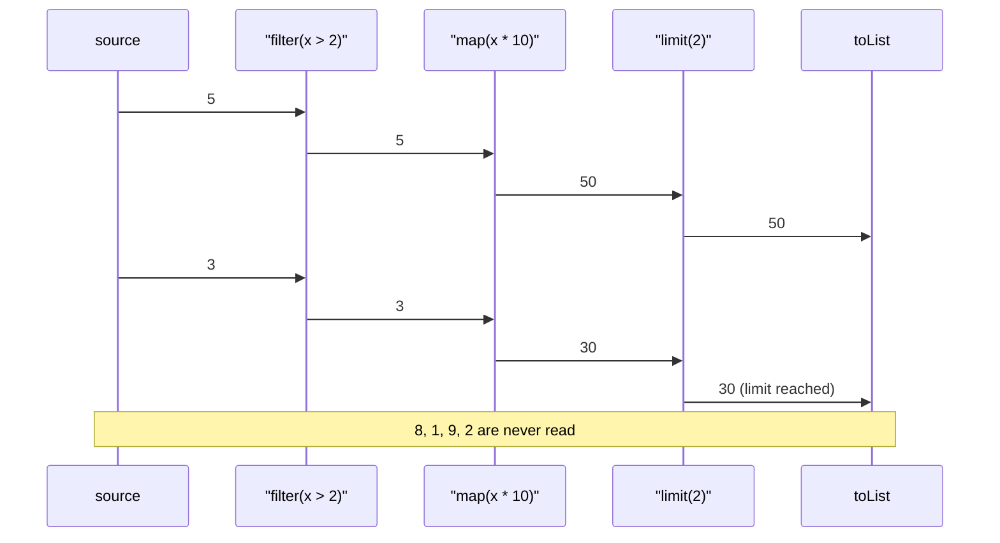
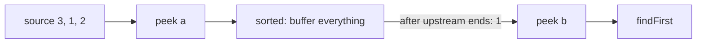

# Streams: overview

A **stream** is a lazy pipeline that pulls elements from a source (a collection, an array, a generator, a
range of numbers…), passes them through zero or more **intermediate operations** (`filter`, `map`, `sorted`, …)
and ends in exactly one **terminal operation** (`toList`, `reduce`, `collect`, `count`, …) that produces a result.
Nothing happens until the terminal operation runs; then each element travels through the whole pipeline before
the next one starts, so no intermediate arrays are built and work stops as soon as the result is known. This page
explains the model; the other stream pages are references for the individual pieces.

- [A first example](#a-first-example)
- [Sources](#sources)
- [Intermediate vs terminal operations](#intermediate-vs-terminal-operations)
- [Laziness and element-by-element evaluation](#laziness-and-element-by-element-evaluation)
- [Short-circuiting and infinite streams](#short-circuiting-and-infinite-streams)
- [Single use](#single-use)
- [Stateless vs stateful operations](#stateless-vs-stateful-operations)
- [Ordering and `unordered()`](#ordering-and-unordered)
- [`parallel()`](#parallel)
- [Closing streams](#closing-streams)
- [Iterating a stream from JS](#iterating-a-stream-from-js)
- [Streams vs array methods vs Iterator helpers](#streams-vs-array-methods-vs-iterator-helpers)

Related pages: [operations](operations.md) · [number streams](number-streams.md) · [collectors](collectors.md) ·
[gatherers](gatherers.md) · [Optional](optional.md) · [spliterators](spliterators.md) ·
[core concepts](../guide/core-concepts.md)

## A first example

```ts
import { List, Collectors } from 'ts-collections-framework';

const words = List.of('stream', 'map', 'filter', 'reduce', 'sorted', 'limit');

const longWordsByLength = words
  .stream()
  .filter((w) => w.length > 5)               // intermediate
  .map((w) => w.toUpperCase())               // intermediate
  .collect(Collectors.joining(', ', '<', '>')); // terminal

console.log(longWordsByLength); // → <STREAM, FILTER, REDUCE, SORTED>
```

## Sources

Every collection has `stream()` (and `parallelStream()`, see [`parallel()`](#parallel)). The static factories
cover everything else:

| Factory | Produces |
|---|---|
| `collection.stream()` | the collection's elements, in its iteration order |
| `Stream.of(a, b, …)` | the given values |
| `Stream.ofNullable(x)` | one element, or an empty stream when `x` is `null`/`undefined` |
| `Stream.empty()` | no elements |
| `Stream.iterate(seed, f)` | `seed, f(seed), f(f(seed)), …` — infinite |
| `Stream.iterate(seed, hasNext, next)` | like a `for` loop: stops when `hasNext` is false |
| `Stream.generate(supplier)` | `supplier()` called for each element — infinite |
| `Stream.concat(a, b)` | all of `a`, then all of `b` (lazy) |
| `Stream.builder()` | add elements one by one, then `build()` |
| `Stream.from(iterable)` | any JS iterable (JS extra); a generator stopped early (`findFirst`, `limit`, a throw, `break`, `close()`) is closed, so its `finally` runs |
| `Stream.ofArray(array)` | the array itself, read when the terminal runs — no copy (JS extra) |
| `IntStream.range(a, b)` / `rangeClosed(a, b)` | `a … b-1` / `a … b` (also `LongStream`) |
| `IntStream.of`, `DoubleStream.generate`, … | the same factories for [number streams](number-streams.md) |
| `optional.stream()` | zero or one element ([Optional](optional.md)) |
| `StreamSupport.stream(spliterator, parallel)` | a custom source ([spliterators](spliterators.md)) |

```ts
import { Stream, IntStream, ArrayList, List } from 'ts-collections-framework';

console.log(new ArrayList(List.of(1, 2, 3)).stream().toList()); // → [1, 2, 3]
console.log(Stream.of('a', 'b').toList());                  // → [a, b]
console.log(Stream.ofNullable(null).count());               // → 0
console.log(Stream.iterate(1, (x) => x * 2).limit(5).toList()); // → [1, 2, 4, 8, 16]
console.log(Stream.iterate(1, (x) => x < 20, (x) => x * 3).toList()); // → [1, 3, 9]

let n = 0;
console.log(Stream.generate(() => ++n).limit(3).toList()); // → [1, 2, 3]

console.log(Stream.concat(Stream.of(1, 2), Stream.of(3)).toList()); // → [1, 2, 3]
console.log(Stream.builder<string>().add('x').add('y').build().toList()); // → [x, y]

console.log(Stream.from(new globalThis.Set(['js', 'set'])).toList()); // → [js, set]
console.log(Stream.from('héllo').count()); // → 5
console.log(IntStream.range(0, 5).toArray()); // → [ 0, 1, 2, 3, 4 ]
console.log(IntStream.rangeClosed(1, 3).sum()); // → 6
```

`Stream.ofArray` does not copy: the range (`0` to the array's length at creation) is fixed, but the elements are
read when the terminal operation runs, so element updates made before then are visible:

```ts
import { Stream } from 'ts-collections-framework';

const data = [1, 2];
const s = Stream.ofArray(data);
data[0] = 100;
data.push(3); // outside the stream's range
console.log(s.toList()); // → [100, 2]
```

## Intermediate vs terminal operations

| | Intermediate | Terminal |
|---|---|---|
| Returns | a new stream | a result (value, collection, `Optional`, `void`) |
| Runs | nothing yet — it only adds a stage | the whole pipeline |
| Examples | `filter`, `map`, `flatMap`, `distinct`, `sorted`, `peek`, `limit`, `skip`, `takeWhile`, `dropWhile`, `gather` | `forEach`, `toArray`, `toList`, `reduce`, `collect`, `count`, `min`, `max`, `anyMatch`, `findFirst`, `iterator` |

A pipeline without a terminal operation does nothing at all:

```ts
import { Stream } from 'ts-collections-framework';

const seen: number[] = [];
const pipeline = Stream.of(1, 2, 3).peek((x) => seen.push(x)).map((x) => x * 2);
console.log(seen); // → []
console.log(pipeline.toList()); // → [2, 4, 6]
console.log(seen); // → [ 1, 2, 3 ]
```

## Laziness and element-by-element evaluation

Array methods work **horizontally**: `filter` processes the whole array and builds a new one, then `map` runs
over that one, and so on. A stream works **vertically**: the source pushes one element through every stage, then
the next element. That is why `limit(2)` below stops the source after the fourth element instead of filtering all
six.



The `peek` log proves the order:

```ts
import { Stream } from 'ts-collections-framework';

const log: string[] = [];
const result = Stream.of(5, 3, 8, 1, 9, 2)
  .peek((x) => log.push(`read ${x}`))
  .filter((x) => x > 2)
  .peek((x) => log.push(`kept ${x}`))
  .map((x) => x * 10)
  .limit(2)
  .toList();

console.log(result); // → [50, 30]
console.log(log.join(', ')); // → read 5, kept 5, read 3, kept 3
```

## Short-circuiting and infinite streams

Some operations can finish without seeing all elements: `limit`, `takeWhile`, `findFirst`, `findAny`, `anyMatch`,
`allMatch`, `noneMatch` (and gatherers that stop, see [gatherers](gatherers.md)). Because evaluation is lazy and
element-by-element, they work on infinite sources:

```ts
import { Stream, IntStream } from 'ts-collections-framework';

// first square above 1000
console.log(IntStream.iterate(1, (i) => i + 1).map((i) => i * i).filter((sq) => sq > 1000).findFirst().getAsInt()); // → 1024

// primes, lazily
const isPrime = (n: number) => n > 1 && IntStream.rangeClosed(2, Math.floor(Math.sqrt(n))).noneMatch((d) => n % d === 0);
console.log(Stream.iterate(2, (n) => n + 1).filter(isPrime).limit(6).toList()); // → [2, 3, 5, 7, 11, 13]

console.log(Stream.iterate(1, (x) => x + 1).anyMatch((x) => x > 100)); // → true
```

A non-short-circuiting terminal (`count`, `toList`, `forEach`, `collect`, …) on an infinite stream never returns,
and neither does `sorted()` or `distinct()` before `limit`: put the `limit` first.

## Single use

A stream is a one-shot pipeline, not a collection. Once an operation has been called on a stream object
(intermediate or terminal), using that same object again throws `IllegalStateException`. To traverse the data
twice, create a new stream from the source each time (a `() => Stream` function is a handy "reusable stream").

```ts
import { Stream, List } from 'ts-collections-framework';

const s = Stream.of(1, 2, 3);
console.log(s.count()); // → 3
try {
  s.count();
} catch (e) {
  console.log((e as Error).name, (e as Error).message); // → IllegalStateException stream has already been operated upon or closed
}

const base = Stream.of(1, 2, 3);
base.map((x) => x * 2); // `base` is now linked to the new stage
try {
  base.filter((x) => x > 1);
} catch (e) {
  console.log((e as Error).name); // → IllegalStateException
}

const nums = List.of(1, 2, 3);
const evens = () => nums.stream().filter((x) => x % 2 === 0);
console.log(evens().count(), evens().toList()); // → 1 [2]
```

## Stateless vs stateful operations

| Kind | Operations | Memory | Notes |
|---|---|---|---|
| Stateless | `filter`, `map`, `mapToX`, `flatMap`, `mapMulti`, `peek` | none | each element handled independently |
| Stateful, streaming | `limit`, `skip`, `takeWhile`, `dropWhile`, `distinct` | a counter, flag or a seen-set | elements still flow one at a time (`distinct` remembers what it saw) |
| Stateful, barrier | `sorted` | buffers **all** elements | nothing passes until the upstream is exhausted |

`sorted()` is a **barrier**: it cannot emit the smallest element before it has seen every element. Downstream
work then resumes element by element, and a short-circuit after the barrier stops the *downstream* early, but the
upstream has already been fully read.



```ts
import { Stream } from 'ts-collections-framework';

const log: string[] = [];
const first = Stream.of(3, 1, 2)
  .peek((x) => log.push(`a${x}`))
  .sorted()
  .peek((x) => log.push(`b${x}`))
  .findFirst();

console.log(first); // → Optional[1]
console.log(log.join(' ')); // → a3 a1 a2 b1
```

`distinct()` is stateful but **not** a barrier: it emits an element the first time it sees it.

```ts
import { Stream } from 'ts-collections-framework';

const log: string[] = [];
Stream.of(1, 1, 2, 3)
  .distinct()
  .peek((x) => log.push(String(x)))
  .limit(2)
  .forEach(() => {});
console.log(log.join(' ')); // → 1 2
```

## Ordering and `unordered()`

A stream has an **encounter order** when its source does (lists, arrays, `LinkedHashSet`, `TreeSet`, ranges,
`iterate`). Hash-based sources (`HashSet`, `HashMap` views) have none. Operations keep the encounter order of an
ordered stream — `findFirst`, `limit`, `skip`, `toList`, `forEachOrdered` and the like respect it.

`unordered()` drops the ordering constraint so an operation *may* choose a cheaper strategy. Since evaluation is
sequential here, results come out in source order anyway; treat `unordered()` as a declaration of intent, and do
not rely on any particular order after it.

```ts
import { Stream } from 'ts-collections-framework';

console.log(Stream.of(1, 2, 3).unordered().toList()); // → [1, 2, 3]
```

## `parallel()`

`parallel()`, `sequential()` and `collection.parallelStream()` set a flag that `isParallel()` reports. JS runs a
stream on one thread, so **evaluation is always sequential**. Every parallel-capable operation in the classic
stream API is specified so that a sequential run gives a valid result, so code written for parallel streams
(associative reducers, combiners, `findAny`) works unchanged and produces the same results.

```ts
import { Stream, List } from 'ts-collections-framework';

const s = List.of(1, 2, 3).parallelStream();
console.log(s.isParallel()); // → true
console.log(s.sequential().isParallel()); // → false
console.log(Stream.of(4, 5, 6).parallel().findAny()); // → Optional[4]
```

## Closing streams

Streams over in-memory data need no cleanup. When a stream owns a resource, register cleanup with
`onClose(handler)`; `close()` runs the handlers in registration order, once. A terminal operation does **not**
close the stream. If a handler throws, the rest still run and the first error is rethrown (later ones are added
as suppressed).

```ts
import { Stream } from 'ts-collections-framework';

const log: string[] = [];
const s = Stream.of(1, 2)
  .onClose(() => log.push('first'))
  .onClose(() => log.push('second'));

console.log(s.count()); // → 2
console.log(log); // → []
s.close();
s.close(); // second close does nothing
console.log(log); // → [ 'first', 'second' ]
```

Streams implement `Symbol.dispose`, so a `using` declaration closes them at the end of the block:

```ts
import { Stream } from 'ts-collections-framework';

const events: string[] = [];
function openLines() {
  return Stream.of('line 1', 'line 2').onClose(() => events.push('file closed'));
}

{
  using lines = openLines();
  events.push(`counted ${lines.count()}`);
} // `lines` is closed here
events.push('after block');
console.log(events); // → [ 'counted 2', 'file closed', 'after block' ]
```

`Stream.concat(a, b)` closes both inputs when it is closed, and `flatMap` closes each inner stream as soon as it
has been consumed (see [operations](operations.md#flatmap)).

## Iterating a stream from JS

Streams are JS iterables: `for…of`, spread and destructuring consume them like `iterator()` does (a terminal
operation, so the stream is used up afterwards). `iterator()` returns the library's `Iterator`
(`hasNext()`/`next()`).

```ts
import { Stream } from 'ts-collections-framework';

const seen: string[] = [];
for (const w of Stream.of('a', 'b').map((s) => s.toUpperCase())) seen.push(w);
console.log(seen); // → [ 'A', 'B' ]

console.log([...Stream.of(1, 2, 3).map((x) => x * x)]); // → [ 1, 4, 9 ]
const [first, second] = Stream.iterate(10, (x) => x + 1); // lazy: only two elements are produced
console.log(first, second); // → 10 11

const it = Stream.of('x', 'y').iterator();
const out: string[] = [];
while (it.hasNext()) out.push(it.next());
console.log(out); // → [ 'x', 'y' ]
```

## Streams vs array methods vs Iterator helpers

| | Array methods | Iterator helpers (`values().map()`) | Streams |
|---|---|---|---|
| Evaluation | eager, one stage at a time | lazy, element by element | lazy, element by element |
| Intermediate arrays | one per stage | none | none |
| Short-circuit over infinite sources | no | yes (`take`, `find`, `some`) | yes |
| Sorting, distinct, grouping | `sort` (in place), manual | none | `sorted`, `distinct`, [`Collectors`](collectors.md), [`Gatherers`](gatherers.md) |
| Number aggregates | manual `reduce` | manual | `sum`, `average`, `summaryStatistics` (compensated double sums) |
| Reusable result | yes, it's an array | single use | single use |

```ts
import { Stream, Collectors } from 'ts-collections-framework';

type Order = { customer: string; total: number };
const orders: Order[] = [
  { customer: 'ann', total: 30 },
  { customer: 'bob', total: 12 },
  { customer: 'ann', total: 5 },
];

// array methods: fine for short one-off transformations of small arrays
console.log(orders.filter((o) => o.total > 10).map((o) => o.customer)); // → [ 'ann', 'bob' ]

// stream: one pass, plus a collector for the grouping
const totals = Stream.ofArray(orders).collect(
  Collectors.groupingBy((o: Order) => o.customer, Collectors.summingInt((o: Order) => o.total)),
);
console.log(totals.get('ann'), totals.get('bob')); // → 35 12
```

```ts nocheck
// Iterator helpers (ES2025) are lazy too, but stop at map/filter/take/drop/flatMap/reduce:
const firstBig = [5, 3, 8].values().filter((x) => x > 4).map((x) => x * 10).take(1).toArray(); // [50]
```

When to use which:

- **Array methods** for small arrays, when you want an array back and the code reads naturally.
- **Iterator helpers** for simple lazy chains over JS iterables when you need nothing else.
- **Streams** when you work with this library's collections, need grouping, partitioning, statistics, sorting,
  `distinct`, windows, `Optional` results, or want short-circuiting over large or infinite sources without
  intermediate arrays. See [performance](../advanced/performance.md) for measurements.
