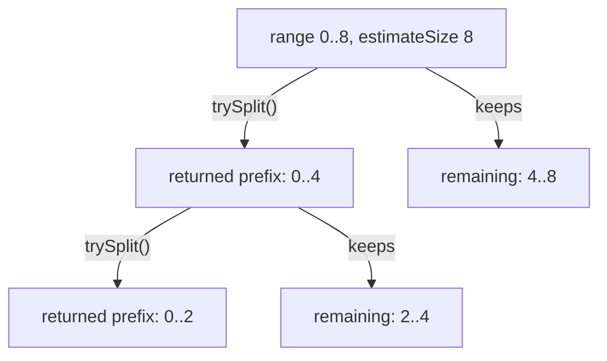

# Spliterators and custom stream sources

A **spliterator** ("splittable iterator") is the low-level protocol every stream reads its source through. It
hands out elements one at a time (`tryAdvance`) or all at once (`forEachRemaining`), can split off part of its
elements for parallel work (`trySplit`), and describes the source with a size estimate and **characteristic
flags** (ordered, sized, sorted, distinct, …) that let the stream engine skip work — for example `count()` on a
`SIZED` source without traversing it. You only need this page to build a stream over a custom data source, or to
understand why an operation is fast on one collection and slower on another.

- [The protocol](#the-protocol)
- [Splitting](#splitting)
- [Characteristic flags](#characteristic-flags)
- [What each collection reports](#what-each-collection-reports)
- [Spliterators utilities](#spliterators-utilities)
- [AbstractSpliterator and the number variants](#abstractspliterator-and-the-number-variants)
- [Building a stream with StreamSupport](#building-a-stream-with-streamsupport)

## The protocol

| Method | Does |
|---|---|
| `tryAdvance(action)` | if an element remains, calls `action(element)` and returns `true`; otherwise returns `false` |
| `forEachRemaining(action)` | calls `action` for every remaining element (usually faster than a `tryAdvance` loop) |
| `trySplit()` | splits off a prefix into a new spliterator and keeps the rest, or returns `null` |
| `estimateSize()` | remaining elements; exact when `SIZED`, `Infinity` when unknown |
| `getExactSizeIfKnown()` | `estimateSize()` if `SIZED`, else `-1` |
| `characteristics()` | bitwise OR of the flags below |
| `hasCharacteristics(flags)` | `true` if all the given flags are set |
| `getComparator()` | the source's comparator when `SORTED` (`null` = natural order); throws `IllegalStateException` otherwise |

```ts
import { IntStream } from 'ts-collections-framework';

const sp = IntStream.range(0, 3).spliterator();
const got: number[] = [];
console.log(sp.tryAdvance((x) => got.push(x)), got, sp.estimateSize()); // → true [ 0 ] 2
sp.forEachRemaining((x) => got.push(x));
console.log(got); // → [ 0, 1, 2 ]
console.log(sp.tryAdvance((x) => got.push(x))); // → false
```

A spliterator is single-use and, like an iterator, not meant to be shared.

## Splitting

`trySplit()` is how a parallel runtime divides work: each call hands out a prefix and keeps the suffix, and the
pieces together cover the source exactly once, in order. Array-backed and range spliterators split in half.



```ts
import { IntStream } from 'ts-collections-framework';

const rest = IntStream.range(0, 8).spliterator();
const prefix = rest.trySplit()!;
console.log(prefix.estimateSize(), rest.estimateSize()); // → 4 4

const quarter = prefix.trySplit()!;
const a: number[] = [];
quarter.forEachRemaining((x) => a.push(x));
console.log(a, prefix.estimateSize()); // → [ 0, 1 ] 2
```

Streams here always run sequentially, so the engine never calls `trySplit` for you; it is still part of the
contract, and a custom spliterator may simply return `null`.

## Characteristic flags

The flags are constants on `Spliterator` (same bit values as the Java API):

| Flag | Value | Promise |
|---|---|---|
| `Spliterator.ORDERED` | `0x10` | elements have a defined encounter order |
| `Spliterator.DISTINCT` | `0x1` | no two elements are `equals` |
| `Spliterator.SORTED` | `0x4` | elements follow `getComparator()` (or natural order); implies `ORDERED` |
| `Spliterator.SIZED` | `0x40` | `estimateSize()` is exact |
| `Spliterator.SUBSIZED` | `0x4000` | every `trySplit` result is `SIZED` too |
| `Spliterator.NONNULL` | `0x100` | no element is `null` |
| `Spliterator.IMMUTABLE` | `0x400` | the source cannot change during traversal |
| `Spliterator.CONCURRENT` | `0x1000` | the source may change safely during traversal |

The engine uses them: `distinct()` on a `DISTINCT` source and `sorted()` on a naturally `SORTED` one are no-ops,
`count()` and `toArray()` on a `SIZED` pipeline need no counting pass. Report only what is true — a wrong flag gives
wrong results.

```ts
import { Spliterator, TreeSet, List } from 'ts-collections-framework';

const flags = (c: number) =>
  (Object.keys(Spliterator) as (keyof typeof Spliterator)[]).filter((k) => (c & Spliterator[k]) !== 0).join(' | ');

const sp = new TreeSet(List.of(3, 1, 2)).spliterator();
console.log(flags(sp.characteristics())); // → DISTINCT | SORTED | ORDERED | SIZED
console.log(sp.hasCharacteristics(Spliterator.SORTED | Spliterator.DISTINCT)); // → true
console.log(sp.getComparator()); // → null
try {
  List.of(1).spliterator().getComparator();
} catch (e) {
  console.log((e as Error).name); // → IllegalStateException
}
```

## What each collection reports

| Source | Characteristics |
|---|---|
| `ArrayList`, `Vector`, `LinkedList`, `List.of(…)` | `ORDERED`, `SIZED`, `SUBSIZED` |
| `ArrayDeque` | `ORDERED`, `SIZED`, `SUBSIZED`, `NONNULL` |
| `PriorityQueue` | `SIZED`, `SUBSIZED`, `NONNULL` (heap order is not an encounter order) |
| `HashSet`, `HashMap` key/entry sets | `DISTINCT`, `SIZED` |
| `HashMap.values()` | `SIZED` |
| `LinkedHashSet`, `LinkedHashMap` key set | `DISTINCT`, `ORDERED`, `SIZED`, `SUBSIZED` |
| `TreeSet`, `TreeMap` key/entry sets | `DISTINCT`, `SORTED`, `ORDERED`, `SIZED` |
| `TreeMap.values()` | `ORDERED`, `SIZED` |
| `Set.of(…)` | `DISTINCT`, `SIZED`, `SUBSIZED` |
| `Stream.of(…)`, `Stream.ofArray(…)` | `ORDERED`, `SIZED`, `SUBSIZED`, `IMMUTABLE` |
| `IntStream.range(…)` | `ORDERED`, `SIZED`, `SUBSIZED`, `IMMUTABLE`, `NONNULL`, `DISTINCT`, `SORTED` |
| `Stream.iterate(…)` | `ORDERED`, `IMMUTABLE` (unknown size) |
| `Stream.generate(…)` | `IMMUTABLE` (unknown size) |
| `Stream.from(jsIterable)` | `ORDERED` (unknown size); a JS array is read like `Stream.ofArray` (`ORDERED`, `SIZED`, `SUBSIZED`, `IMMUTABLE`), and a library collection through its own spliterator |

Collection spliterators are **late-binding** and **fail-fast**: they bind to the collection when traversal
starts, so changes made after `stream()` but before the terminal operation are seen; structural changes *during*
traversal throw `ConcurrentModificationException`.

```ts
import { ArrayList } from 'ts-collections-framework';

const list = new ArrayList<number>();
list.add(1);
const s = list.stream().map((x) => x * 10);
list.add(2); // before the terminal: included
console.log(s.toList()); // → [10, 20]

try {
  list.stream().forEach((x) => {
    if (x === 1) list.add(99);
  });
} catch (e) {
  console.log((e as Error).name); // → ConcurrentModificationException
}
```

## Spliterators utilities

| Method | Returns |
|---|---|
| `Spliterators.spliterator(array, characteristics)` | over a whole array-like (typed arrays too); adds `SIZED` and `SUBSIZED` |
| `Spliterators.spliterator(array, from, to, characteristics)` | over `array[from..to)`; bad bounds throw `ArrayIndexOutOfBoundsException` |
| `Spliterators.spliterator(collection, characteristics)` | over a collection's iterator, sized by `collection.size()` |
| `Spliterators.spliterator(iterator, size, characteristics)` | over an iterator with a known size |
| `Spliterators.spliteratorUnknownSize(iterator, characteristics)` | over an iterator, size `Infinity` |
| `Spliterators.iterator(spliterator)` | an `Iterator` (`hasNext`/`next`) over a spliterator |
| `Spliterators.emptySpliterator()` | no elements (also `emptyIntSpliterator`, `emptyLongSpliterator`, `emptyDoubleSpliterator`) |
| `Spliterators.AbstractSpliterator` | base class: implement `tryAdvance` only |
| `Spliterators.AbstractIntSpliterator`, `AbstractLongSpliterator`, `AbstractDoubleSpliterator` | the same for number sources |

The iterator arguments are the library's `Iterator` (`hasNext()`/`next()`), as returned by `collection.iterator()`.

```ts
import { Spliterators, Spliterator, List } from 'ts-collections-framework';

const arr = Spliterators.spliterator([10, 20, 30, 40], Spliterator.ORDERED);
console.log(arr.getExactSizeIfKnown()); // → 4

const slice = Spliterators.spliterator([10, 20, 30, 40], 1, 3, Spliterator.ORDERED);
const seen: number[] = [];
slice.forEachRemaining((x) => seen.push(x));
console.log(seen); // → [ 20, 30 ]

try {
  Spliterators.spliterator([1, 2, 3], 3, 1, 0);
} catch (e) {
  console.log((e as Error).name, (e as Error).message); // → ArrayIndexOutOfBoundsException origin(3) > fence(1)
}

const unknown = Spliterators.spliteratorUnknownSize(List.of('a', 'b').iterator(), Spliterator.ORDERED);
console.log(unknown.estimateSize(), unknown.getExactSizeIfKnown()); // → Infinity -1

const sized = Spliterators.spliterator(List.of('a', 'b').iterator(), 2, Spliterator.ORDERED);
console.log(sized.getExactSizeIfKnown()); // → 2

const it = Spliterators.iterator(Spliterators.spliterator(['x', 'y'], 0));
console.log(it.next(), it.next(), it.hasNext()); // → x y false

console.log(Spliterators.emptySpliterator().tryAdvance(() => {})); // → false
```

## AbstractSpliterator and the number variants

Extend `Spliterators.AbstractSpliterator<T>` (or `AbstractIntSpliterator` / `AbstractLongSpliterator` /
`AbstractDoubleSpliterator` for numbers) and implement only `tryAdvance`. Call `super(estimatedSize,
characteristics)`; pass `Infinity` when the size is unknown (`SIZED` implies `SUBSIZED`). You get
`forEachRemaining`, `estimateSize`, `characteristics` and a `trySplit` that copies out growing batches into an
array-backed spliterator.

```ts
import { Spliterators, Spliterator, StreamSupport } from 'ts-collections-framework';

class Countdown extends Spliterators.AbstractSpliterator<number> {
  constructor(private n: number) {
    super(n, Spliterator.ORDERED | Spliterator.SIZED | Spliterator.NONNULL);
  }
  tryAdvance(action: (t: number) => void): boolean {
    if (this.n <= 0) return false;
    action(this.n--);
    return true;
  }
}

console.log(StreamSupport.stream(new Countdown(3), false).toList()); // → [3, 2, 1]
console.log(StreamSupport.stream(new Countdown(5), false).count()); // → 5

class Fibonacci extends Spliterators.AbstractLongSpliterator {
  private a = 0;
  private b = 1;
  constructor() {
    super(Infinity, Spliterator.ORDERED | Spliterator.NONNULL | Spliterator.IMMUTABLE);
  }
  tryAdvance(action: (n: number) => void): boolean {
    action(this.a);
    [this.a, this.b] = [this.b, this.a + this.b];
    return true;
  }
}

console.log(StreamSupport.longStream(new Fibonacci(), false).limit(10).boxed().toList()); // → [0, 1, 1, 2, 3, 5, 8, 13, 21, 34]
```

## Building a stream with StreamSupport

`StreamSupport.stream(spliterator, parallel)` wraps a spliterator in a `Stream`; `intStream`, `longStream` and
`doubleStream` do the same for number streams. The `parallel` flag only sets `isParallel()` (see the
[overview](overview.md#parallel)).

```ts
import { StreamSupport, Spliterators, Spliterator } from 'ts-collections-framework';

const words = StreamSupport.stream(Spliterators.spliterator(['a', 'b'], Spliterator.ORDERED), false);
console.log(words.map((w) => w.toUpperCase()).toList()); // → [A, B]

const sum = StreamSupport.intStream(Spliterators.spliterator(Int32Array.of(5, 6), Spliterator.ORDERED), false).sum();
console.log(sum); // → 11
```

**The supplier form** — `StreamSupport.stream(() => spliterator, characteristics, parallel)` — defers creating the
spliterator until the terminal operation starts (or `spliterator()`/`iterator()` is first called). Use it when the
source must be bound late, for example a mutable structure that may still change between building the pipeline
and running it. `characteristics` must match what the supplied spliterator will report.

```ts
import { StreamSupport, Spliterator, ArrayList } from 'ts-collections-framework';

const buffer = new ArrayList<string>();
buffer.add('first');
const s = StreamSupport.stream(() => buffer.spliterator(), Spliterator.ORDERED | Spliterator.SIZED | Spliterator.SUBSIZED, false);
buffer.add('second'); // the supplier has not run yet
console.log(s.toList()); // → [first, second]
```

A complete custom source — a stream over the lines of a string, read lazily:

```ts
import { Spliterators, Spliterator, StreamSupport } from 'ts-collections-framework';

class LineSpliterator extends Spliterators.AbstractSpliterator<string> {
  private pos = 0;
  constructor(private readonly text: string) {
    super(Infinity, Spliterator.ORDERED | Spliterator.NONNULL | Spliterator.IMMUTABLE);
  }
  tryAdvance(action: (line: string) => void): boolean {
    if (this.pos > this.text.length) return false;
    const end = this.text.indexOf('\n', this.pos);
    const stop = end === -1 ? this.text.length : end;
    action(this.text.slice(this.pos, stop));
    this.pos = stop + 1;
    return true;
  }
}

const lines = (text: string) => StreamSupport.stream(new LineSpliterator(text), false);
console.log(lines('a\nbb\n\nccc').filter((l) => l.length > 0).toList()); // → [a, bb, ccc]
console.log(lines('x\ny\nz').skip(1).findFirst()); // → Optional[y]
```

For JS iterables you usually don't need any of this: `Stream.from(iterable)` does it for you (see
[sources](overview.md#sources)).
