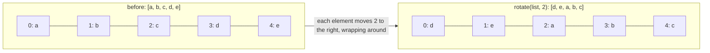

# The `Collections` utility

`Collections` is a plain object of static helpers that work on any `List`, `Set`, `Map`, `Queue` or `Deque` from this library, and on your own classes built from the [abstract skeletons](../advanced/custom-collections.md). It provides the classic algorithms (sort, shuffle, rotate, binary search and so on), shared empty and singleton collections, adapters between the old `Enumeration` style and iterators, and the view wrappers. Every helper throws `NullPointerException` when a collection argument is `null` or `undefined`. The algorithms check whether a list is random-access, so they stay O(n) on a `LinkedList`.

**Contents**

- [Algorithms](#algorithms)
  - [sort, reverse, swap, fill, copy](#sort-reverse-swap-fill-copy)
  - [shuffle with a seeded RandomSource](#shuffle-with-a-seeded-randomsource)
  - [rotate](#rotate)
  - [binarySearch and the insertion point](#binarysearch-and-the-insertion-point)
  - [min, max, frequency, disjoint](#min-max-frequency-disjoint)
  - [indexOfSubList, lastIndexOfSubList, replaceAll, addAll](#indexofsublist-lastindexofsublist-replaceall-addall)
  - [nCopies and reverseOrder](#ncopies-and-reverseorder)
  - [Random access and LinkedList](#random-access-and-linkedlist)
- [Empty and singleton collections](#empty-and-singleton-collections)
- [Empty iterators and enumerations](#empty-iterators-and-enumerations)
- [Enumeration adapters: `enumeration` and `list`](#enumeration-adapters-enumeration-and-list)
- [Adapters: `asLifoQueue`, `newSetFromMap`, `newSequencedSetFromMap`](#adapters-aslifoqueue-newsetfrommap-newsequencedsetfrommap)
- [Wrappers](#wrappers)
- [Quick reference](#quick-reference)

## Algorithms

### sort, reverse, swap, fill, copy

`Collections.sort(list, c?)` calls `list.sort(c)`. The sort is **stable**: elements that compare equal keep their relative order. If you omit the comparator or pass `null`, natural ordering is used (see [Comparator and Objects](./comparator-and-objects.md#natural-ordering)). Unlike `Array.prototype.sort`, there is no string conversion, so numbers sort numerically.

```ts
import { ArrayList, Collections, Comparator } from '@nodestd/collections';

const nums = ArrayList.of(10, 9, 100, 1);
Collections.sort(nums);
console.log(nums); // → [1, 9, 10, 100]

// stable: words of equal length keep their original order
const words = ArrayList.of('pear', 'fig', 'kiwi', 'apple', 'yam');
Collections.sort(words, Comparator.comparing((w: string) => w.length));
console.log(words); // → [fig, yam, pear, kiwi, apple]
```

`reverse`, `swap` and `fill` change a list in place. `copy(dest, src)` overwrites the first `src.size()` positions of `dest`. It never grows `dest`, so a source that is too large throws `IndexOutOfBoundsException`.

```ts
import { ArrayList, Collections, List } from '@nodestd/collections';

const l = ArrayList.of('a', 'b', 'c', 'd');
Collections.reverse(l);
console.log(l); // → [d, c, b, a]

Collections.swap(l, 0, 3);
console.log(l); // → [a, c, b, d]

Collections.fill(l, '-');
console.log(l); // → [-, -, -, -]

const dest = ArrayList.of(1, 2, 3, 4);
Collections.copy(dest, List.of(9, 8));
console.log(dest); // → [9, 8, 3, 4]

try {
  Collections.copy(ArrayList.of(1), List.of(1, 2));
} catch (e) {
  console.log((e as Error).name); // → IndexOutOfBoundsException
}
```

### shuffle with a seeded RandomSource

`Collections.shuffle(list, rnd?)` is a Fisher–Yates shuffle. `rnd` is a `RandomSource`, which can be either of two things:

| Form | Contract | Example |
| --- | --- | --- |
| `() => number` | returns a float in `[0, 1)`, like `Math.random` (the default) | a seeded PRNG function |
| `{ nextInt(bound: number): number }` | returns an integer in `[0, bound)` | an object wrapping your generator |

Pass a seeded source when you need shuffles you can reproduce, for example in tests, simulations or replays. The same seed always gives the same order:

```ts
import { ArrayList, Collections } from '@nodestd/collections';
import type { RandomSource } from '@nodestd/collections';

// mulberry32: a tiny seeded PRNG returning floats in [0, 1)
function seeded(seed: number): RandomSource {
  return () => {
    seed = (seed + 0x6d2b79f5) | 0;
    let t = Math.imul(seed ^ (seed >>> 15), 1 | seed);
    t = (t + Math.imul(t ^ (t >>> 7), 61 | t)) ^ t;
    return ((t ^ (t >>> 14)) >>> 0) / 4294967296;
  };
}

const a = ArrayList.of(1, 2, 3, 4, 5, 6, 7, 8);
const b = ArrayList.of(1, 2, 3, 4, 5, 6, 7, 8);
Collections.shuffle(a, seeded(42));
Collections.shuffle(b, seeded(42));
console.log(a.equals(b)); // → true

// the nextInt form: this one always picks index 0, which rotates the list left by one
const c = ArrayList.of(1, 2, 3, 4, 5, 6);
Collections.shuffle(c, { nextInt: () => 0 });
console.log(c); // → [2, 3, 4, 5, 6, 1]
```

### rotate

`rotate(list, distance)` moves the element at index `i` to `(i + distance) mod size`. A positive distance rotates right and a negative one rotates left. Any integer works, including values larger than the size. A distance that is not an integer (such as `1.5` or `NaN`) throws `IllegalArgumentException`.



```ts
import { ArrayList, Collections } from '@nodestd/collections';

const l = ArrayList.of('a', 'b', 'c', 'd', 'e');
Collections.rotate(l, 2);
console.log(l); // → [d, e, a, b, c]
Collections.rotate(l, -2); // back again
console.log(l); // → [a, b, c, d, e]
Collections.rotate(l, 7); // 7 mod 5 = 2
console.log(l); // → [d, e, a, b, c]

// rotate a sub-range by rotating a subList view: move "d" (index 1 here) to the end of [1, 4)
const m = ArrayList.of('a', 'd', 'b', 'c', 'e');
Collections.rotate(m.subList(1, 4), -1);
console.log(m); // → [a, b, c, d, e]
```

On a random-access list, rotation uses the cycle-leader algorithm, so each element is moved exactly once with no extra array. Other lists are copied to an array once and written back with a list iterator.

### binarySearch and the insertion point

`binarySearch(list, key, c?)` searches a list that is **already sorted** by `c` (natural ordering when `c` is omitted). If the list is not sorted, the result is undefined.

- If `key` is found, the result is its index (≥ 0). With duplicates, any one of the matching indices may be returned.
- If `key` is not found, the result is `-(insertionPoint) - 1`. The insertion point is the index where `key` would have to be inserted to keep the list sorted: the index of the first greater element, or `size()` if every element is smaller.

This encoding makes every miss negative, including a miss whose insertion point is 0. To recover the insertion point, compute `-(result) - 1`, which is the same as `~result`.

| list `[10, 20, 30]`, key | found? | insertion point | result |
| --- | --- | --- | --- |
| `20` | yes | — | `1` |
| `5` | no | 0 | `-1` |
| `25` | no | 2 | `-3` |
| `99` | no | 3 | `-4` |

```ts
import { ArrayList, Collections } from '@nodestd/collections';

const sorted = ArrayList.of(10, 20, 30);
console.log(Collections.binarySearch(sorted, 20)); // → 1
console.log(Collections.binarySearch(sorted, 25)); // → -3

// "insert if absent" while keeping the list sorted
function insertSorted(list: ArrayList<number>, x: number): void {
  const r = Collections.binarySearch(list, x);
  if (r < 0) list.add(-r - 1, x);
}
insertSorted(sorted, 25);
insertSorted(sorted, 5);
insertSorted(sorted, 20); // already there: no-op
console.log(sorted); // → [5, 10, 20, 25, 30]
```

When the list was sorted with a comparator, pass the same comparator to the search:

```ts
import { ArrayList, Collections, Comparator } from '@nodestd/collections';

const desc = ArrayList.of(30, 20, 10);
console.log(Collections.binarySearch(desc, 20, Comparator.reverseOrder())); // → 1
console.log(Collections.binarySearch(desc, 15, Comparator.reverseOrder())); // → -3
```

### min, max, frequency, disjoint

`min` and `max` scan any collection, using natural ordering or the comparator you pass. When several elements tie, the first one encountered wins. An empty collection throws `NoSuchElementException`.

```ts
import { Collections, Comparator, List } from '@nodestd/collections';

const fruit = List.of('pear', 'fig', 'banana');
console.log(Collections.max(fruit)); // → pear
console.log(Collections.min(fruit, Comparator.comparing((s: string) => s.length))); // → fig

try {
  Collections.max(List.of<number>());
} catch (e) {
  console.log((e as Error).name); // → NoSuchElementException
}
```

`frequency(c, o)` counts the elements that are `Objects.equals` to `o`, so `null` and objects with an `equals()` method both work. `disjoint(c1, c2)` is `true` when the two collections have no element in common. If one argument is a `Set`, `disjoint` asks that set `contains()`, which makes the check fast. If neither is a set, it iterates the smaller collection.

```ts
import { ArrayList, Collections, HashSet, List } from '@nodestd/collections';

console.log(Collections.frequency(ArrayList.of<number | null>(1, 2, 1, null), 1)); // → 2
console.log(Collections.frequency(ArrayList.of<number | null>(1, null, null), null)); // → 2

const banned = HashSet.of('root', 'admin');
console.log(Collections.disjoint(List.of('alice', 'bob'), banned)); // → true
console.log(Collections.disjoint(List.of('alice', 'admin'), banned)); // → false
```

### indexOfSubList, lastIndexOfSubList, replaceAll, addAll

```ts
import { ArrayList, Collections, List } from '@nodestd/collections';

const seq = ArrayList.of(1, 2, 3, 1, 2, 3);
console.log(Collections.indexOfSubList(seq, List.of(2, 3))); // → 1
console.log(Collections.lastIndexOfSubList(seq, List.of(2, 3))); // → 4
console.log(Collections.indexOfSubList(seq, List.of(3, 2))); // → -1
console.log(Collections.indexOfSubList(seq, List.of<number>())); // → 0

// replaceAll(list, old, new): true if anything was replaced
const tags = ArrayList.of('draft', 'ok', 'draft');
console.log(Collections.replaceAll(tags, 'draft', 'final')); // → true
console.log(tags); // → [final, ok, final]

// addAll(collection, ...elements): varargs add; true if the collection changed
const set = new ArrayList<number>();
console.log(Collections.addAll(set, 3, 1, 2)); // → true
console.log(set); // → [3, 1, 2]
```

`replaceAll` here is the static helper `replaceAll(list, oldVal, newVal)`. Do not confuse it with the instance method `list.replaceAll(operator)`, which maps every element through a function.

### nCopies and reverseOrder

`nCopies(n, o)` returns an **immutable** list that contains `o` exactly `n` times. It stores only `o` and the count, so it uses O(1) memory whatever the value of `n`. It is handy for building lists of a fixed size, or for padding. `n` must be a non-negative integer. `nCopies(0, x)` returns the shared empty list.

```ts
import { ArrayList, Collections } from '@nodestd/collections';

const row = Collections.nCopies(3, '.');
console.log(row); // → [., ., .]

const grid = new ArrayList(Collections.nCopies(4, 0)); // a modifiable copy
grid.set(2, 7);
console.log(grid); // → [0, 0, 7, 0]

try {
  row.add('x');
} catch (e) {
  console.log((e as Error).name); // → UnsupportedOperationException
}
console.log(Collections.nCopies(0, 'x') === Collections.emptyList()); // → true
```

`reverseOrder()` returns the comparator that reverses natural ordering. It is one shared instance, the same one as `Comparator.reverseOrder()`. `reverseOrder(c)` reverses `c`, and reversing a reversed comparator gives back the original.

```ts
import { ArrayList, Collections, Comparator } from '@nodestd/collections';

const l = ArrayList.of(3, 1, 2);
l.sort(Collections.reverseOrder());
console.log(l); // → [3, 2, 1]

const byLength = Comparator.comparing((s: string) => s.length);
const words = ArrayList.of('bb', 'a', 'ccc');
words.sort(Collections.reverseOrder(byLength));
console.log(words); // → [ccc, bb, a]

console.log(Collections.reverseOrder() === Comparator.reverseOrder()); // → true
console.log(Collections.reverseOrder(Collections.reverseOrder(byLength)) === byLength); // → true
```

### Random access and LinkedList

Lists that support O(1) `get(i)` carry the `RANDOM_ACCESS` brand: `ArrayList`, `Vector`, `Stack`, `List.of`, `nCopies`, and random-access `subList` views. Use `isRandomAccess(list)` to check for it. The algorithms test for the brand and pick a strategy to match:

| Algorithm | Random-access list | Sequential list (`LinkedList`) |
| --- | --- | --- |
| `reverse` | swap with `get`/`set` from both ends | two list iterators moving toward each other |
| `shuffle` | swap in place | copy to an array, shuffle, write back through a list iterator |
| `fill`, `replaceAll`, `copy` | indexed loop | list iterator |
| `rotate` | cycle-leader with `set` | array copy and one write-back pass |
| `binarySearch` | O(log n) `get` calls | O(n) iterator moves, but still O(log n) comparisons |

Indexing into a `LinkedList` costs O(n), so an indexed loop over one would be O(n²). Every algorithm therefore stays O(n) on a `LinkedList` (O(n log n) for sort), and you can use them without checking which kind of list you have.

```ts
import { ArrayList, Collections, LinkedList, isRandomAccess } from '@nodestd/collections';

console.log(isRandomAccess(new ArrayList())); // → true
console.log(isRandomAccess(new LinkedList())); // → false

const linked = new LinkedList<number>();
for (let i = 0; i < 100_000; i++) linked.add(i);
Collections.reverse(linked); // linear, not quadratic
Collections.rotate(linked, 1);
console.log(linked.getFirst(), linked.getLast()); // → 0 1
```

## Empty and singleton collections

These are immutable and cheap to create. Every mutator throws `UnsupportedOperationException`. Use them as return values that callers cannot modify, and as defaults.

| Factory | Returns | Notes |
| --- | --- | --- |
| `emptyList()`, `EMPTY_LIST` | `List<E>` | one shared instance; random access |
| `emptySet()`, `EMPTY_SET` | `Set<E>` | one shared instance |
| `emptyMap()`, `EMPTY_MAP` | `Map<K, V>` | one shared instance |
| `emptySortedSet()`, `emptyNavigableSet()` | `SortedSet` / `NavigableSet` | shared; `lower`/`floor`/`ceiling`/`higher` return `null`, `pollFirst`/`pollLast` throw `UnsupportedOperationException` |
| `emptySortedMap()`, `emptyNavigableMap()` | `SortedMap` / `NavigableMap` | shared |
| `singletonList(o)` | `List<E>` of one element | `o` may be `null` |
| `singleton(o)` | `Set<E>` of one element | |
| `singletonMap(k, v)` | `Map<K, V>` of one entry | |

```ts
import { Collections, List } from '@nodestd/collections';

console.log(Collections.emptyList()); // → []
console.log(Collections.emptyMap()); // → {}
console.log(Collections.emptyList() === Collections.EMPTY_LIST); // → true

const one = Collections.singletonList('only');
console.log(one, one.size()); // → [only] 1
console.log(Collections.singleton(42)); // → [42]
console.log(Collections.singletonMap('k', 'v')); // → {k=v}

// immutable, but equal to any list with the same elements
console.log(one.equals(List.of('only'))); // → true
try {
  Collections.singletonList('x').set(0, 'y');
} catch (e) {
  console.log((e as Error).name); // → UnsupportedOperationException
}

// typed empties: the constants are typed as never, the functions take a type argument
function tagsOf(id: number): List<string> {
  return id > 0 ? List.of('a', 'b') : Collections.emptyList<string>();
}
console.log(tagsOf(0).isEmpty()); // → true
```

`EMPTY_LIST`, `EMPTY_SET` and `EMPTY_MAP` are typed with `never` element types. Use `emptyList<T>()` and its siblings when you need a specific type. They return the same instances.

## Empty iterators and enumerations

`emptyIterator()`, `emptyListIterator()` and `emptyEnumeration()` return iterators that have nothing to iterate. They are useful when you implement `iterator()` for a collection that may be empty.

```ts
import { Collections } from '@nodestd/collections';

const it = Collections.emptyIterator<string>();
console.log(it.hasNext()); // → false
try {
  it.next();
} catch (e) {
  console.log((e as Error).name); // → NoSuchElementException
}

const lit = Collections.emptyListIterator<string>();
console.log(lit.hasPrevious(), lit.nextIndex(), lit.previousIndex()); // → false 0 -1

console.log(Collections.emptyEnumeration().hasMoreElements()); // → false
```

## Enumeration adapters: `enumeration` and `list`

`Enumeration` is the older iteration interface, with `hasMoreElements()` and `nextElement()`. `Vector` still offers it. `Collections.enumeration(c)` adapts any collection to it. `Collections.list(e)` drains an enumeration into a new `ArrayList`, taking only the elements that are left. `asIterator()` turns an enumeration back into an `Iterator`.

```ts
import { Collections, List } from '@nodestd/collections';

const e = Collections.enumeration(List.of('a', 'b', 'c'));
console.log(e.hasMoreElements(), e.nextElement()); // → true a

const rest = Collections.list(e); // the remaining elements
console.log(rest); // → [b, c]

const it = Collections.enumeration(List.of(1, 2)).asIterator();
console.log(it.next(), it.hasNext()); // → 1 true
```

## Adapters: `asLifoQueue`, `newSetFromMap`, `newSequencedSetFromMap`

`asLifoQueue(deque)` gives you a `Queue` view of a deque that is last-in, first-out. `add`/`offer` push at the front, and `poll`/`remove`/`peek`/`element` read the front. This lets code written against `Queue` work as a stack:

```ts
import { ArrayDeque, Collections } from '@nodestd/collections';

const deque = new ArrayDeque<string>();
const stack = Collections.asLifoQueue(deque);
stack.add('first');
stack.offer('second');
console.log(stack.peek()); // → second
console.log(stack.poll(), stack.poll()); // → second first
console.log(deque.isEmpty()); // → true
```

`newSetFromMap(map)` turns an **empty** map into a `Set` view whose elements are the map's keys. `add(e)` is `map.put(e, true) === null`. Use it to get a set with a map's behaviour, for example identity semantics from an `IdentityHashMap`, or LRU eviction from an access-ordered `LinkedHashMap`. A map that is not empty throws `IllegalArgumentException`.

```ts
import { Collections, HashMap, IdentityHashMap } from '@nodestd/collections';

class Key {
  constructor(readonly id: number) {}
  equals(o: unknown) {
    return o instanceof Key && o.id === this.id;
  }
  hashCode() {
    return this.id;
  }
}

// an identity set: two equal-but-distinct objects are both kept
const ids = Collections.newSetFromMap(new IdentityHashMap<Key, boolean>());
ids.add(new Key(1));
ids.add(new Key(1));
console.log(ids.size()); // → 2

const nonEmpty = new HashMap<string, boolean>();
nonEmpty.put('x', true);
try {
  Collections.newSetFromMap(nonEmpty);
} catch (e) {
  console.log((e as Error).name); // → IllegalArgumentException
}
```

`newSequencedSetFromMap(map)` does the same for a `SequencedMap` such as `LinkedHashMap`. It returns a `SequencedSet`: `addFirst` and `addLast` map to `putFirst` and `putLast`, and `reversed()` is a live reversed view.

```ts
import { Collections, LinkedHashMap } from '@nodestd/collections';

const recent = Collections.newSequencedSetFromMap(new LinkedHashMap<string, boolean>());
recent.add('b');
recent.addFirst('a');
recent.addLast('c');
console.log(recent); // → [a, b, c]
console.log(recent.reversed()); // → [c, b, a]
```

## Wrappers

`Collections` also has three families of wrappers:

- `unmodifiable*`: read-only views.
- `synchronized*`: the same API as the wrapped collection, kept for code ported from the Java API.
- `checked*`: views that check element types at runtime.

`unmodifiable*` and `synchronized*` come in versions for `Collection`, `List`, `Set`, `SortedSet`, `NavigableSet`, `Map`, `SortedMap` and `NavigableMap`, plus `unmodifiableSequencedCollection`/`Set`/`Map`; `checked*` has the same set plus `checkedQueue`. They are documented with the immutable collections in [Immutable collections and wrappers](../collections/immutable-and-wrappers.md).

```ts
import { ArrayList, Collections } from '@nodestd/collections';

const backing = ArrayList.of(1, 2);
const view = Collections.unmodifiableList(backing);
backing.add(3);
console.log(view); // → [1, 2, 3]
```

## Quick reference

| Method | Complexity | Notes |
| --- | --- | --- |
| `sort(list, c?)` | O(n log n) | stable; `null` comparator means natural order |
| `reverse(list)` | O(n) | |
| `shuffle(list, rnd?)` | O(n) | `rnd`: `() => [0,1)` or `{ nextInt(bound) }` |
| `swap(list, i, j)` | O(1) random access | `IndexOutOfBoundsException` for bad indices |
| `fill(list, v)` | O(n) | |
| `copy(dest, src)` | O(n) | `dest` must be at least as large as `src` |
| `rotate(list, d)` | O(n) | any integer `d`; non-integers throw `IllegalArgumentException` |
| `binarySearch(list, key, c?)` | O(log n) comparisons | `-(insertionPoint) - 1` on a miss |
| `min` / `max(coll, c?)` | O(n) | empty: `NoSuchElementException` |
| `frequency(coll, o)` | O(n) | `Objects.equals` |
| `disjoint(c1, c2)` | O(n) with a hash set | |
| `indexOfSubList` / `lastIndexOfSubList` | O(n·m) | `-1` if absent; an empty target matches at 0 / `size()` |
| `replaceAll(list, old, new)` | O(n) | returns whether anything changed |
| `addAll(c, ...elements)` | O(k) | returns whether `c` changed |
| `nCopies(n, o)` | O(1) | immutable |
| `reverseOrder(c?)` | O(1) | shared instance for natural order |
| `empty*`, `EMPTY_*`, `singleton*` | O(1) | immutable |
| `emptyIterator` / `emptyListIterator` / `emptyEnumeration` | O(1) | |
| `enumeration(c)` / `list(e)` | O(1) / O(n) | |
| `asLifoQueue(deque)` | O(1) | live view |
| `newSetFromMap` / `newSequencedSetFromMap` | O(1) | the map must be empty |
